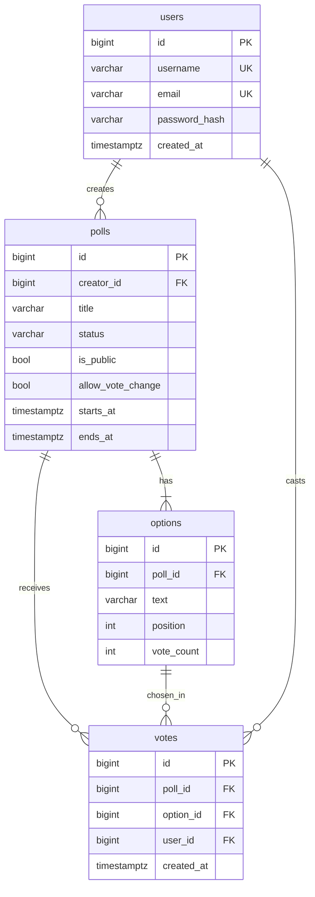
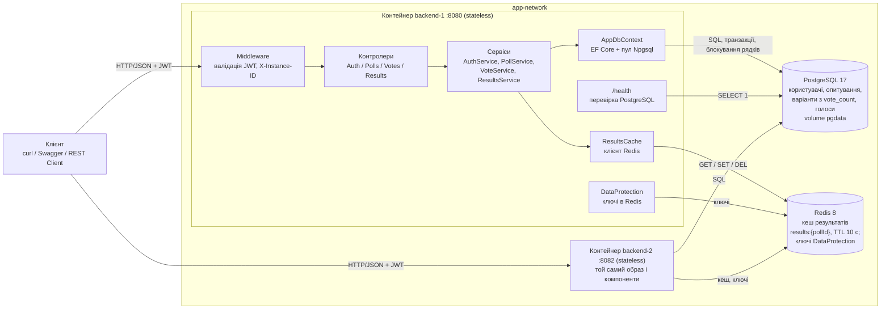
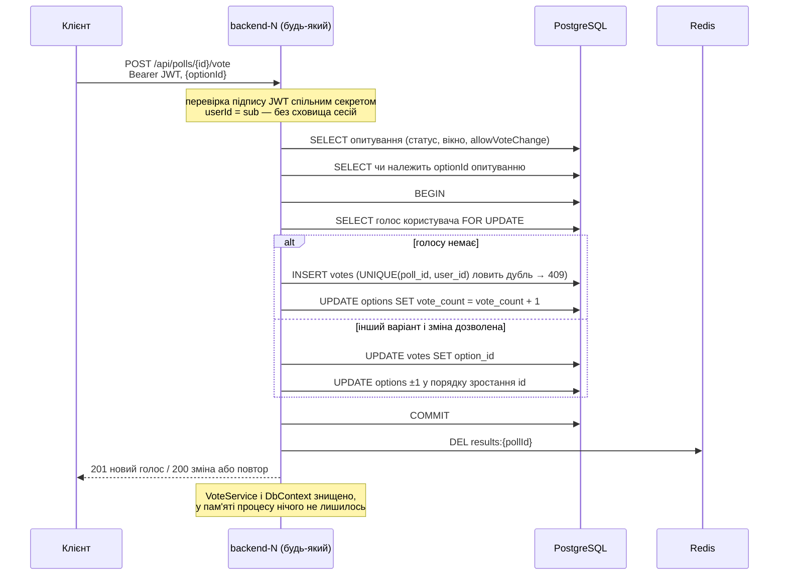
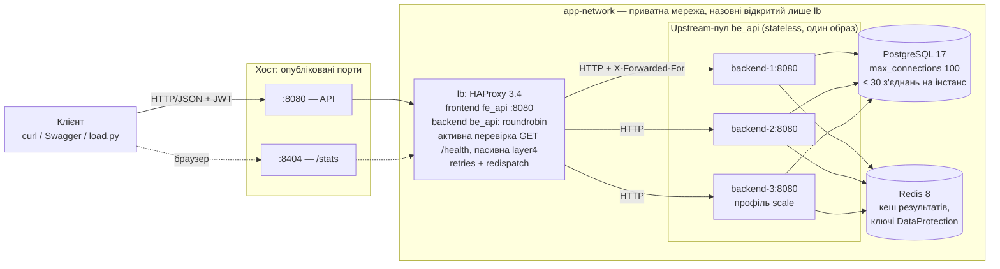
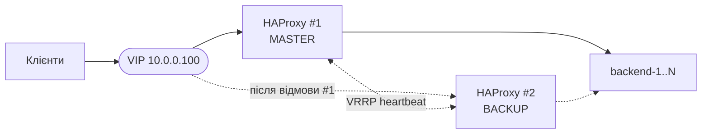

# Платформа опитувань — Highload Systems Practice

Наш варіант — платформа опитувань у реальному часі. Проєкт розвивається від лаби 1 (MVP) до лаби 5 (навантажувальне тестування); методички та дизайн-документи — у [`docs/`](docs/).

> **Розгорнутий посібник до лаби 1** (архітектура, логіка, обґрунтування рішень, питання на захист): [`docs/lab1-guide.md`](docs/lab1-guide.md).
>
> **Посібник до захисту лаби 2** (stateless, аудит стану, сценарій захисту з командами, питання на захист): [`docs/lab2-guide.md`](docs/lab2-guide.md).
>
> Контекст для учасників і AI-агентів: [`CLAUDE.md`](CLAUDE.md) → [`docs/ai/`](docs/ai/status.md) (стан, рішення/ADR, контракти, runbook, журнал сесій).

**Стек:** C# / ASP.NET Core 10 · EF Core 10 + Npgsql · PostgreSQL 17 · JWT · FluentValidation · Docker Compose

## Швидкий старт

Потрібен лише Docker.

```bash
docker compose up -d --build
```

| Що | Адреса |
|---|---|
| API (через балансувальник HAProxy) | http://localhost:8080 |
| Swagger UI | http://localhost:8080/swagger |
| Health check | http://localhost:8080/health |
| Статистика балансувальника | http://localhost:8404/stats |
| PostgreSQL (з хоста) | `localhost:5433`, БД/користувач/пароль `polling` |
| Redis (з хоста) | `localhost:6379`; консоль — `docker compose exec redis redis-cli` |
| Adminer (опційно) | `docker compose --profile tools up -d` → http://localhost:8081 |
| pgAdmin 4 | http://localhost:5050 (піднімається разом зі стеком, ~40 с), сервер `polling (docker)` уже додано, пароль БД `polling` |

Стек запускає два однакові інстанси backend з одного образу за балансувальником HAProxy (лаба 3); назовні відкритий лише балансувальник, заголовок `X-Instance-ID` у кожній відповіді показує, який інстанс її обробив (`backend-1` / `backend-2`). Третій інстанс — `docker compose --profile scale up -d`. При старті backend сам застосовує міграції та заповнює порожню БД тестовими даними. Жодних ручних кроків не потрібно. Значення за замовчуванням можна перевизначити через `.env` (див. [`.env.example`](.env.example)).

```bash
docker compose restart postgres   # дані переживають перезапуск БД (named volume pgdata)
docker compose down -v            # повне очищення, включно з даними
```

### Тестові дані (сід)

| Дані | Значення |
|---|---|
| Користувачі | `user001@example.com` … `user500@example.com`, пароль `Password123!` |
| Опитування | 50 шт.: ~70% active, ~15% closed, ~15% draft, з голосами |
| Опитування #1 | «гаряче»: active, без голосів, `allowVoteChange = true` — ціль для write-сценарію в лабі 5 |

Генератор детермінований (фіксований seed), тож холодний старт дає ті самі дані.

### Локальна розробка без Docker для backend

```bash
docker compose up -d postgres redis
dotnet run --project src/PollingPlatform.Api   # http://localhost:5094/swagger, середовище Development
```

Нова міграція: `dotnet ef migrations add <Name> --project src/PollingPlatform.Api -o Data/Migrations`.

## API

Формат — JSON; помилки — RFC 7807 `application/problem+json`. Колекція запитів для демо: [`requests/polls.http`](requests/polls.http).

| Method | Endpoint | Auth | Призначення |
|---|---|---|---|
| POST | `/api/auth/register` | — | Реєстрація |
| POST | `/api/auth/login` | — | Вхід, повертає JWT |
| GET | `/api/auth/me` | JWT | Поточний користувач |
| POST | `/api/polls` | JWT | Створити опитування з варіантами (status `draft`) |
| GET | `/api/polls?status=&creatorId=&page=&pageSize=` | — | Список з фільтрами та пагінацією |
| GET | `/api/polls/{id}` | — | Деталі опитування та варіанти |
| PATCH | `/api/polls/{id}/publish` | автор | `draft → active` |
| PATCH | `/api/polls/{id}/close` | автор | Дострокове закриття, `active → closed` |
| DELETE | `/api/polls/{id}` | автор | Видалити (лише `draft`) |
| POST | `/api/polls/{id}/vote` | JWT | Проголосувати: 201 — новий голос, 200 — змінений або повторний |
| GET | `/api/polls/{id}/results` | — | Агреговані результати (голоси та відсотки) |
| GET | `/health` | — | Готовність сервісу та стан БД |

Кожна відповідь містить заголовок `X-Instance-ID` з ідентифікатором інстансу, який її обробив (hostname контейнера або змінна `INSTANCE_ID`).

**Правила видимості:** чернетку бачить лише її автор, для інших вона повертає 404. Непублічне опитування (`isPublic = false`) не показується в загальному списку, але доступне за прямим посиланням.

**Коди помилок:**

| Код | Коли |
|---|---|
| 400 | Запит неможливо розпарсити (битий JSON, невірний тип) |
| 401 | Немає токена або токен невалідний; невірний логін |
| 403 | Дія над чужим опитуванням |
| 404 | Опитування не існує або це чужа чернетка |
| 409 | Недопустимий перехід статусу; дублікат email чи username; повторний голос; голос поза часовим вікном |
| 422 | Валідація полів |
| 503 | БД тимчасово недоступна (транзієнтний збій після вичерпання повторів EF) або недоступний Redis при читанні результатів |

**Голосування:** один голос на користувача на опитування — гарантує унікальний індекс `(poll_id, user_id)`, а не перевірка в коді. Якщо `allowVoteChange = true`, повторний запит змінює голос (200), а повтор того самого варіанта ідемпотентний і не змінює лічильники. Голос поза вікном `startsAt … endsAt` повертає 409 навіть для опитування зі статусом `active` — фонового закривача немає.

## Модель даних



Ключові обмеження:

- `UNIQUE(poll_id, user_id)` на `votes` гарантує один голос від користувача на опитування.
- `UNIQUE(poll_id, position)` на `options`.
- CHECK на `polls.status` і на умову `starts_at < ends_at`.
- `vote_count >= 0`.

Схема описана EF-міграціями в [`src/PollingPlatform.Api/Data/Migrations`](src/PollingPlatform.Api/Data/Migrations).

## Архітектура (Lab 2)

C4 Component Diagram: сервісний шар — два однакові stateless-інстанси з одного образу, весь стан — у централізованих сховищах. Компоненти показано для `backend-1`; `backend-2` — та сама збірка з тими самими компонентами.



- **Між запитами в процесі нічого не лишається:** бізнес-дані — у PostgreSQL, кеш результатів і ключі DataProtection — у Redis, ідентичність користувача — у JWT на боці клієнта. Тому будь-який інстанс обробить будь-який запит, і будь-який можна вбити без втрати даних.
- **Однакова конфігурація:** обидва інстанси — один YAML-якір у `docker-compose.yml` (той самий JWT-секрет і рядки підключення); відрізняються лише `INSTANCE_ID` і портом ([ADR 0021](docs/ai/decisions/0021-redis-and-two-backend-instances.md)).
- **Узгодженість записів** тримає PostgreSQL: транзакція «голос + лічильник», `UNIQUE(poll_id, user_id)`, `FOR UPDATE`; міграції й сід при одночасному старті серіалізуються блокуваннями в БД ([ADR 0022](docs/ai/decisions/0022-concurrent-startup-verified.md)).
- **Балансувальника ще немає** (стан лаби 2): клієнт сам обирає інстанс портом. З лаби 3 перед пулом стоїть HAProxy — схема в розділі «Лабораторна 3 → Архітектура і розгортання з балансувальником».

## Структура репозиторію

```
src/PollingPlatform.Api/
  Auth/          JWT, реєстрація/логін, ClaimsPrincipal.GetUserId()
  Polls/         CRUD і життєвий цикл опитувань
  Votes/         голосування: транзакція + атомарний лічильник
  Results/       агреговані результати і їхній кеш (з лаби 2 — у Redis)
  Domain/        сутності User, Poll, PollOption, Vote
  Data/          DbContext, конфігурації EF, міграції, сід
  Common/        бізнес-винятки → HTTP-коди, обробник помилок, X-Instance-ID
docker-compose.yml        стек: lb (HAProxy), backend-1/2 (+ backend-3 у профілі scale), postgres, redis, pgAdmin
docker-compose.debug.yml  лише для налагодження: порти 8091–8093 до окремих інстансів
haproxy/         конфіг балансувальника (haproxy.cfg)
requests/        колекції запитів для демо (polls.http, cross-instance.http)
scripts/         перевірки й експерименти лаб 2–3 (lb-algorithm.sh, lb-distribution.py, lb-failover.py, cross-instance.sh,
                 load.py та ін.; Python — лише стандартна бібліотека, запуск — у runbook)
docs/            методички та дизайн-документи
docs/lab2/, docs/lab3/  розподіл задач лаб 2 і 3 між учасниками
docs/ai/         контекст для AI-агентів: стан, ADR, контракти, runbook, журнал сесій
CLAUDE.md        точка входу для Claude Code
```

## Розподіл відповідальності (RACI)

R — Responsible, A — Accountable, C — Consulted, I — Informed.

| Модуль | Учасник 1 | Учасник 2 |
|---|---|---|
| Каркас, Docker, мережі, volumes | R/A | I |
| Схема БД, міграції, сід | R/A | C |
| Автентифікація (JWT) | R/A | I |
| CRUD і життєвий цикл опитувань | R/A | I |
| Голосування (POST /vote) | I | R/A |
| Результати + кеш | I | R/A |
| Обробка помилок | C | R/A |
| Bottleneck Analysis | C | R/A |
| README, OpenAPI, схема C4 | R | R |
| Лаба 2: Redis, два інстанси, одночасний старт | R/A | C |
| Лаба 2: ключі DataProtection у Redis | R/A | I |
| Лаба 2: кеш результатів у Redis | C | R/A |
| Лаба 2: аудит стану | R (платформа) | R/A (голосування, результати) |
| Лаба 2: Stateless Request Flow | I | R/A |
| Лаба 2: cross-instance перевірка | R/A | C |
| Лаба 2: тест втрати інстансу | C | R/A |
| Лаба 3: HAProxy, інкапсуляція, пул інстансів, бюджет з'єднань | R/A | C |
| Лаба 3: health checks, повтори, відмова вузла (читання) | R/A | C |
| Лаба 3: алгоритми балансування, live-перемикання, статистика розподілу | R/A | C |
| Лаба 3: затримка, генератор навантаження, RR vs Least Connections | C | R/A |
| Лаба 3: відмова вузла під час запису, scale-out, наступний bottleneck | C | R/A |
| Лаба 3: схема, розгортання, SPOF | R/A | C |

## High-Load сценарій

Пікова операція системи — **масове голосування в одне опитування в останні хвилини перед його завершенням**: тисячі конкурентних `POST /api/polls/{id}/vote`, кожен з яких перевіряє унікальність голосу і оновлює лічильник, плюс паралельний потік `GET /results` для лайв-дашборду. Ціль для навантажувального тесту — «гаряче» опитування #1 із сіду.

## Bottleneck Analysis

Формат: **Компонент / Root Cause / Симптоматика**. Аналіз теоретичний (лаба 1); кількісне підтвердження — у лабі 5.

### 1. Оновлення лічильника `options.vote_count`

- **Компонент:** `UPDATE options SET vote_count = vote_count + 1` у транзакції `POST /vote` — рядок одного популярного варіанта.
- **Root Cause:** Lock Contention. Усі голоси за один варіант оновлюють **той самий рядок**; row-level lock у PostgreSQL серіалізує їх, і паралельність на цій ділянці вироджується в чергу. Голоси за різні варіанти конкурують лише за `votes` (вставки в різні сторінки індексу дешевші).
- **Симптоматика:** зростання p99 на `POST /vote` при майже незмінному p50, черга транзакцій у `pg_locks`, `lock_waits` у логах, у гіршому разі — deadlock або statement timeout.
- **Стан:** інкремент виконується на рівні SQL (не load-modify-save), а зміна голосу блокує рядок голосу користувача (`SELECT … FOR UPDATE`) і оновлює два лічильники в порядку зростання id (ADR 0017). Без блокування паралельні зміни голосу одним користувачем розсинхронізовували лічильники по варіантах (або падали з 500 на `CHECK vote_count >= 0`), хоча загальна `SUM(vote_count) = COUNT(votes)` зберігалася, — тому перевіряти треба **по кожному варіанту**, а не сумою. Перевірено: 200 паралельних голосів різних користувачів, 40 паралельних змін голосу одним користувачем, 100 зустрічних змін (A→B і B→A) — лічильники точні, deadlock немає. Серіалізація на рядку популярного варіанта лишається і є головним кандидатом на точку насичення в лабі 5.

### 2. `GET /results` як read-intensive навантаження

- **Компонент:** ендпоінт агрегованих результатів — найчастіше читання (дашборд оновлюється в усіх глядачів одночасно).
- **Root Cause:** без кешу кожен запит іде в БД по агрегат. Читань на порядок більше, ніж записів, тож саме вони з'їдають CPU та I/O основної БД.
- **Симптоматика:** падіння Throughput/RPS, зростання CPU і I/O Wait на контейнері БД, деградація *усіх* ендпоінтів, бо вони ділять один connection pool.
- **Стан:** пом'якшено на двох рівнях — агрегат читається з денормалізованого `vote_count` (без `COUNT`/`JOIN` по `votes`), а відповідь кешується з явною інвалідацією на голос, publish, close і delete. У лабі 1 кеш був **навмисно локальним** (ADR 0013); у лабі 2 він розійшовся між інстансами і переїхав у Redis (ADR 0026), а в лабі 4 оформиться як Cache-Aside зі схемою ключів, обґрунтуванням TTL і fallback на БД.

### 3. Вичерпання пулу з'єднань до БД

- **Компонент:** пул Npgsql між backend і PostgreSQL (спільний для всіх ендпоінтів).
- **Root Cause:** Connection Pool Exhaustion. Транзакції з п.1 тримають з'єднання довше, ніж зазвичай, бо чекають на лок. При сплеску голосів вільні з'єднання закінчуються, і запити стають у чергу ще до того, як дійдуть до БД.
- **Симптоматика:** час очікування з'єднання в метриках пулу, таймаути на рівні API, різке зростання Error Rate при майже незавантаженому CPU БД — класична ознака, що вузьке місце не в обчисленнях, а в очікуванні.
- **Стан:** пул обмежено до 30 з'єднань на інстанс (`Maximum Pool Size`, змінна `DB_MAX_POOL_SIZE`, ADR 0018). Раніше пул Npgsql за замовчуванням (100) дорівнював `max_connections` PostgreSQL (100): після навантаження один інстанс забирав усі з'єднання, і БД відмовляла навіть `psql` (`too many clients already`); з двома інстансами в лабі 2 це була б гарантована відмова. Правило: *інстанси × розмір пулу ≤ `max_connections` − 3*. Тепер надлишкові запити чекають на вільне з'єднання в пулі — саме це очікування і є вимірюваною формою цього bottleneck у лабі 5. Транзієнтні збої БД повертають **503**, а не 500, а `/health` відповідає не довше 2 с (ADR 0019), — у лабі 3 за ним балансувальник вимикатиме вузол.

### 4. N+1 при створенні опитування з багатьма варіантами

- **Компонент:** `POST /api/polls` з до 20 варіантами.
- **Root Cause:** наївний ORM-код вставляє кожен варіант окремим запитом — N round-trip до БД замість одного.
- **Симптоматика:** латентність створення росте лінійно з кількістю варіантів; на тлі мережевої затримки до БД саме round-trip, а не сама вставка, домінує в часі відповіді.
- **Стан:** усунено — опитування і всі його варіанти зберігаються одним `SaveChanges`, EF відправляє їх батчем (ADR 0007). Залишено в аналізі як приклад проблеми, яку легко внести назад необережною правкою.

## Лабораторна 2: Stateless-архітектура

Вимоги — [`docs/labs/Lab2 - Stateless Architecture.md`](docs/labs/Lab2%20-%20Stateless%20Architecture.md), розподіл задач — [`docs/lab2/`](docs/lab2/). Кожен підрозділ заповнює вказаний учасник у своїй гілці.

### Аудит стану

Класифікація за трьома категоріями методички: **Ephemeral / Local Safe**, **Shared / Externalized**, **Critical Stateful Dependencies** (підлягають вилученню). Пройдено весь `src/` і `Program.cs` — по коду, з пошуком `static`, singleton-реєстрацій, `Concurrent*`, `IMemoryCache`, блокувань, таймерів, фонових задач, роботи з файлами й сесій. Платформну частину (Auth, опитування, старт БД, інфраструктура) аудитував Учасник 1, голосування й результати — Учасник 2.

| Елемент | Модуль | Категорія | Обґрунтування |
|---|---|---|---|
| Кеш результатів: `ResultsCache` поверх `IMemoryCache` | Results | **Critical** → усунено | Агрегат жив у пам'яті процесу, інвалідація доходила лише до інстансу, що обробив запис; інший до 10 с віддавав старе. Тепер Redis ([ADR 0026](docs/ai/decisions/0026-results-cache-in-redis.md)) |
| Рішення про доступ у кешованому записі (`Status`, `CreatorId`) | Results | **Critical** → усунено разом з кешем | Після publish на одному інстансі інший до 10 с повертав стороннім 404 замість результатів |
| Ключі DataProtection у файловій системі контейнера | Платформа | **Critical** → усунено | У кожного інстансу свій набір ключів, зникає з контейнером. Тепер Redis ([ADR 0023](docs/ai/decisions/0023-dataprotection-keys-in-redis.md)) |
| Сесії та ідентичність користувача | Auth | **Shared / Externalized** | Серверних сесій немає: ідентичність — у підписаному JWT на боці клієнта (claim `sub`), cookie сервер не видає ([ADR 0006](docs/ai/decisions/0006-stateless-jwt-auth.md)) |
| `Jwt:Secret`, issuer, audience | Auth | **Shared** (конфігурація) | Однакові на всіх інстансах — спільний блок змінних у `docker-compose.yml` |
| Користувачі, опитування, варіанти, статуси | Auth, Polls | **Shared / Externalized** | PostgreSQL; переходи статусу — умовні `UPDATE`/`DELETE` ([ADR 0004](docs/ai/decisions/0004-atomic-status-transitions.md)), унікальність email/username — індекси БД |
| Лічильник `options.vote_count` | Votes | **Shared** | Рядок у PostgreSQL, змінюється SQL `vote_count ± 1` у транзакції голосу, а не лічильник у пам'яті ([ADR 0014](docs/ai/decisions/0014-vote-transaction-and-counter.md)) |
| «Один голос на користувача» | Votes | **Shared** | `UNIQUE(poll_id, user_id)` у БД: повтор, що прийшов на інший інстанс, усе одно отримає 409 |
| Серіалізація змін голосу | Votes | **Shared** | `SELECT … FOR UPDATE` — рядкове блокування PostgreSQL працює між інстансами, на відміну від `lock` у процесі ([ADR 0017](docs/ai/decisions/0017-serialize-vote-changes.md)) |
| Стан опитування для голосу (статус, вікно, `allowVoteChange`), належність варіанта | Votes | **Shared** | Читається з PostgreSQL на кожен голос; у шляху голосування нічого не кешується |
| Міграції та сід при старті | Data | **Shared** | Серіалізуються блокуваннями в PostgreSQL (`LOCK TABLE` історії міграцій, `pg_advisory_xact_lock`) ([ADR 0022](docs/ai/decisions/0022-concurrent-startup-verified.md)) |
| `AppDbContext` (з change tracker), `AuthService`, `PollService`, `VoteService`, `ResultsService` | усі | **Ephemeral** | Scoped: живуть один запит і знищуються після відповіді |
| Singleton без змінних даних: `JwtTokenService`, `PasswordHasher`, `TimeProvider`, `IConnectionMultiplexer`, `ResultsCache`, `GlobalExceptionHandler` | усі | **Ephemeral / Local Safe** | Лише незмінні налаштування, потокобезпечні обробники й з'єднання; дані лежать у PostgreSQL / Redis |
| Статичні константи й чисті функції: `DataSeeder.Topics`, `ResultsCache.Ttl` / `Key()`, `IsTransient` | Data, Results, Common | **Ephemeral / Local Safe** | `static readonly` або без стану, однакові в кожному образі |
| Пул з'єднань Npgsql, метадані моделі EF | Data | **Ephemeral / Local Safe** | Інфраструктура процесу; бюджет 2 × 30 = 60 ≤ 97 з'єднань ([ADR 0018](docs/ai/decisions/0018-connection-pool-budget.md)) |
| `InstanceIdentity` (`X-Instance-ID`) | Common | **Ephemeral / Local Safe** | Навмисно різний на кожному інстансі — діагностика |
| `/health` | Common | **Ephemeral / Local Safe** | Кожна перевірка відкриває власне з'єднання ([ADR 0019](docs/ai/decisions/0019-health-check-timeout.md)) |
| Логи, об'єкти винятків | усі | **Ephemeral / Local Safe** | stdout контейнера; винятки живуть у межах запиту |

Фонових задач, таймерів, in-memory колекцій з даними, блокувань у процесі (`lock`, `SemaphoreSlim`) і файлових сесій у коді немає.

#### Аудит коду

Команда для захисту — шукає в коді конструкції, що можуть тримати стан у процесі (міграції EF виключено):

```bash
grep -rnE "\bstatic\b|AddSingleton|AddHostedService|IMemoryCache|AddMemoryCache|Concurrent[A-Z]|lock *\(|SemaphoreSlim|Interlocked|Timer|BackgroundService|\bFile\.|Directory\.|Session|ThreadStatic|AsyncLocal|AddExceptionHandler" src/PollingPlatform.Api --include=*.cs | grep -v /Migrations/
```

Кожен збіг (стан на `main` після лаби 2):

| Збіг | Де | Чому це не стан |
|---|---|---|
| `AddSingleton` ×6, `AddExceptionHandler` | `Program.cs` | `IConnectionMultiplexer` — з'єднання, дані в Redis; `TimeProvider` — годинник; `PasswordHasher` — без полів; `JwtTokenService` — лише налаштування і потокобезпечний `JsonWebTokenHandler` (єдині інстансні поля в коді); `ResultsCache` — лише з'єднання і логер; `InstanceIdentity` — навмисно різний на інстансах; `GlobalExceptionHandler` — лише сервіси |
| `static readonly` ×3 | `DataSeeder.Topics`, `ResultsCache.Ttl`, `ResultsCache.Json` | Незмінні константи й налаштування серіалізатора |
| статичні методи й класи-розширення | `AuthService`, `ClaimsPrincipalExtensions`, `JwtTokenService.CreateSigningKey`, `GlobalExceptionHandler`, `InstanceIdentityExtensions`, `ValidatorExtensions`, `DatabaseInitializer`, `DataSeeder`, `ResultsCache` | Чисті функції без полів |
| `lock` | `DataSeeder` — `pg_advisory_xact_lock`; коментар у `DatabaseInitializer` | Блокування в PostgreSQL, а не в процесі |

Не знайдено жодного: `IMemoryCache` / `AddMemoryCache`, `Concurrent*`, `lock (…)`, `SemaphoreSlim`, `Interlocked`, таймерів, фонових сервісів, роботи з файлами, сесій, `ThreadStatic` / `AsyncLocal`. До лаби 2 (`06692fe`) той самий пошук знаходив `AddMemoryCache()` у `Program.cs` і `ResultsCache(IMemoryCache cache)` — це і є усунений кеш у пам'яті процесу.

З лаби 3 той самий пошук дає **32** збіги замість 30: два нові — `public static class ArtificialDelayExtensions` і його метод `UseArtificialDelay` (`Common/Diagnostics`, Учасник 2, [ADR 0036](docs/ai/decisions/0036-artificial-delay-middleware.md)). Це клас-розширення без полів: затримка читається з конфігурації один раз при старті, між запитами нічого не зберігається.

#### Доказ, що сесій немає

Стек з двома інстансами:

| Крок | Інстанс | Результат |
|---|---|---|
| `POST /api/auth/register` | `backend-2` | 201 |
| `POST /api/auth/login` тим самим користувачем | `backend-1` | 200, токен; заголовка `Set-Cookie` немає |
| `GET /api/auth/me` з цим токеном | `backend-2`, потім `backend-1` | 200 на обох, той самий користувач |
| той самий токен зі зміненим останнім символом | `backend-2` | 401 — довіра тримається на підписі, а не на пам'яті інстансу |

#### Приклад прихованої affinity

Тимчасовий третій інстанс з іншим `Jwt__Secret` (`docker compose run`, порт 8083) на токен від `backend-1` відповідає `401 invalid_token: The signature key was not found`, а `backend-2` з тим самим секретом — 200. Якби кожен інстанс генерував секрет сам (наприклад, при старті), користувач був би «прив'язаний» до інстансу, що видав токен, — і ніякої помилки в коді б не було видно, доки не з'явиться другий інстанс.

#### Що ще показав аудит

1. **Застаріває не лише число, а й доступ.** Кешований запис тримає статус опитування, тому після publish інший інстанс до 10 с повертає стороннім 404 — сильніший приклад прихованої affinity, ніж застарілий `totalVotes`.
2. **`GlobalExceptionHandler` — singleton, а не scoped.** Безпечно, бо змінного стану немає; пояснення для аудиту коду, який шукає `AddSingleton`.
3. **Гонка «прочитали до коміту — поклали в кеш після інвалідації».** Якщо `GET /results` порахував агрегат до коміту голосу, а поклав у кеш уже після інвалідації, застаріле значення живе до 10 с — навіть на одному інстансі. Перенос у Redis її **не** усуває; це тема лаби 4.
4. **Невідомий результат коміту.** Якщо з'єднання обірвалось після `COMMIT`, але до відповіді, повтор (retry-стратегія EF або клієнт на іншому інстансі) знайде вже записаний голос і поверне 409 (або 200 при `allowVoteChange` і тому самому варіанті). Голос записано рівно один раз, але клієнт бачить 409 замість 201.

### Усунені in-memory залежності

| Залежність | Було | Стало | Доказ |
|---|---|---|---|
| Кеш результатів | `IMemoryCache` у кожному процесі | Redis, `results:{pollId}`, TTL 10 с, `DEL` при змінах | `scripts/results-cache-demo.py`, крок 8 `scripts/cross-instance.sh` |
| Ключі DataProtection | файли в кожному контейнері | Redis, список `DataProtection-Keys`, одна назва застосунку | `redis-cli LRANGE DataProtection-Keys 0 -1`, зникло попередження в логах |

#### Кеш результатів

**До: кеш у пам'яті кожного процесу.** Демо — [`scripts/results-cache-demo.py`](scripts/results-cache-demo.py) (лише стандартна бібліотека Python, стек має бути піднятий): `python scripts/results-cache-demo.py`. Вивід від 2026-10-27, стабільний у трьох прогонах поспіль:

```text
Scenario A: vote through backend-1, read through backend-2
  1. warm cache:     GET results               backend-2  HTTP 200  totalVotes=0  status=active  generatedAt=2026-10-27T10:19:41.7607238+00:00
  2. vote:           POST vote                 backend-1  HTTP 201
  3. right after:    GET results               backend-2  HTTP 200  totalVotes=0  status=active  generatedAt=2026-10-27T10:19:41.7607238+00:00
     right after:    GET results               backend-1  HTTP 200  totalVotes=1  status=active  generatedAt=2026-10-27T10:19:42.088658+00:00
  ... waiting 11s for the TTL ...
  4. after TTL:      GET results               backend-2  HTTP 200  totalVotes=1  status=active  generatedAt=2026-10-27T10:19:53.2569791+00:00

Scenario B: publish through backend-1, read through backend-2
  1. author previews draft: GET results        backend-2  HTTP 200  totalVotes=0  status=draft  generatedAt=2026-10-27T10:19:53.3833789+00:00
  2. publish:        PATCH publish             backend-1  HTTP 200
  3. anonymous:      GET results               backend-2  HTTP 404
     anonymous:      GET results               backend-1  HTTP 200  totalVotes=0  status=active  generatedAt=2026-10-27T10:19:53.4810787+00:00
```

Що тут видно:

- **A.** Голос пройшов через backend-1, і backend-1 інвалідував **свій** кеш — він одразу бачить `totalVotes=1`. До backend-2 інвалідація не дійшла: він віддає `0` і той самий `generatedAt`, тобто стару копію з власної пам'яті. Розбіжність тримається, поки не спливе TTL (крок 4) — тож TTL тут єдине, що обмежує неузгодженість.
- **B.** Автор переглянув чернетку через backend-2, і той закешував її зі статусом `draft`. Після publish через backend-1 сторонній отримує від backend-2 **404**, хоча опитування вже публічне, а backend-1 на той самий запит відповідає 200. Застаріло не число, а рішення про доступ.

Обидва випадки — прихована affinity: правильність відповіді залежить від того, на який інстанс потрапив запит. Sticky sessions лише сховали б це — клієнт «прилипав» би до одного інстансу, але різні клієнти так само бачили б різне. Тому кеш — **critical stateful dependency**, і його виносимо в спільне сховище.

**Після: кеш у Redis (ADR 0026).** `ResultsCache` працює через спільний для процесу `IConnectionMultiplexer`: ключ `results:{pollId}`, значення — JSON, TTL 10 с, інвалідація — `DEL`. `AddMemoryCache()` прибрано; `ResultsCache` лишився singleton, бо даних у ньому більше немає — лише посилання на з'єднання. Той самий скрипт, без жодних змін:

```text
Scenario A: vote through backend-1, read through backend-2
  1. warm cache:     GET results               backend-2  HTTP 200  totalVotes=0  status=active  generatedAt=2026-10-27T10:25:50.5231928+00:00
  2. vote:           POST vote                 backend-1  HTTP 201
  3. right after:    GET results               backend-2  HTTP 200  totalVotes=1  status=active  generatedAt=2026-10-27T10:25:51.063114+00:00
     right after:    GET results               backend-1  HTTP 200  totalVotes=1  status=active  generatedAt=2026-10-27T10:25:51.063114+00:00

Scenario B: publish through backend-1, read through backend-2
  1. author previews draft: GET results        backend-2  HTTP 200  totalVotes=0  status=draft  generatedAt=2026-10-27T10:25:51.2707272+00:00
  2. publish:        PATCH publish             backend-1  HTTP 200
  3. anonymous:      GET results               backend-2  HTTP 200  totalVotes=0  status=active  generatedAt=2026-10-27T10:25:51.3377633+00:00
     anonymous:      GET results               backend-1  HTTP 200  totalVotes=0  status=active  generatedAt=2026-10-27T10:25:51.3377633+00:00

Summary
  backend-2 served stale vote counts after a vote on backend-1:  no
  backend-2 answered 404 for a poll published on backend-1:      no
```

Найпереконливіше тут — **однаковий `generatedAt` на обох інстансах** на кроці 3: агрегат порахував один інстанс, а другий віддав саме цю копію з Redis. Інвалідація, зроблена backend-1, тепер одразу видна backend-2, а TTL знову лише страховка. Перевірка в Redis: `docker compose exec redis redis-cli TTL results:1` після читання — не більше 10; після голосу `EXISTS results:1` → 0.

Що перенос у Redis **не** усуває: гонку «агрегат порахували до коміту голосу, а в кеш поклали вже після інвалідації» — застаріле значення може прожити до TTL. Це тема лаби 4, разом зі схемою ключів, обґрунтуванням TTL і fallback на БД.

**Якщо Redis недоступний (ADR 0027).** Redis — нова зовнішня залежність, і її відмова не повинна давати 500 чи вводити клієнта в оману. Без обробки так і було: `GET /results` → 500, а `POST /vote` → 500, **хоча голос уже був записаний** — клієнт повторив би запит і отримав 409 на голос, який насправді пройшов. Тепер:

| Операція при зупиненому Redis | Відповідь | Чому |
|---|---|---|
| `GET /results` | **503**, `detail: "The cache is temporarily unavailable"` | Інфраструктурний збій, повтор має сенс; fallback на БД — лаба 4 |
| `POST /vote`, `PATCH publish/close`, `DELETE` | звичайний успіх (201 / 200 / 204) | Інвалідація йде вже після коміту в БД; її збій лише логується одним рядком `warn` |
| Redis знову піднято | усе працює, результати свіжі | Клієнт Redis перепідключається сам, рестарт backend не потрібен |

Застаріле значення після невдалої інвалідації можливе лише при короткому збої, коли Redis зберіг дані, — і живе не довше TTL 10 с. Після рестарту Redis порожній (без volume), тож застарілого немає взагалі. Відома ціна: поки Redis лежить, кожен запит, що його торкається, чекає ~5 с — клієнт тримає команду в черзі до свого таймауту. Короткі збої це переживає без помилок, але тривалий робить повільним; швидка відмова разом із fallback на БД — лаба 4.

Перевірка — [`scripts/redis-outage-check.py`](scripts/redis-outage-check.py): зупиняє Redis, голосує, читає, публікує, запускає Redis і перевіряє відновлення. Прогін від 2026-10-27:

```text
Redis stopped (docker compose stop redis)
  OK   GET results -> 503 with ProblemDetails                     HTTP 503 in 5.2s, detail: The cache is temporarily unavailable. Please retry.
  OK   POST vote -> 201 (committed vote not reported as failed)   HTTP 201 in 5.9s
  OK   vote stored in PostgreSQL exactly once                     rows=1
  OK   PATCH publish -> 200 (failed invalidation tolerated)       HTTP 200 in 5.4s
  OK   per-option counters consistent                             mismatches=0

Redis started again (docker compose start redis)
  OK   GET results -> 200 again                                   after 1.6s
  OK   results are fresh (the outage vote is counted)             totalVotes=1
  OK   no backend restart
```

#### Ключі DataProtection

ASP.NET Core завжди реєструє DataProtection і за замовчуванням зберігає ключі у файловій системі контейнера — у кожного інстансу свій набір, і він зникає разом з контейнером. Ми DataProtection зараз не використовуємо (автентифікація — JWT), але це прихована прив'язка до інстансу: cookie чи antiforgery-токен, виданий одним інстансом, інший не розшифрував би.

| | До | Після |
|---|---|---|
| Де ключі | `/home/app/.aspnet/DataProtection-Keys` у кожному контейнері | Redis, список `DataProtection-Keys`, назва застосунку `polling-platform` на всіх інстансах |
| Скільки наборів ключів | по одному на інстанс | один спільний |
| У логах | `Storing keys in a directory ... that may not be persisted outside of the container` | попередження немає |
| Після перестворення контейнерів | нові ключі | той самий ключ із Redis |

Перевірка: `docker compose exec redis redis-cli LRANGE DataProtection-Keys 0 -1` — один ключ і після холодного старту, і після `docker compose rm -sf backend-1 backend-2 && docker compose up -d`. Рішення — [ADR 0023](docs/ai/decisions/0023-dataprotection-keys-in-redis.md).

### Stateless Request Flow: `POST /api/polls/{id}/vote`

Сценарій — голосування, high-load сценарій проєкту. Запит може прийти на будь-який інстанс; нижче — що він бере з запиту, що читає зі спільних сховищ, що змінює атомарно і чому після відповіді в процесі нічого не лишається.

| Вимога 2.3 | Як це зроблено | Код |
|---|---|---|
| Вхідні параметри / context token | `Authorization: Bearer <JWT>` → middleware JwtBearer перевіряє підпис ключем із `Jwt:Secret` (env `JWT_SECRET`, однаковий на всіх інстансах) → `userId` з claim `sub`. `pollId` — з маршруту, `{optionId}` — з тіла, валідатор (`optionId > 0`, інакше 422) | `Votes/VotesController.cs`, `Auth/ClaimsPrincipalExtensions.cs` |
| Вичитування контексту зі shared storage | PostgreSQL: опитування (видимість, статус, часове вікно, `allowVoteChange`) і належність варіанта цьому опитуванню | `VoteService.LoadVotablePollAsync`, перевірка `optionId` у `CastAsync` |
| Атомарні зміни у зовнішньому сховищі | Одна транзакція в execution strategy: наявний голос `SELECT … FOR UPDATE` → `INSERT` (новий голос; дубль ловить унікальний індекс) **або** `UPDATE votes` + `vote_count ± 1` у порядку зростання id варіантів (зміна) **або** нічого (той самий варіант) → `COMMIT`. Після коміту — інвалідація `results:{pollId}` | `VoteService.CastOnceAsync`, `InsertVoteAsync`, `ChangeVoteCountAsync` |
| Відсутність залишкових мутацій у пам'яті | `VoteService` і `AppDbContext` scoped — знищуються після відповіді; `static`-полів із даними немає; наступний запит того ж користувача може піти на інший інстанс | `Program.cs` — `AddScoped` |

> Останній рядок виконується лише з лаби 2 (ADR 0026). У лабі 1 інвалідація була `IMemoryCache.Remove` на поточному інстансі — запит голосування змінював пам'ять процесу, і ця зміна переживала запит. Тепер це `DEL results:{pollId}` у Redis, і в пам'яті процесу нічого не лишається.



**Інваріант після будь-якого запиту** — перевіряти по кожному варіанту, не сумою (ADR 0017):

```sql
SELECT count(*) FROM options o
WHERE o.vote_count <> (SELECT count(*) FROM votes v WHERE v.option_id = o.id);   -- 0
```

**Якщо інстанс упаде на півдорозі:**

- до `COMMIT` — транзакція обривається разом зі з'єднанням, PostgreSQL її відкочує; голосу без лічильника не буває, бо обидві зміни в одній транзакції;
- після `COMMIT`, але до відповіді — голос збережено; повтор на іншому інстансі отримає 409 від унікального індексу, подвійного голосу немає;
- після `COMMIT`, але до інвалідації кешу — результати застаріють максимум на TTL 10 с.

**Перевірка під конкуренцією через обидва інстанси.** Гарантії цього потоку — транзакція, `UNIQUE(poll_id, user_id)`, `FOR UPDATE`, порядок блокувань — мають триматися, коли запити одного й того самого користувача приходять одночасно на **різні** процеси. [`scripts/concurrency-checks.py`](scripts/concurrency-checks.py) ділить запити навпіл між backend-1 і backend-2 і стартує їх одночасно (бар'єр); після кожної перевірки звіряє лічильники по кожному варіанту з `votes` і результати обох інстансів із БД. Прогін від 2026-10-27, стабільний у чотирьох прогонах поспіль (~16 с):

```text
Check 1: 200 different users vote into one poll at once
  OK   all 201, no 5xx                                      201x200
  OK   one vote row per user                                rows=200
  OK   per-option counters = votes rows (whole DB)          mismatches=0
  OK   results on backend-1 and backend-2 match the DB      db=100,100 b1=100,100 b2=100,100

Check 2: one user changes the vote 40 times in parallel
  OK   fresh poll: all 200                                  200x40
  OK   fresh poll: exactly one vote row for the user        rows=1
  OK   hot poll #1: all 200                                 200x40
  OK   hot poll #1: exactly one vote row for the user       rows=1
  (+ per-option counters and results on both instances after each poll — OK)

Check 3: 100 users make opposite changes (A->B and B->A) at once
  OK   opposite changes: all 200                            200x100
  OK   still 50/50 after the swap                           50/50

Logs since the start of this run
  OK   no 'deadlock detected' in postgres logs              count=0
  OK   no 'fail:' entries in backend logs                   count=0
```

**Чи тест взагалі здатен щось зловити.** Зелений тест нічого не доводить, якщо він не падає на справжній помилці. Тому `FOR UPDATE` тимчасово прибрали з `VoteService` і прогнали той самий скрипт: зміна голосу на свіжому опитуванні дала **21 × 500 із 40**, на опитуванні #1 — **6 × 500**, у логах backend — 54 записи `fail:`. Це та сама гонка, яку виправляє ADR 0017 (там було 23 з 40). Блокування повернули — знову все зелене. Отже, перевірка 2 справді ловить цю гонку, і тепер — через два процеси.

### Мульти-інстансне розгортання

> Стан на кінець лаби 2. З лаби 3 інстанси стоять за балансувальником і портів назовні не мають: `:8082` і змінні `API_PORT` / `API2_PORT` прибрано, усе йде через `http://localhost:8080` — див. «Лабораторна 3 → Балансувальник і інкапсуляція».

Потрібен лише Docker. Одна команда піднімає PostgreSQL, Redis і два інстанси backend з одного образу; міграції та сід виконуються автоматично, навіть коли обидва інстанси стартують одночасно.

```bash
docker compose up -d --build        # postgres, redis, backend-1, backend-2 (+ pgAdmin)
docker compose ps                   # стан контейнерів
```

| Інстанс | Адреса | `X-Instance-ID` |
|---|---|---|
| `backend-1` | http://localhost:8080 | `backend-1` |
| `backend-2` | http://localhost:8082 | `backend-2` |

Порти змінюються через `.env` (`API_PORT`, `API2_PORT`). Який інстанс обробив запит — видно в заголовку відповіді:

```bash
curl -i http://localhost:8080/health   # X-Instance-ID: backend-1
curl -i http://localhost:8082/health   # X-Instance-ID: backend-2
```

Керування окремим інстансом і спільними сховищами:

```bash
docker compose logs -f backend-2                   # логи одного інстансу
docker compose stop backend-1                      # плавна зупинка
docker compose kill backend-1                      # аварійна зупинка (SIGKILL)
docker compose start backend-1                     # повернути інстанс (після stop/kill Docker сам не перезапускає)
docker compose exec redis redis-cli KEYS '*'       # що лежить у Redis
docker compose down -v                             # повне очищення, наступний up — холодний старт
```

Приклади запитів для перевірки узгодженості між інстансами — у наступному підрозділі.

### Перевірка cross-instance консистентності

Ланцюжок запитів, де кроки йдуть на різні інстанси (п. 2.5 методички: POST → Instance 1, GET → Instance 2, PUT → Instance 2, GET → Instance 1). PUT у нашому API немає — зміну стану робить `PATCH …/publish`. Cookies не використовуються, інстанс обирається портом, тож sticky sessions немає.

```bash
bash scripts/cross-instance.sh     # curl; кожен крок друкує X-Instance-ID, HTTP-код і ключове поле
```

Те саме вручну — [`requests/cross-instance.http`](requests/cross-instance.http) (VS Code REST Client / Rider / Visual Studio).

| Крок | Запит | Інстанс | Очікування |
|---|---|---|---|
| 1 | `POST /api/auth/login` | `backend-1` | 200, токен |
| 2 | `POST /api/polls` | `backend-1` | 201, `draft` |
| 3 | `GET /api/polls/{id}` | `backend-2` | `draft` — токен від `backend-1` прийнято |
| 4 | `PATCH /api/polls/{id}/publish` | `backend-2` | `active` |
| 5 | `GET /api/polls/{id}` | `backend-1` | `active` |
| 6 | `GET /api/polls/{id}/results` | `backend-2` | `totalVotes = 0` |
| 7 | `POST /api/polls/{id}/vote` | `backend-1` | 201 |
| 8 | `GET /api/polls/{id}/results` | `backend-2` | `totalVotes = 1` |

**Результат** (кеш результатів у Redis, спільний для інстансів, [ADR 0026](docs/ai/decisions/0026-results-cache-in-redis.md)):

```
1   POST   :8080/api/auth/login                 backend-1, HTTP 200
2   POST   :8080/api/polls                      backend-1, HTTP 201
    status: draft
3   GET    :8082/api/polls/63                   backend-2, HTTP 200
    status: draft
4   PATCH  :8082/api/polls/63/publish           backend-2, HTTP 200
    status: active
5   GET    :8080/api/polls/63                   backend-1, HTTP 200
    status: active
6   GET    :8082/api/polls/63/results           backend-2, HTTP 200
    totalVotes: 0
7   POST   :8080/api/polls/63/vote              backend-1, HTTP 201
8   GET    :8082/api/polls/63/results           backend-2, HTTP 200
    totalVotes: 1   (очікується 1)
```

Усі кроки узгоджені: після голосу через `backend-1` інстанс `backend-2` одразу бачить `totalVotes: 1`. Поки кеш був у пам'яті процесу, крок 8 повертав `0` до 10 с (TTL) — `backend-2` віддавав копію, закешовану на кроці 6; демо «до» — у підрозділі «Усунені in-memory залежності».

### Відмовостійкість: втрата інстансу

Аварійна зупинка одного інстансу **під час голосування** не повинна ні загубити, ні задвоїти жодного голосу, а другий інстанс має підхопити обробку. [`scripts/kill-test.py`](scripts/kill-test.py): 400 сід-користувачів голосують у двох свіжих опитуваннях (800 голосів, 32 потоки, по черзі на backend-1 і backend-2); після ~10 % голосів — `docker compose kill backend-1` (SIGKILL). Клієнт, не отримавши відповіді від backend-1, повторює той самий запит на backend-2 і далі шле запити backend-1 одразу туди — так у лабі 3 робитиме балансувальник. Прогін від 2026-10-27:

```text
Voting: 400 users x 2 polls = 800 votes over 32 threads; `docker compose kill backend-1` after 80 votes
  run took 4.5s; the kill command took 1.1s
  answered by backend-1: 100, by backend-2: 400, failed on backend-1 and retried on backend-2: 5 ['RemoteDisconnected'], rerouted to backend-2 after that: 295
  PostgreSQL saw 2 client connection(s) break; of them with an open transaction (rolled back): 1

Checks
  OK   backend-1 died mid-run and the client failed over            retried=5, rerouted=295
  OK   every vote ended with 201, or 409 on a retry                 201x800, 409x0, other=[]
  OK   poll 90: vote rows = users (stored exactly once)             rows=400
  OK   poll 91: vote rows = users (stored exactly once)             rows=400
  OK   per-option counters = votes rows (whole DB)                  mismatches=0
  OK   results on backend-2 match the DB                            db=['134,133,133', '134,133,133'] backend-2=['134,133,133', '134,133,133']

Instance comes back
  Docker restarted backend-1 by itself within 10 s: no (restart: unless-stopped)
  -> docker compose start backend-1
  OK   backend-1 /health = 200                                      after 3.3s
  OK   backend-1 serves the same results right away (no warm-up)    backend-1=['134,133,133', '134,133,133']
```

Три прогони з `kill` поспіль і один зі штатною зупинкою — усі зелені; кожен зачепив запити на льоту по-різному:

| Прогін | Обірвано на льоту → повтор на backend-2 | Транзакцій, відкочених PostgreSQL | Повтор отримав 409 | Голосів записано |
|---|---|---|---|---|
| `kill` № 1 | 5 | 1 | 0 | 800 з 800, кожен один раз |
| `kill` № 2 | 7 | 3 | **1** | 800 з 800, кожен один раз |
| `kill` № 3 | 14 | 10 | 0 | 800 з 800, кожен один раз |
| `stop` (`--stop`) | 2 | 0 — з'єднання закрито штатно | 0 | 800 з 800, кожен один раз |

Чому бізнес-стан цілий — два можливі моменти смерті інстансу посеред голосу:

- **До `COMMIT`.** Транзакція обривається разом зі з'єднанням, PostgreSQL її відкочує — у логах postgres `unexpected EOF on client connection with an open transaction`, саме ці рядки рахує скрипт. Голосу без лічильника не буває, бо обидві зміни в одній транзакції (ADR 0014). Повтор на backend-2 записує голос з нуля → **201**.
- **Після `COMMIT`, але до відповіді.** Голос уже збережено, клієнт про це не знає і повторює запит. Повтор упирається в `UNIQUE(poll_id, user_id)` → **409**, подвійного голосу немає (прогін № 2). Клієнт бачить 409 замість 201, але для `allowVoteChange = false` це правдива відповідь: голос цього користувача в опитуванні вже є.

**`kill` проти `stop`.** При `stop` ASP.NET завершує прийняті запити і сам закриває з'єднання з БД — PostgreSQL не бачить жодного обриву; відмову отримують лише запити, що прийшли вже під час зупинки. При `kill` процес зникає миттєво, з усіма відкритими транзакціями.

**Повернення інстансу.** Docker **не** підняв контейнер сам, попри `restart: unless-stopped`: ручні `docker kill` / `docker stop` вимикають політику перезапуску до наступного ручного старту — вона спрацьовує, коли процес падає сам. Після `docker compose start backend-1` інстанс здоровий за ~3 с і **одразу** віддає ті самі результати: стану, який треба було б відновлювати чи «прогрівати», у нього немає — голоси в PostgreSQL, кеш у Redis, ідентичність у JWT.

## Лабораторна 3: Горизонтальне масштабування

Методичка — [`docs/labs/Lab3 - Horizontal Scaling.md`](docs/labs/Lab3%20-%20Horizontal%20Scaling.md), розподіл задач — [`docs/lab3/`](docs/lab3/participant-1.md). Кожен підрозділ має власника: кожен пише лише у свої підрозділи.

> Скрипти й колекції лаби 2 раніше зверталися до `backend-2` напряму на `:8082`, якого тепер немає. `scripts/cross-instance.sh` і `requests/cross-instance.http` уже йдуть через балансувальник (П1-5); Python-скрипти Учасника 2 (`load.py`, `kill-test.py`, `concurrency-checks.py`, `redis-outage-check.py`) за замовчуванням теж ідуть через балансувальник (П2-7); історичне демо `results-cache-demo.py` працює лише з прямим доступом до інстансів. Прямий доступ до інстансу для налагодження — [`docker-compose.debug.yml`](docker-compose.debug.yml) (порти 8091–8093 лише на `127.0.0.1`), ніколи не в стандартному стеку.

### Балансувальник і інкапсуляція *(Учасник 1)*

Єдина точка входу — HAProxy ([`haproxy/haproxy.cfg`](haproxy/haproxy.cfg), [ADR 0031](docs/ai/decisions/0031-haproxy-single-entry-point.md)). Назовні відкриті лише два порти балансувальника: `8080` — API, `8404` — сторінка статистики. Інстанси `backend-1`, `backend-2` (і `backend-3` у профілі `scale`) портів не публікують і доступні тільки всередині мережі `app-network` як `backend-N:8080` (п. 2.2 методички).

```bash
docker compose up -d --build                    # postgres, redis, lb, backend-1, backend-2
docker compose --profile scale up -d            # + backend-3; балансувальник підхоплює його сам, без перезапуску
curl -i http://localhost:8080/health            # X-Instance-ID чергується: backend-1, backend-2, ...
curl http://localhost:8082/health               # connection refused — інстанси ззовні недоступні
docker compose logs -f lb                       # HTTP-лог: який вузол обробив запит, код, таймінги
```

| Що | Адреса / значення |
|---|---|
| API | http://localhost:8080 (`LB_PORT`) |
| Статистика HAProxy: стан вузлів, кількість запитів, час відповіді | http://localhost:8404/stats (`LB_STATS_PORT`) |
| Пул | `backend-1`, `backend-2`; `backend-3` — `--profile scale` |
| Алгоритм зараз | `roundrobin` (решта — підрозділ «Алгоритми балансування») |

**Чому HAProxy, а не Nginx.** Відкритий Nginx не вміє активних health checks (лише платний NGINX Plus), а методичка оцінює саме «автоматичне відновлення та деградацію пулу»: вузол має випадати з пулу і повертатися за результатом `/health`, а не після того, як на ньому вже впав клієнтський запит. HAProxy безкоштовно дає активні й пасивні перевірки, повтор на інший вузол, усі чотири алгоритми з методички і вбудовану сторінку статистики. Повна таблиця — у [`docs/lab3/participant-1.md`](docs/lab3/participant-1.md).

**Як HAProxy знаходить інстанси.** Імена `backend-N` резолвляться через Docker DNS під час роботи, а не лише на старті (`resolvers docker`, `init-addr none`). Тому балансувальник стартує без `backend-3` (вузол чекає в стані `MAINT (resolution)`), а коли контейнер з'являється, вмикає його сам. Перевірено: `backend-3` з'явився на сторінці статистики як UP за ~9 с після `--profile scale up -d`, і 30 запитів розподілилися 10 / 10 / 10.

**Конфіг міняється без перезбирання і перезапуску:** HAProxy в образі працює в режимі master-worker, тож `docker compose kill -s USR2 lb` перечитує змонтований `haproxy.cfg` і запускає новий worker, а старий доробляє свої з'єднання. Під потоком із 60 запитів — 0 помилок, перезавантаження ≈ 0.4 с.

### Алгоритми балансування і статистика розподілу *(Учасник 1)*

Алгоритм перемикається **наживо однією командою**, без перезбирання образу і без перезапуску контейнера ([ADR 0034](docs/ai/decisions/0034-balancing-algorithms-and-live-switch.md)):

```bash
bash scripts/lb-algorithm.sh leastconn      # roundrobin | leastconn | weighted | source; без аргументу — поточний
python scripts/lb-distribution.py           # 300 GET через балансувальник → розподіл по X-Instance-ID
```

Скрипт змінює рядок `balance` (і вагу `backend-1` для `weighted`) у [`haproxy/haproxy.cfg`](haproxy/haproxy.cfg), перевіряє конфіг тим самим HAProxy у контейнері (битий файл відновлюється і до перезавантаження не доходить) і шле master-процесу SIGUSR2: новий worker читає новий конфіг, старий доробляє свої з'єднання. `lb-distribution.py` поруч із підрахунком `X-Instance-ID` друкує приріст відповідей кожного сервера зі сторінки статистики HAProxy — числа збігалися завжди, до запиту.

**Розподіл** (300 послідовних `GET /health`, 2026-10-28):

| Алгоритм | 2 інстанси (b1 / b2) | 3 інстанси (b1 / b2 / b3) | Для якого профілю навантаження |
|---|---|---|---|
| `roundrobin` | 50.0 / 50.0 % | 33.3 / 33.3 / 33.3 % | однакові вузли, короткі однакові запити — наш випадок після лаби 2; повільного вузла не бачить |
| `leastconn` | 52.7 / 47.3 % | 31.0 / 34.0 / 35.0 % | запити різної тривалості або вузол деградує: повільний вузол довше тримає з'єднання і отримує менше нових |
| weighted 3 : 1 (: 1) | 75.3 / 24.7 % | 60.3 / 19.7 / 20.0 % | вузли різної потужності; ваги ставляться руками і не реагують на раптову деградацію |
| `source` (IP Hash) | 0 / 100 % | 0 / 100 / 0 % | прив'язка клієнта до вузла; нам не потрібна, бо стану в інстансах немає |

- **Least Connections ≈ Round Robin** у цьому тесті, бо запити йдуть по одному: у кожного вузла 0 активних з'єднань, і нічия розв'язується по черзі. Різниця з'являється лише при паралельних запитах різної тривалості — це експеримент Учасника 2 з повільним вузлом (підрозділ нижче).
- **`source` віддає все одному інстансу**, бо всі запити з хоста потрапляють у Docker-мережу з однієї адреси шлюзу (`172.20.0.1` у лозі HAProxy). Це той самий ефект, що й NAT або корпоративний проксі в реальному світі: тисячі клієнтів — «один IP», і IP Hash вантажить один вузол.
- **Live-перемикання під навантаженням:** `scripts/load.py --scenario mixed --threads 16 --duration 14` (≈ 600 rps), посередині RR → Least Connections → RR — 8365 запитів, **0 5xx, 0 обривів з'єднання**.

На захисті ті самі числа видно на сторінці статистики http://localhost:8404/stats (стовпці Sessions → Total і стан кожного сервера). Після демо — `bash scripts/lb-algorithm.sh roundrobin`, щоб у Git лишився алгоритм за замовчуванням.

### Асиметричне навантаження: Round Robin vs Least Connections *(Учасник 2)*

**Як зроблено «повільний вузол».** Middleware [`Common/Diagnostics/ArtificialDelay.cs`](src/PollingPlatform.Api/Common/Diagnostics/ArtificialDelay.cs) ([ADR 0036](docs/ai/decisions/0036-artificial-delay-middleware.md)) затримує кожен запит інстансу на `Diagnostics__ArtificialDelayMs` мілісекунд — крім `/health`, щоб вузол лишався «повільним, але живим» і перевірки балансувальника не викинули його з пулу. За замовчуванням 0, і middleware взагалі не підключається. Вмикається лише на одному інстансі локальним `docker-compose.override.yml` (у `.gitignore`):

```yaml
services:
  backend-2:
    environment:
      Diagnostics__ArtificialDelayMs: 200
```

```bash
docker compose up -d backend-2                   # backend-2 стає повільним: +200 мс на кожен запит
python scripts/load.py --scenario read --threads 32 --duration 20 --runs 3
bash scripts/lb-algorithm.sh leastconn          # перемкнути алгоритм наживо (м'яке перезавантаження HAProxy)
python scripts/load.py --scenario read --threads 32 --duration 20 --runs 3
```

`Task.Delay` не займає ні CPU, ні потоку — це модель вузла з повільною залежністю (диск, мережа, «важкий» запит до БД), а не перевантаженого процесора.

**Генератор навантаження** — [`scripts/load.py`](scripts/load.py): закритий цикл, 32 потоки, кожен зі своїм keep-alive з'єднанням шле наступний запит одразу після відповіді. Сценарій `read` — `GET /api/polls/{id}/results`. Генератор працює на тій самій машині, що й стек, тож числа порівнюємо між конфігураціями, а абсолютну продуктивність міряємо k6 у лабі 5.

**Результати** (2 інстанси, `backend-2` +200 мс, `read`, 32 потоки × 20 с, 3 прогони кожного; 2026-10-28; заміряно ще з TCP-перевірками П1-1 — на результат це не впливає, бо `/health` повільного вузла не затримується і він увесь час лишався UP):

| Алгоритм | Частка `backend-1` / `backend-2` | RPS | p50, мс | p95, мс | p99, мс | CPU `backend-1` / `backend-2` | 5xx |
|---|---|---|---|---|---|---|---|
| Round Robin | 50.0 % / 50.0 % | 298 – 303 | 14 – 199 * | 208 – 210 | 210 – 215 | ≈ 35 % / ≈ 35 % | 0 |
| Least Connections | 97.5 % / 2.5 % | 1708 – 2007 | 10 – 13 | 23 – 28 | 213 – 216 | ≈ 255 % / ≈ 13 % | 0 |
| Least Connections, **без затримки** (контроль) | 50 % / 50 % | 1711 – 1727 | 17 | 36 | 47 | — | 0 |

\* p50 у Round Robin «стрибає»: рівно половина запитів швидкі (≈ 5 мс), половина — повільні (≈ 205 мс), і медіана потрапляє точно на межу двох груп.

**Що це означає.**

- **Round Robin не бачить, що вузол повільний.** Він чесно віддає кожен другий запит на `backend-2`, тож половина клієнтів чекає 200 мс. У закритому циклі це ще й обвалює пропускну здатність: потік, що потрапив на повільний вузол, 200 мс нічого не робить, і система видає ≈ 300 RPS замість ≈ 1700. Швидкий `backend-1` при цьому простоює (CPU ≈ 35 %) — ресурси не використовуються.
- **Least Connections реагує сам.** Повільний вузол довше тримає кожне з'єднання, тому в нього завжди більше активних з'єднань, і HAProxy шле нові запити на швидкий. Результат — 97.5 / 2.5, RPS ×6, p95 у 8 разів нижчий, а `backend-1` завантажений по-справжньому (CPU ≈ 255 %). Без затримки Least Connections ділить навпіл, як Round Robin, — тобто нічого не ламає, коли вузли однакові.
- **p99 не покращився (≈ 215 мс в обох) — і це чесний результат.** На повільний вузол усе одно йде 2.5 % запитів (Least Connections не виключає вузол, лише рідше його обирає), а 2.5 % > 1 %, тож 99-й перцентиль — це латентність повільного вузла. p95 — уже ні. Щоб прибрати хвіст повністю, повільний вузол треба виводити з пулу (degraded-перевірка по `/health` з порогом часу відповіді) або знижувати йому вагу.
- **Чому з одним швидким вузлом RPS той самий, що й з двома.** Читання впирається не в backend, а в генератор, HAProxy (CPU `lb` ≈ 110–120 %) і спільний CPU машини — див. «Scale-out» і «Наступний bottleneck».

**Який алгоритм під який профіль навантаження:**

| Профіль | Алгоритм | Чому |
|---|---|---|
| Однакові вузли, короткі однакові запити | Round Robin | найпростіший, рівний розподіл; Least Connections дає те саме |
| Вузли різної потужності, відомої заздалегідь | Weighted Round Robin | ваги задаються руками і не змінюються самі |
| Запити різної тривалості або вузол, що може деградувати (наш голос під блокуванням, повільна БД на одному вузлі) | **Least Connections** | бачить «застряглі» з'єднання і обходить повільний вузол без ручного налаштування |
| Потрібна прив'язка клієнта до вузла | IP Hash (`balance source`) | лише для stateful-сервісів; у нас стану в інстансах немає (лаба 2), тому не потрібна |

Для нашої системи висновок — **Least Connections**: тривалість запитів дуже різна (читання з кешу — мілісекунди, голос у гаряче опитування під рядковим блокуванням — до секунди, див. «Scale-out»), і за деградації одного вузла він не втрачає пропускну здатність.

### Health checks і виключення вузла *(Учасник 1)*

**Readiness-ендпоінт** `GET /health` (з лаби 1, [ADR 0012](docs/ai/decisions/0012-instance-id-and-health.md), [0019](docs/ai/decisions/0019-health-check-timeout.md)): власний `SELECT 1` до PostgreSQL з таймаутом 2 с, без EF-повторів; 200 `Healthy` або 503 `Unhealthy`. Redis навмисно не перевіряє: падіння одного спільного Redis зробило б «хворими» всі інстанси одночасно, і балансувальник вимкнув би весь пул навіть для запитів, яким Redis не потрібен ([ADR 0021](docs/ai/decisions/0021-redis-and-two-backend-instances.md)). Штучна затримка Учасника 2 `/health` теж не зачіпає — повільний вузол лишається в пулі.

Налаштування в `backend be_api` ([ADR 0033](docs/ai/decisions/0033-health-checks-and-retries.md)):

| Механізм | Конфіг | Що робить |
|---|---|---|
| Активна перевірка | `option httpchk` + `http-check send meth GET uri /health`, `expect status 200`, `inter 2s fastinter 500ms fall 2 rise 2`, `timeout check 3s` | HAProxy сам питає `/health` кожного вузла кожні 2 с; 2 невдачі поспіль → вузол поза пулом, 2 успіхи → назад. Вузол без БД (503) — «degraded», теж поза пулом. `timeout check` більший за 2 с, з якими `/health` повідомляє про мертву БД |
| Пасивна перевірка | `observe layer4 error-limit 1 on-error mark-down` | перша ж помилка з'єднання на живому запиті одразу виключає вузол, не чекаючи наступної перевірки |
| Повтор, коли не вдалося з'єднатися | `retries 2`, `option redispatch 1` | запит ще не відправлено — безпечно для будь-якого методу; кожен повтор іде на **інший** вузол |
| Повтор обірваного запиту | `retry-on conn-failure empty-response` + `http-request disable-l7-retry if !METH_GET` | вузол помер посеред відповіді: GET повторюється, POST / PATCH / DELETE — ні (повтор `POST /api/polls` створив би друге опитування) |

**Чого навмисно немає — «пастка 503».** Ні `observe layer7`, ні `retry-on 503`: наше API чесно віддає 503 ProblemDetails, коли недоступні БД або Redis ([ADR 0016](docs/ai/decisions/0016-transient-db-errors-503.md), [0027](docs/ai/decisions/0027-redis-unavailable.md)), і віддає їх **усі інстанси одночасно**. Якби балансувальник вважав це відмовою вузла, падіння Redis вимкнуло б увесь пул, і клієнт побачив би сторінку HAProxy замість відповіді API. Повтори голосування — окреме рішення Учасника 2 (підрозділ «Відмова вузла: запис»).

**Коли падає PostgreSQL** (перевірено): `/health` усіх вузлів віддає 503, через ~4.6 с після `docker compose stop postgres` обидва вузли поза пулом, і нові запити за ~3 мс отримують від HAProxy `503 text/html` «No server is available» замість очікування 13–19 с на наш 503. Після `docker compose start postgres` пул повертається сам за ~2.3 с. Це ціна вимоги 2.4.1 (готовність = доступна БД).

### Відмова вузла: читання *(Учасник 1)*

Сценарій для захисту (п. 3 процедури): потік GET через балансувальник, посеред нього вузол зупиняється, потім повертається.

```bash
python scripts/lb-failover.py           # docker compose stop backend-2 на 3-й с, start на 10-й
python scripts/lb-failover.py --kill    # те саме з kill (SIGKILL)
```

Вивід прогону з `kill` (8 потоків × `GET /api/polls?pageSize=5`, 2026-10-28):

```text
    3.03s  docker compose kill backend-2
    3.55s  HAProxy: backend-2 DOWN
   10.03s  docker compose start backend-2
   16.12s  HAProxy: backend-2 DOWN 1/2
   16.65s  HAProxy: backend-2 UP

phase        requests  by instance                       non-2xx / errors    max latency
before           1925  backend-1 962, backend-2 963      0                          80ms
node down        3587  backend-1 3480, backend-2 107     0                        1041ms
after start      9302  backend-1 7333, backend-2 1969    0                         417ms

client saw 0 non-2xx responses / connection errors out of 14834 requests
```

| Прогін | Запитів | 5xx / обривів у клієнта | Вузол поза пулом через | Повторено на backend-1 | Повернувся після `start` |
|---|---|---|---|---|---|
| `stop` № 1 | 18 943 | **0** | 0.49 с | — | 7.8 с |
| `stop` № 2 | 20 924 | **0** | 0.44 с | 2 | 6.3 с |
| `kill` № 1 | 14 834 | **0** | 0.52 с | — | 6.6 с |
| `kill` № 2 | 21 421 | **0** | 0.34 с | 7 | 6.8 с |

- **Виявлення за пів секунди**, а не за `inter × fall` ≈ 4 с: першим вузол вимикає пасивна перевірка — у лозі HAProxy `reason: Health analyze, info: "Detected 1 consecutive errors, last one was: L4 unsuccessful connection"`.
- **Нуль помилок у клієнта.** Запити, що встигли піти на мертвий вузол, HAProxy повторив на `backend-1` (у лозі — `+1` у полі повторів); клієнт отримав 200, лише довше (до ~1 с замість ~20 мс).
- **Повернення без перезапуску `lb`.** Після `start` HAProxy сам знаходить контейнер через Docker DNS (навіть якщо IP змінився) і повертає його в пул після двох вдалих перевірок `/health`. Більшість із ~6–8 с — старт самого ASP.NET (перевірка міграцій і сіду); від першої вдалої перевірки (`DOWN 1/2`) до `UP` — ~0.5 с.
- **`stop` проти `kill`.** При `stop` ASP.NET закриває listener і доробляє прийняті запити; при `kill` процес зникає миттєво, і запити на льоту обриваються — для GET це закриває `retry-on empty-response`. Для запису (голосування) повтор після відправлення — рішення Учасника 2 нижче.

### Відмова вузла: запис *(Учасник 2)*

**Що перевіряємо.** [`scripts/kill-test.py`](scripts/kill-test.py): 400 користувачів голосують у двох свіжих опитуваннях (800 голосів, 32 потоки) через балансувальник; після 10 % голосів — `docker compose kill backend-1` (SIGKILL) або з `--stop` — `docker compose stop backend-1` (SIGTERM). Клієнт інстансів не знає: будь-яка відповідь 5xx чи обрив з'єднання — це помилка, яку побачив би користувач. Після помилки клієнт один раз повторює той самий голос, щоб перевірити, що голос записано рівно один раз. Далі — ті самі перевірки цілісності, що в лабі 2, і повернення вузла.

```bash
python scripts/kill-test.py           # аварійна зупинка
python scripts/kill-test.py --stop    # штатна зупинка
```

**Рішення: окрема секція `be_vote` з повтором уже відправленого голосу** ([`haproxy/haproxy.cfg`](haproxy/haproxy.cfg), [ADR 0037](docs/ai/decisions/0037-vote-backend-retries.md)). У `be_api` Учасник 1 повторює запит на інший вузол лише тоді, коли не вдалося з'єднатися (запит ще не відправлено), а обрив уже відправленого запиту — лише для GET: повтор `POST /api/polls` створив би друге опитування. Для голосу повтор безпечний і після відправлення:

- голос і лічильник — одна транзакція (ADR 0014): на вбитому вузлі вона або закомічена цілком, або PostgreSQL її відкотить разом з обірваним з'єднанням — «половинчастого» голосу не буває;
- якщо коміт встиг, а відповідь загубилась, повтор на іншому вузлі отримає 409 завдяки `UNIQUE(poll_id, user_id)` — подвійного голосу не буває; повтор зміни голосу на той самий варіант дає 200 без змін.

Тому `POST /api/polls/{id}/vote` іде в `be_vote` з `retry-on conn-failure empty-response` і `option redispatch`. 5xx не повторюємо, як і в `be_api` — це «пастка 503» (нижче).

**Результати** (2 інстанси, 2026-10-28):

| Конфігурація HAProxy | Прогони | Помилки в клієнта (на 800 голосів) | Вузол виключено через | Голосів втрачено | Цілісність |
|---|---|---|---|---|---|
| П1-1: TCP-перевірки, без `redispatch` | 1 × kill | 52 (48 × 503, 4 × 502), до 18 с після kill | 11.2 с | 16 (повтор теж потрапив на мертвий вузол) | лічильники узгоджені |
| П1-3: `/health`, `redispatch`, `observe layer4`; голоси через `be_api` | 1 × kill | 6 × 502 — голоси, що саме оброблялись на вбитому вузлі | 0.9 с | 0 (повтор клієнта — 201) | ✓ |
| + `be_vote` з `track be_api/...` | 3 × kill + 1 × stop | 0, 1 × 502, 0; stop — 0 | 5.7 – 6.3 с | 0 | ✓ |
| + `be_vote` з власними перевірками, без `http-buffer-request` | 9 × kill + 1 × stop, потім холодний старт | 0 у 9 з 10, але після холодного старту до 6 × 502 (`SH--`, повтор не відбувся) | **0.9 – 1.2 с** | 0 | ✓ |
| **+ `option http-buffer-request` (обрано)** | 6 × kill + 1 × stop після холодного старту | **0 у кожному прогоні** (5 600 голосів); 3 голоси отримали 409 — HAProxy повторив уже закомічений голос | **0.9 – 1.2 с** | 0 | ✓ |

У всіх прогонах: рядків у `votes` = користувачів, лічильники по варіантах = рядки голосів, результати через балансувальник = БД; після `docker compose start backend-1` HAProxy повертає вузол у пул сам за 4–5 с, і він одразу віддає ті самі результати.

**Чому власні перевірки, а не `track`.** Учасник 1 запропонував брати стан вузлів з `be_api` (`track be_api/backend-N`) — менше запитів `/health`. Заміри показали ціну: у секції з `track` немає пасивної перевірки, а голоси вже не йдуть через `be_api`, тож його `observe layer4` їхніх помилок не бачить. Вбитий вузол лишався в пулі ≈ 6 с (до двох невдалих активних перевірок), і кожен голос, що потрапляв на нього, чекав 2 с `timeout connect`, перш ніж піти на інший вузол. Прогін тривав 9.5 с замість 6.5 с, а в одному прогоні голос, оброблений уже після коміту, отримав 502 (повтор клієнта — 409). З власними перевірками і `observe layer4` перша ж помилка з'єднання голосу виключає вузол за ≈ 1 с.

**Навіщо `http-buffer-request`.** Повторити можна лише запит, який HAProxy тримає в буфері цілком. Клієнт шле заголовки і тіло окремими пакетами, і HAProxy встигав переслати заголовки на вузол до приходу тіла — такий голос уже не відтворити, і в лозі були 502 `SH--` з 0 повторів. Опція змушує дочекатися тіла (кілька десятків байт) перед відправленням.

**Ціна повтору — 409 замість 201.** Якщо вузол закомітив голос і загинув, не встигнувши відповісти, HAProxy повторює голос на іншому вузлі, і клієнт отримує 409 «вже голосували» (у прогонах — 3 з 5 600). Голос при цьому записаний рівно один раз. Для клієнта це не помилка: 409 означає, що голос є.

**Чесна межа.** Повтор не рятує відповідь, яку вузол почав відправляти і не дописав (HAProxy уже передає її клієнту — повторювати нема чого). На 10 прогонів (8 000 голосів) з обраною конфігурацією такого не трапилось, а з `track` — один раз на 3 200 голосів. Навіть тоді клієнт, повторивши, отримує 409, тобто бачить, що голос є.

**Пастка 503 — перевірено.** `python scripts/redis-outage-check.py` через балансувальник: поки Redis зупинено, обидва вузли лишаються UP в обох секціях, `GET /results` — наш 503 ProblemDetails («The cache is temporarily unavailable»), а не сторінка HAProxy; голос — 201 і записаний рівно раз; після старту Redis усе працює без рестарту backend. Якби 5xx вважалися відмовою вузла (`observe layer7`) або причиною повтору (`retry-on 503`), падіння одного Redis вимкнуло б увесь пул.

### Scale-out: 1, 2, 3 інстанси *(Учасник 2)*

**Як міряли.** [`scripts/load.py`](scripts/load.py) через балансувальник, Round Robin, без затримки; конфігурації: 1 інстанс (`docker compose stop backend-2`), 2, 3 (`docker compose --profile scale up -d`). `read` — `GET /results` (кеш у Redis), `write` — голоси і зміни голосу 300 користувачів в одному опитуванні з 4 варіантами (гаряче опитування з high-load сценарію). Поруч знімали `docker stats` (CPU контейнерів) і `pg_stat_activity` (на що чекають активні сесії PostgreSQL). Машина — 24 ядра, усе (стек і генератор) на ній.

**Серія 1 — як є, без лімітів CPU** (1 генератор × 32 потоки, 3 прогони × 15 с):

| Інстансів | `read`, RPS | `read` p99, мс | `write`, RPS | `write` p99, мс | 5xx |
|---|---|---|---|---|---|
| 1 | 1749 – 1791 | 46 – 47 | 250 – 306 | 947 – 1132 | 0 |
| 2 | 1721 – 1834 | 46 – 48 | 233 – 282 | 1107 – 1371 | 0 |
| 3 | 1741 – 2082 | 42 – 46 | 234 – 288 | 1035 – 1347 | 0 |

Масштабування не видно ні для читання, ні для запису. Причини різні, і їх треба було розділити:

- **Читання впиралося в генератор.** Один процес Python (GIL) видає ≈ 1.8k RPS незалежно від кількості інстансів; три генератори паралельно — ≈ 4.7–5.1k. Але й тоді — **≈ 4.8k на 1, 2 і 3 інстансах**: один `backend-1` сам обробляв ≈ 5k RPS, займаючи 5.6 ядра з 24. Контейнери без лімітів, тож на одній машині другий інстанс не додає заліза — лише ділить те саме (CPU кожного падає з ≈ 560 % до ≈ 250 %).
- **Запис упирається не в backend** — див. серію 3.

**Серія 2 — `read`, кожен інстанс = «сервер» з одним ядром** (`cpus: 1.0` на кожен backend у локальному `docker-compose.override.yml`, 3 генератори × 32 потоки, 20 с; показано другий прогін — перший включає прогрів JIT після рестарту):

| Інстансів | RPS (сума 3 генераторів) | p95, мс | p99, мс | CPU кожного backend | CPU `lb` |
|---|---|---|---|---|---|
| 1 | 1491 | 110 | 167 | ≈ 100 % | ≈ 2 % |
| 2 | 2785 (× 1.87) | 89 | 116 | ≈ 100 % | ≈ 4 % |
| 3 | 3218 (× 2.16) | 80 | 106 | ≈ 100 % | ≈ 7 % |

Так видно, для чого горизонтальне масштабування: читання не торкається PostgreSQL (результати з кешу Redis), інстанси нічого не ділять, тож кожен новий вузол додає ≈ ще одну порцію пропускної здатності, а латентність падає. Третій інстанс дав менший приріст, ніж другий (`backend-3` щойно стартував і ще прогрівався, генератори теж ближчі до своєї стелі).

**Серія 3 — `write`, ті самі ліміти в одне ядро** (1 генератор × 32 потоки, 15 с, другий прогін):

| Інстансів | RPS | p99, мс | Активні сесії PostgreSQL, що чекають на `Lock` | CPU `postgres` |
|---|---|---|---|---|
| 1 | 108 | 2685 | — (backend на 96 % CPU — межа в ньому) | ≈ 1 % |
| 2 | 153 | 2009 | 26 з ≈ 28 | ≈ 160 % |
| 3 | 242 | 1229 | 26–29 з ≈ 30 | ≈ 150 % |
| для порівняння: 3 без лімітів (серія 1) | 234 – 288 | 1035 – 1347 | — | ≈ 300–350 % |

Поки backend слабкий (1 ядро), запис росте з кількістю інстансів. Але вже на трьох він виходить на ту саму стелю ≈ 250–300 RPS, що й без лімітів, і далі не росте: майже всі активні сесії PostgreSQL стоять у черзі на рядкове блокування. Лічильники після кожного прогону узгоджені (0 розбіжностей), 5xx — 0.

**З'єднання з БД (другий критерій П1-2):** під навантаженням на трьох інстансах — 77–79 клієнтських з'єднань у `pg_stat_activity` (бюджет 3 × 30 = 90, ADR 0032), на двох — 55, на одному — 21–31. Пул жодного разу не вичерпався (немає таймаутів очікування з'єднання, 0 помилок).

### Наступний bottleneck *(Учасник 2)*

Висновок за числами з «Scale-out» по чотирьох кандидатах методички:

| Кандидат | Що показали заміри | Обмежує? |
|---|---|---|
| **Shared Storage Locks** | на 2–3 інстансах 26–29 з ≈ 30 активних сесій PostgreSQL чекають на `Lock`; запис виходить на стелю ≈ 250–300 RPS і з новими інстансами не росте; p99 запису ≈ 1 с | **так — головне обмеження запису** |
| Database connection pool | 77–79 з'єднань на трьох інстансах при бюджеті 90; без таймаутів очікування | поки ні, але це наступне: кожен інстанс — ще 30 з'єднань, а `max_connections` = 100 (ADR 0018, 0032). Четвертий інстанс уже вимагає зменшити пул до 22 |
| CPU Load Balancer | ≈ 2–7 % при ≈ 1.5–3.2k RPS, ≈ 270–295 % (≈ 3 ядра з 24) при ≈ 5k RPS | ні; для читання на одній машині — наступний кандидат після самих backend-ів |
| Network I/O | усе всередині одного хоста через Docker bridge, відповіді малі (JSON ≈ 0.5 КБ) | ні |

**Чому саме блокування.** У гарячому опитуванні голоси всіх користувачів змінюють `options.vote_count` у тих самих 4 рядках (`vote_count ± 1` у транзакції голосу, ADR 0014), а зміна голосу ще й блокує рядок голосу `FOR UPDATE` (ADR 0017). Транзакції на один рядок PostgreSQL виконує по черзі — скільки б backend-ів не надсилало їх паралельно. Це bottleneck №1 з лаби 1 («Bottleneck Analysis» вище), тепер підтверджений числами: горизонтальне масштабування compute-шару його не лікує, бо сховище спільне (і так і має бути — саме це дає узгодженість між інстансами з лаби 2).

**Що далі (не в цій лабі):**

- **читання** вже винесено з PostgreSQL у кеш Redis — тому воно й масштабується; схема ключів, TTL, fallback на БД, захист від stampede — лаба 4;
- **запис:** розбити гарячий лічильник на кілька рядків-«шардів» (`vote_count` = сума N рядків, кожен голос оновлює випадковий шард) — менше конкуренції за один рядок; або писати голос одразу, а лічильник оновлювати пакетно / асинхронно (черга, фоновий агрегатор), прийнявши, що результати відстають на секунду-дві; або рахувати результати з `votes` (`COUNT ... GROUP BY`) і кешувати — без гарячого рядка взагалі;
- **пул з'єднань:** для 4+ інстансів — менший пул на інстанс (ADR 0032) або PgBouncer перед PostgreSQL.

Повні заміри на 200 VU з k6, saturation point і p95 / p99 як baseline — лаба 5.

### Архітектура і розгортання з балансувальником *(Учасник 1)*



- **Клієнтський трафік** іде лише на `lb:8080`; backend-и портів не мають, тож обійти балансувальник неможливо (п. 2.2). Сторінка статистики — інтерфейс самого балансувальника.
- **Upstream-пул** — 2 інстанси за замовчуванням, 3-й у профілі `scale`; HAProxy знаходить їх через Docker DNS під час роботи. Компоненти всередині інстансу ті самі, що на C4 лаби 2 (розділ «Архітектура»).
- **Сховища спільні й не масштабуються разом із пулом:** кожен інстанс тримає до 30 з'єднань з PostgreSQL, тому для 4+ інстансів пул одного інстансу зменшується до `floor(90 / N)` ([ADR 0032](docs/ai/decisions/0032-connection-budget-for-scale-out.md)).

**Розгортання з балансувальником** — усе однією командою, без ручних кроків:

```bash
docker compose up -d --build                     # 2 інстанси: postgres, redis, lb, backend-1, backend-2 (+ pgAdmin)
docker compose --profile scale up -d             # 3 інстанси: + backend-3, у пулі за ~9 с без перезапуску lb
docker compose stop backend-2                    # 1 інстанс: балансувальник виключає вузол сам за < 1 с
docker compose start backend-2                   # вузол повертається в пул сам після 2 вдалих перевірок
docker compose --profile scale rm -sf backend-3  # прибрати 3-й інстанс
bash scripts/lb-algorithm.sh leastconn           # перемкнути алгоритм наживо (roundrobin | leastconn | weighted | source)
docker compose logs -f lb                        # лог HAProxy: вузол, код, таймінги кожного запиту; зміни стану вузлів
docker compose down -v                           # повне очищення → наступний up — холодний старт
```

| Що | Де |
|---|---|
| Стан вузлів, кількість запитів і час відповіді кожного | http://localhost:8404/stats (CSV — `/stats;csv`) |
| Лог запитів: `fe_api be_api/backend-2 0/0/0/3/3 200 …` — вузол, таймінги `Tq/Tw/Tc/Tr/Ta`, код, повтори (`+1`) | `docker compose logs lb` |
| Конфіг балансувальника | [`haproxy/haproxy.cfg`](haproxy/haproxy.cfg) (змонтований read-only; зміни — `docker compose kill -s USR2 lb`) |
| Прямий доступ до інстансу (налагодження) | `docker compose -f docker-compose.yml -f docker-compose.debug.yml up -d` → `127.0.0.1:8091 / 8092 / 8093` |

На холодному старті перші секунди (поки backend-и застосовують міграції й сід) HAProxy відповідає власним 503 «No server is available» — вузли ще DOWN на сторінці статистики.

### Балансувальник як SPOF *(Учасник 1)*

Ми прибрали точку відмови в compute-шарі — будь-який backend можна вбити без помилок у клієнта, — але поставили перед ним **один** HAProxy. Якщо впаде він, система недоступна при повністю живих backend-ах: це і є Single Point of Failure (п. 4 процедури захисту). Шляхи усунення:

| Підхід | Як працює | Ціна / обмеження |
|---|---|---|
| **Keepalived / VRRP** (active-passive) | два балансувальники ділять одну віртуальну IP-адресу (VIP); активний шле VRRP-heartbeat, а коли той зникає, резервний забирає VIP за 1–3 с. Клієнти й DNS бачать ту саму адресу | потрібна спільна L2-мережа; резервний вузол простоює; конфіги двох LB тримати однаковими |
| **DNS Round Robin** | кілька A-записів на різні балансувальники, клієнти розходяться між ними | дешево, але DNS кешується (TTL): клієнт не знає, що адреса мертва, health check-ів немає — частина клієнтів «висить» до спливання TTL |
| **Керований хмарний балансувальник** (AWS ALB / NLB, GCP LB), anycast | провайдер сам тримає кілька екземплярів у різних зонах доступності за однією адресою | залежність від провайдера, гроші |



У нашому стенді один HAProxy у compose — свідомо: це навчальний стенд на одному хості, де сам хост і так є точкою відмови, а Keepalived потребує окремої мережі й прав `NET_ADMIN`. На захисті показуємо схему вище і пояснюємо, як VIP переїжджає на резервний вузол.
