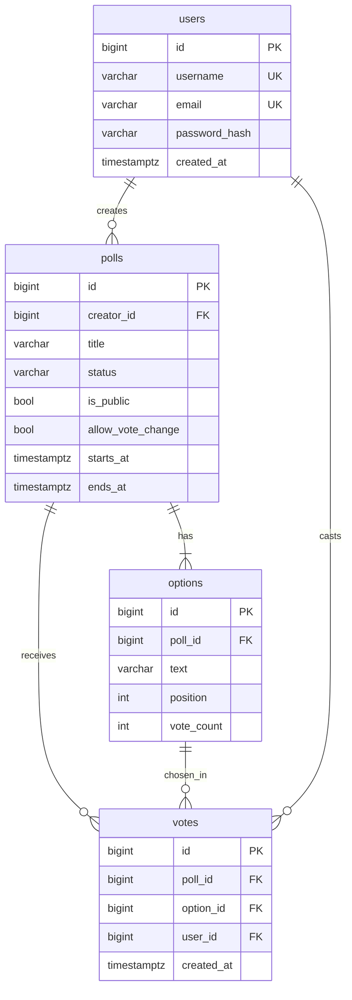
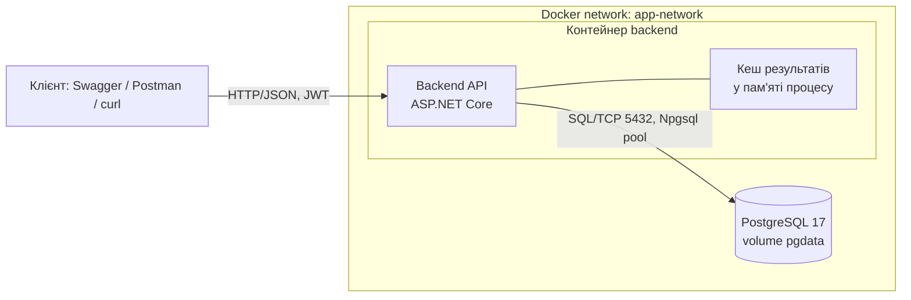
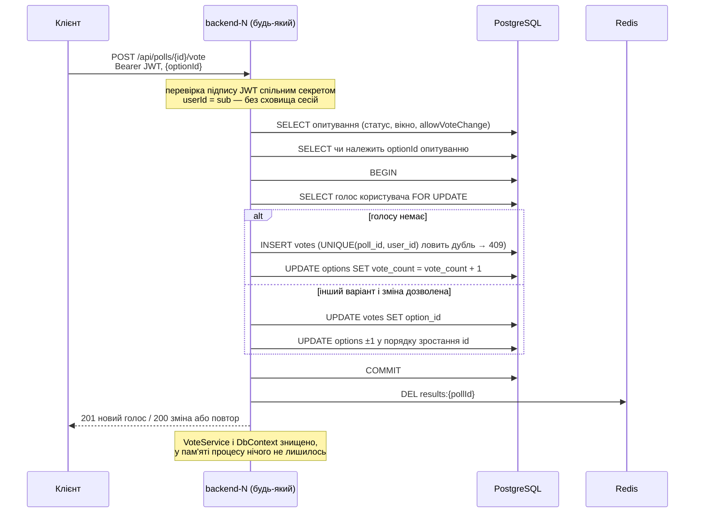

# Платформа опитувань — Highload Systems Practice

Наш варіант — платформа опитувань у реальному часі. Проєкт розвивається від лаби 1 (MVP) до лаби 5 (навантажувальне тестування); методички та дизайн-документи — у [`docs/`](docs/).

> **Розгорнутий посібник до лаби 1** (архітектура, логіка, обґрунтування рішень, питання на захист): [`docs/lab1-guide.md`](docs/lab1-guide.md).
>
> Контекст для учасників і AI-агентів: [`CLAUDE.md`](CLAUDE.md) → [`docs/ai/`](docs/ai/status.md) (стан, рішення/ADR, контракти, runbook, журнал сесій).

**Стек:** C# / ASP.NET Core 10 · EF Core 10 + Npgsql · PostgreSQL 17 · JWT · FluentValidation · Docker Compose

## Швидкий старт

Потрібен лише Docker.

```bash
docker compose up -d --build
```

| Що | Адреса |
|---|---|
| API, інстанс `backend-1` | http://localhost:8080 |
| API, інстанс `backend-2` | http://localhost:8082 |
| Swagger UI | http://localhost:8080/swagger (або :8082) |
| Health check | http://localhost:8080/health (або :8082) |
| PostgreSQL (з хоста) | `localhost:5433`, БД/користувач/пароль `polling` |
| Redis (з хоста) | `localhost:6379`; консоль — `docker compose exec redis redis-cli` |
| Adminer (опційно) | `docker compose --profile tools up -d` → http://localhost:8081 |
| pgAdmin 4 | http://localhost:5050 (піднімається разом зі стеком, ~40 с), сервер `polling (docker)` уже додано, пароль БД `polling` |

Стек запускає два однакові інстанси backend з одного образу (лаба 2); заголовок `X-Instance-ID` у кожній відповіді показує, який із них її обробив (`backend-1` / `backend-2`). При старті backend сам застосовує міграції та заповнює порожню БД тестовими даними. Жодних ручних кроків не потрібно. Значення за замовчуванням можна перевизначити через `.env` (див. [`.env.example`](.env.example)).

```bash
docker compose restart postgres   # дані переживають перезапуск БД (named volume pgdata)
docker compose down -v            # повне очищення, включно з даними
```

### Тестові дані (сід)

| Дані | Значення |
|---|---|
| Користувачі | `user001@example.com` … `user500@example.com`, пароль `Password123!` |
| Опитування | 50 шт.: ~70% active, ~15% closed, ~15% draft, з голосами |
| Опитування #1 | «гаряче»: active, без голосів, `allowVoteChange = true` — ціль для write-сценарію в лабі 5 |

Генератор детермінований (фіксований seed), тож холодний старт дає ті самі дані.

### Локальна розробка без Docker для backend

```bash
docker compose up -d postgres redis
dotnet run --project src/PollingPlatform.Api   # http://localhost:5094/swagger, середовище Development
```

Нова міграція: `dotnet ef migrations add <Name> --project src/PollingPlatform.Api -o Data/Migrations`.

## API

Формат — JSON; помилки — RFC 7807 `application/problem+json`. Колекція запитів для демо: [`requests/polls.http`](requests/polls.http).

| Method | Endpoint | Auth | Призначення |
|---|---|---|---|
| POST | `/api/auth/register` | — | Реєстрація |
| POST | `/api/auth/login` | — | Вхід, повертає JWT |
| GET | `/api/auth/me` | JWT | Поточний користувач |
| POST | `/api/polls` | JWT | Створити опитування з варіантами (status `draft`) |
| GET | `/api/polls?status=&creatorId=&page=&pageSize=` | — | Список з фільтрами та пагінацією |
| GET | `/api/polls/{id}` | — | Деталі опитування та варіанти |
| PATCH | `/api/polls/{id}/publish` | автор | `draft → active` |
| PATCH | `/api/polls/{id}/close` | автор | Дострокове закриття, `active → closed` |
| DELETE | `/api/polls/{id}` | автор | Видалити (лише `draft`) |
| POST | `/api/polls/{id}/vote` | JWT | Проголосувати: 201 — новий голос, 200 — змінений або повторний |
| GET | `/api/polls/{id}/results` | — | Агреговані результати (голоси та відсотки) |
| GET | `/health` | — | Готовність сервісу та стан БД |

Кожна відповідь містить заголовок `X-Instance-ID` з ідентифікатором інстансу, який її обробив (hostname контейнера або змінна `INSTANCE_ID`).

**Правила видимості:** чернетку бачить лише її автор, для інших вона повертає 404. Непублічне опитування (`isPublic = false`) не показується в загальному списку, але доступне за прямим посиланням.

**Коди помилок:**

| Код | Коли |
|---|---|
| 400 | Запит неможливо розпарсити (битий JSON, невірний тип) |
| 401 | Немає токена або токен невалідний; невірний логін |
| 403 | Дія над чужим опитуванням |
| 404 | Опитування не існує або це чужа чернетка |
| 409 | Недопустимий перехід статусу; дублікат email чи username; повторний голос; голос поза часовим вікном |
| 422 | Валідація полів |
| 503 | БД тимчасово недоступна (транзієнтний збій після вичерпання повторів EF) або недоступний Redis при читанні результатів |

**Голосування:** один голос на користувача на опитування — гарантує унікальний індекс `(poll_id, user_id)`, а не перевірка в коді. Якщо `allowVoteChange = true`, повторний запит змінює голос (200), а повтор того самого варіанта ідемпотентний і не змінює лічильники. Голос поза вікном `startsAt … endsAt` повертає 409 навіть для опитування зі статусом `active` — фонового закривача немає.

## Модель даних



Ключові обмеження:

- `UNIQUE(poll_id, user_id)` на `votes` гарантує один голос від користувача на опитування.
- `UNIQUE(poll_id, position)` на `options`.
- CHECK на `polls.status` і на умову `starts_at < ends_at`.
- `vote_count >= 0`.

Схема описана EF-міграціями в [`src/PollingPlatform.Api/Data/Migrations`](src/PollingPlatform.Api/Data/Migrations).

## Архітектура (Lab 1)



Кеш результатів живе **всередині процесу** backend — це свідоме рішення лаби 1 (ADR 0013). Саме його аудит стану лаби 2 виносить у зовнішнє сховище, після чого інстанси стають взаємозамінними.

## Структура репозиторію

```
src/PollingPlatform.Api/
  Auth/          JWT, реєстрація/логін, ClaimsPrincipal.GetUserId()
  Polls/         CRUD і життєвий цикл опитувань
  Votes/         голосування: транзакція + атомарний лічильник
  Results/       агреговані результати і їхній кеш (з лаби 2 — у Redis)
  Domain/        сутності User, Poll, PollOption, Vote
  Data/          DbContext, конфігурації EF, міграції, сід
  Common/        бізнес-винятки → HTTP-коди, обробник помилок, X-Instance-ID
docker-compose.yml
requests/        колекція запитів для демо
docs/            методички та дизайн-документи
docs/lab2/       розподіл задач лаби 2 між учасниками
docs/ai/         контекст для AI-агентів: стан, ADR, контракти, runbook, журнал сесій
CLAUDE.md        точка входу для Claude Code
```

## Розподіл відповідальності (RACI)

R — Responsible, A — Accountable, C — Consulted, I — Informed.

| Модуль | Учасник 1 | Учасник 2 |
|---|---|---|
| Каркас, Docker, мережі, volumes | R/A | I |
| Схема БД, міграції, сід | R/A | C |
| Автентифікація (JWT) | R/A | I |
| CRUD і життєвий цикл опитувань | R/A | I |
| Голосування (POST /vote) | I | R/A |
| Результати + кеш | I | R/A |
| Обробка помилок | C | R/A |
| Bottleneck Analysis | C | R/A |
| README, OpenAPI, схема C4 | R | R |

## High-Load сценарій

Пікова операція системи — **масове голосування в одне опитування в останні хвилини перед його завершенням**: тисячі конкурентних `POST /api/polls/{id}/vote`, кожен з яких перевіряє унікальність голосу і оновлює лічильник, плюс паралельний потік `GET /results` для лайв-дашборду. Ціль для навантажувального тесту — «гаряче» опитування #1 із сіду.

## Bottleneck Analysis

Формат: **Компонент / Root Cause / Симптоматика**. Аналіз теоретичний (лаба 1); кількісне підтвердження — у лабі 5.

### 1. Оновлення лічильника `options.vote_count`

- **Компонент:** `UPDATE options SET vote_count = vote_count + 1` у транзакції `POST /vote` — рядок одного популярного варіанта.
- **Root Cause:** Lock Contention. Усі голоси за один варіант оновлюють **той самий рядок**; row-level lock у PostgreSQL серіалізує їх, і паралельність на цій ділянці вироджується в чергу. Голоси за різні варіанти конкурують лише за `votes` (вставки в різні сторінки індексу дешевші).
- **Симптоматика:** зростання p99 на `POST /vote` при майже незмінному p50, черга транзакцій у `pg_locks`, `lock_waits` у логах, у гіршому разі — deadlock або statement timeout.
- **Стан:** інкремент виконується на рівні SQL (не load-modify-save), а зміна голосу блокує рядок голосу користувача (`SELECT … FOR UPDATE`) і оновлює два лічильники в порядку зростання id (ADR 0017). Без блокування паралельні зміни голосу одним користувачем розсинхронізовували лічильники по варіантах (або падали з 500 на `CHECK vote_count >= 0`), хоча загальна `SUM(vote_count) = COUNT(votes)` зберігалася, — тому перевіряти треба **по кожному варіанту**, а не сумою. Перевірено: 200 паралельних голосів різних користувачів, 40 паралельних змін голосу одним користувачем, 100 зустрічних змін (A→B і B→A) — лічильники точні, deadlock немає. Серіалізація на рядку популярного варіанта лишається і є головним кандидатом на точку насичення в лабі 5.

### 2. `GET /results` як read-intensive навантаження

- **Компонент:** ендпоінт агрегованих результатів — найчастіше читання (дашборд оновлюється в усіх глядачів одночасно).
- **Root Cause:** без кешу кожен запит іде в БД по агрегат. Читань на порядок більше, ніж записів, тож саме вони з'їдають CPU та I/O основної БД.
- **Симптоматика:** падіння Throughput/RPS, зростання CPU і I/O Wait на контейнері БД, деградація *усіх* ендпоінтів, бо вони ділять один connection pool.
- **Стан:** пом'якшено на двох рівнях — агрегат читається з денормалізованого `vote_count` (без `COUNT`/`JOIN` по `votes`), а відповідь кешується з явною інвалідацією на голос, publish, close і delete. У лабі 1 кеш був **навмисно локальним** (ADR 0013); у лабі 2 він розійшовся між інстансами і переїхав у Redis (ADR 0026), а в лабі 4 оформиться як Cache-Aside зі схемою ключів, обґрунтуванням TTL і fallback на БД.

### 3. Вичерпання пулу з'єднань до БД

- **Компонент:** пул Npgsql між backend і PostgreSQL (спільний для всіх ендпоінтів).
- **Root Cause:** Connection Pool Exhaustion. Транзакції з п.1 тримають з'єднання довше, ніж зазвичай, бо чекають на лок. При сплеску голосів вільні з'єднання закінчуються, і запити стають у чергу ще до того, як дійдуть до БД.
- **Симптоматика:** час очікування з'єднання в метриках пулу, таймаути на рівні API, різке зростання Error Rate при майже незавантаженому CPU БД — класична ознака, що вузьке місце не в обчисленнях, а в очікуванні.
- **Стан:** пул обмежено до 30 з'єднань на інстанс (`Maximum Pool Size`, змінна `DB_MAX_POOL_SIZE`, ADR 0018). Раніше пул Npgsql за замовчуванням (100) дорівнював `max_connections` PostgreSQL (100): після навантаження один інстанс забирав усі з'єднання, і БД відмовляла навіть `psql` (`too many clients already`); з двома інстансами в лабі 2 це була б гарантована відмова. Правило: *інстанси × розмір пулу ≤ `max_connections` − 3*. Тепер надлишкові запити чекають на вільне з'єднання в пулі — саме це очікування і є вимірюваною формою цього bottleneck у лабі 5. Транзієнтні збої БД повертають **503**, а не 500, а `/health` відповідає не довше 2 с (ADR 0019), — у лабі 3 за ним балансувальник вимикатиме вузол.

### 4. N+1 при створенні опитування з багатьма варіантами

- **Компонент:** `POST /api/polls` з до 20 варіантами.
- **Root Cause:** наївний ORM-код вставляє кожен варіант окремим запитом — N round-trip до БД замість одного.
- **Симптоматика:** латентність створення росте лінійно з кількістю варіантів; на тлі мережевої затримки до БД саме round-trip, а не сама вставка, домінує в часі відповіді.
- **Стан:** усунено — опитування і всі його варіанти зберігаються одним `SaveChanges`, EF відправляє їх батчем (ADR 0007). Залишено в аналізі як приклад проблеми, яку легко внести назад необережною правкою.

## Лабораторна 2: Stateless-архітектура

Вимоги — [`docs/labs/Lab2 - Stateless Architecture.md`](docs/labs/Lab2%20-%20Stateless%20Architecture.md), розподіл задач — [`docs/lab2/`](docs/lab2/). Кожен підрозділ заповнює вказаний учасник у своїй гілці.

### Аудит стану

Класифікація за трьома категоріями методички: **Ephemeral / Local Safe**, **Shared / Externalized**, **Critical Stateful Dependencies** (підлягають вилученню).

#### Платформа: інфраструктура, Auth, опитування, старт БД

_Заповнює Учасник 1 (П1-4)._

#### Голосування й результати

Пройдено `Votes/`, `Results/`, `Common/ErrorHandling/`, `Common/Exceptions/VoteExceptions.cs` і реєстрації цих модулів у `Program.cs` — по коду, з пошуком `static`, блокувань, `Concurrent*`, `IMemoryCache`, таймерів, файлів і сесій.

| Елемент | Де | Категорія | Чому |
|---|---|---|---|
| Кеш результатів: `ResultsCache` поверх `IMemoryCache` | `Results/ResultsCache.cs`; `Program.cs` — `AddMemoryCache()`, `AddSingleton<ResultsCache>()` | **Critical** | Агрегат лежить у пам'яті процесу. Інвалідація спрацьовує лише на інстансі, що обробив запис; інший до 10 с (TTL) віддає старе. Усунено в П2-3 |
| Рішення про видимість у кеші: `CreatorId` і `Status` всередині кешованого запису | `Results/ResultsService.cs` — перевірка чернетки на попаданні в кеш | **Critical** (наслідок рядка вище) | На попаданні в кеш доступ вирішується за кешованим статусом. Після publish на одному інстансі інший до 10 с віддає стороннім **404** замість результатів — застаріває не лише число, а й рішення про доступ |
| Лічильник `options.vote_count` | PostgreSQL; SQL `vote_count ± 1` у транзакції голосу | Shared | Не лічильник у пам'яті: усі інстанси пишуть в один рядок БД (ADR 0014) |
| Серіалізація змін голосу | `SELECT … FOR UPDATE` у `VoteService` | Shared | Рядкове блокування PostgreSQL працює між інстансами, на відміну від `lock`/`SemaphoreSlim` у процесі (ADR 0017) |
| «Один голос на користувача» | `UNIQUE(poll_id, user_id)` | Shared | Гарантія в БД: повтор, що прийшов на інший інстанс, усе одно отримає 409 |
| Стан опитування для голосу (статус, `startsAt`/`endsAt`, `allowVoteChange`) і належність варіанта | `VoteService.LoadVotablePollAsync`, перевірка `optionId` | Shared | Читається з PostgreSQL на **кожен** голос (`AsNoTracking`); у шляху голосування нічого не кешується |
| Ідентичність того, хто голосує | claim `sub` у JWT | Shared / Externalized | Зберігається на боці клієнта; інстанс лише перевіряє підпис спільним секретом з env (`JWT_SECRET`), сховища сесій немає |
| `VoteService`, `ResultsService`, `AppDbContext` | `Program.cs` — `AddScoped` | Ephemeral | Живуть один запит і знищуються після відповіді |
| Change tracker EF | `AppDbContext` | Ephemeral | Scoped разом із контекстом; на початку кожної спроби retry-стратегії очищується (`ChangeTracker.Clear()`) |
| `GlobalExceptionHandler` | `AddExceptionHandler<…>()` — реєструється як **singleton** | Ephemeral / Local Safe | Попри singleton, змінних даних немає: лише `IProblemDetailsService` і `ILogger`; `IsTransient` — чиста статична функція |
| `static readonly Ttl`, `static Key()` у `ResultsCache` | `Results/ResultsCache.cs` | Local Safe | Незмінна константа і чиста функція, не дані |
| Винятки з `VoteExceptions.cs` | `Common/Exceptions/` | Ephemeral | Незмінні об'єкти в межах одного запиту |
| Логи помилок | stdout контейнера | Local Safe | Діагностика, не бізнес-стан |

**Що ще показав аудит:**

1. **Застаріває не лише число, а й доступ.** Кешований запис тримає статус опитування, тому після publish інший інстанс до 10 с повертає стороннім 404 — сильніший приклад прихованої affinity, ніж застарілий `totalVotes`.
2. **`GlobalExceptionHandler` — singleton, а не scoped.** Безпечно, бо змінного стану немає; пояснення для аудиту коду, який шукає `AddSingleton`.
3. **Гонка «прочитали до коміту — поклали в кеш після інвалідації».** Якщо `GET /results` порахував агрегат до коміту голосу, а поклав у кеш уже після інвалідації, застаріле значення живе до 10 с — навіть на одному інстансі. Перенос у Redis її **не** усуває; це тема лаби 4.
4. **Невідомий результат коміту.** Якщо з'єднання обірвалось після `COMMIT`, але до відповіді, повтор (retry-стратегія EF або клієнт на іншому інстансі) знайде вже записаний голос і поверне 409 (або 200 при `allowVoteChange` і тому самому варіанті). Голос записано рівно один раз, але клієнт бачить 409 замість 201.

### Усунені in-memory залежності

#### Кеш результатів

**До: кеш у пам'яті кожного процесу.** Демо — [`scripts/results-cache-demo.py`](scripts/results-cache-demo.py) (лише стандартна бібліотека Python, стек має бути піднятий): `python scripts/results-cache-demo.py`. Вивід від 2026-10-27, стабільний у трьох прогонах поспіль:

```text
Scenario A: vote through backend-1, read through backend-2
  1. warm cache:     GET results               backend-2  HTTP 200  totalVotes=0  status=active  generatedAt=2026-10-27T10:19:41.7607238+00:00
  2. vote:           POST vote                 backend-1  HTTP 201
  3. right after:    GET results               backend-2  HTTP 200  totalVotes=0  status=active  generatedAt=2026-10-27T10:19:41.7607238+00:00
     right after:    GET results               backend-1  HTTP 200  totalVotes=1  status=active  generatedAt=2026-10-27T10:19:42.088658+00:00
  ... waiting 11s for the TTL ...
  4. after TTL:      GET results               backend-2  HTTP 200  totalVotes=1  status=active  generatedAt=2026-10-27T10:19:53.2569791+00:00

Scenario B: publish through backend-1, read through backend-2
  1. author previews draft: GET results        backend-2  HTTP 200  totalVotes=0  status=draft  generatedAt=2026-10-27T10:19:53.3833789+00:00
  2. publish:        PATCH publish             backend-1  HTTP 200
  3. anonymous:      GET results               backend-2  HTTP 404
     anonymous:      GET results               backend-1  HTTP 200  totalVotes=0  status=active  generatedAt=2026-10-27T10:19:53.4810787+00:00
```

Що тут видно:

- **A.** Голос пройшов через backend-1, і backend-1 інвалідував **свій** кеш — він одразу бачить `totalVotes=1`. До backend-2 інвалідація не дійшла: він віддає `0` і той самий `generatedAt`, тобто стару копію з власної пам'яті. Розбіжність тримається, поки не спливе TTL (крок 4) — тож TTL тут єдине, що обмежує неузгодженість.
- **B.** Автор переглянув чернетку через backend-2, і той закешував її зі статусом `draft`. Після publish через backend-1 сторонній отримує від backend-2 **404**, хоча опитування вже публічне, а backend-1 на той самий запит відповідає 200. Застаріло не число, а рішення про доступ.

Обидва випадки — прихована affinity: правильність відповіді залежить від того, на який інстанс потрапив запит. Sticky sessions лише сховали б це — клієнт «прилипав» би до одного інстансу, але різні клієнти так само бачили б різне. Тому кеш — **critical stateful dependency**, і його виносимо в спільне сховище.

**Після: кеш у Redis (ADR 0026).** `ResultsCache` працює через спільний для процесу `IConnectionMultiplexer`: ключ `results:{pollId}`, значення — JSON, TTL 10 с, інвалідація — `DEL`. `AddMemoryCache()` прибрано; `ResultsCache` лишився singleton, бо даних у ньому більше немає — лише посилання на з'єднання. Той самий скрипт, без жодних змін:

```text
Scenario A: vote through backend-1, read through backend-2
  1. warm cache:     GET results               backend-2  HTTP 200  totalVotes=0  status=active  generatedAt=2026-10-27T10:25:50.5231928+00:00
  2. vote:           POST vote                 backend-1  HTTP 201
  3. right after:    GET results               backend-2  HTTP 200  totalVotes=1  status=active  generatedAt=2026-10-27T10:25:51.063114+00:00
     right after:    GET results               backend-1  HTTP 200  totalVotes=1  status=active  generatedAt=2026-10-27T10:25:51.063114+00:00

Scenario B: publish through backend-1, read through backend-2
  1. author previews draft: GET results        backend-2  HTTP 200  totalVotes=0  status=draft  generatedAt=2026-10-27T10:25:51.2707272+00:00
  2. publish:        PATCH publish             backend-1  HTTP 200
  3. anonymous:      GET results               backend-2  HTTP 200  totalVotes=0  status=active  generatedAt=2026-10-27T10:25:51.3377633+00:00
     anonymous:      GET results               backend-1  HTTP 200  totalVotes=0  status=active  generatedAt=2026-10-27T10:25:51.3377633+00:00

Summary
  backend-2 served stale vote counts after a vote on backend-1:  no
  backend-2 answered 404 for a poll published on backend-1:      no
```

Найпереконливіше тут — **однаковий `generatedAt` на обох інстансах** на кроці 3: агрегат порахував один інстанс, а другий віддав саме цю копію з Redis. Інвалідація, зроблена backend-1, тепер одразу видна backend-2, а TTL знову лише страховка. Перевірка в Redis: `docker compose exec redis redis-cli TTL results:1` після читання — не більше 10; після голосу `EXISTS results:1` → 0.

Що перенос у Redis **не** усуває: гонку «агрегат порахували до коміту голосу, а в кеш поклали вже після інвалідації» — застаріле значення може прожити до TTL. Це тема лаби 4, разом зі схемою ключів, обґрунтуванням TTL і fallback на БД.

**Якщо Redis недоступний (ADR 0027).** Redis — нова зовнішня залежність, і її відмова не повинна давати 500 чи вводити клієнта в оману. Без обробки так і було: `GET /results` → 500, а `POST /vote` → 500, **хоча голос уже був записаний** — клієнт повторив би запит і отримав 409 на голос, який насправді пройшов. Тепер:

| Операція при зупиненому Redis | Відповідь | Чому |
|---|---|---|
| `GET /results` | **503**, `detail: "The cache is temporarily unavailable"` | Інфраструктурний збій, повтор має сенс; fallback на БД — лаба 4 |
| `POST /vote`, `PATCH publish/close`, `DELETE` | звичайний успіх (201 / 200 / 204) | Інвалідація йде вже після коміту в БД; її збій лише логується одним рядком `warn` |
| Redis знову піднято | усе працює, результати свіжі | Клієнт Redis перепідключається сам, рестарт backend не потрібен |

Застаріле значення після невдалої інвалідації можливе лише при короткому збої, коли Redis зберіг дані, — і живе не довше TTL 10 с. Після рестарту Redis порожній (без volume), тож застарілого немає взагалі. Відома ціна: поки Redis лежить, кожен запит, що його торкається, чекає ~5 с — клієнт тримає команду в черзі до свого таймауту. Короткі збої це переживає без помилок, але тривалий робить повільним; швидка відмова разом із fallback на БД — лаба 4.

Перевірка — [`scripts/redis-outage-check.py`](scripts/redis-outage-check.py): зупиняє Redis, голосує, читає, публікує, запускає Redis і перевіряє відновлення. Прогін від 2026-10-27:

```text
Redis stopped (docker compose stop redis)
  OK   GET results -> 503 with ProblemDetails                     HTTP 503 in 5.2s, detail: The cache is temporarily unavailable. Please retry.
  OK   POST vote -> 201 (committed vote not reported as failed)   HTTP 201 in 5.9s
  OK   vote stored in PostgreSQL exactly once                     rows=1
  OK   PATCH publish -> 200 (failed invalidation tolerated)       HTTP 200 in 5.4s
  OK   per-option counters consistent                             mismatches=0

Redis started again (docker compose start redis)
  OK   GET results -> 200 again                                   after 1.6s
  OK   results are fresh (the outage vote is counted)             totalVotes=1
  OK   no backend restart
```

_Ключі DataProtection — Учасник 1 (П1-3)._

### Stateless Request Flow: `POST /api/polls/{id}/vote`

Сценарій — голосування, high-load сценарій проєкту. Запит може прийти на будь-який інстанс; нижче — що він бере з запиту, що читає зі спільних сховищ, що змінює атомарно і чому після відповіді в процесі нічого не лишається.

| Вимога 2.3 | Як це зроблено | Код |
|---|---|---|
| Вхідні параметри / context token | `Authorization: Bearer <JWT>` → middleware JwtBearer перевіряє підпис ключем із `Jwt:Secret` (env `JWT_SECRET`, однаковий на всіх інстансах) → `userId` з claim `sub`. `pollId` — з маршруту, `{optionId}` — з тіла, валідатор (`optionId > 0`, інакше 422) | `Votes/VotesController.cs`, `Auth/ClaimsPrincipalExtensions.cs` |
| Вичитування контексту зі shared storage | PostgreSQL: опитування (видимість, статус, часове вікно, `allowVoteChange`) і належність варіанта цьому опитуванню | `VoteService.LoadVotablePollAsync`, перевірка `optionId` у `CastAsync` |
| Атомарні зміни у зовнішньому сховищі | Одна транзакція в execution strategy: наявний голос `SELECT … FOR UPDATE` → `INSERT` (новий голос; дубль ловить унікальний індекс) **або** `UPDATE votes` + `vote_count ± 1` у порядку зростання id варіантів (зміна) **або** нічого (той самий варіант) → `COMMIT`. Після коміту — інвалідація `results:{pollId}` | `VoteService.CastOnceAsync`, `InsertVoteAsync`, `ChangeVoteCountAsync` |
| Відсутність залишкових мутацій у пам'яті | `VoteService` і `AppDbContext` scoped — знищуються після відповіді; `static`-полів із даними немає; наступний запит того ж користувача може піти на інший інстанс | `Program.cs` — `AddScoped` |

> Останній рядок виконується лише з лаби 2 (ADR 0026). У лабі 1 інвалідація була `IMemoryCache.Remove` на поточному інстансі — запит голосування змінював пам'ять процесу, і ця зміна переживала запит. Тепер це `DEL results:{pollId}` у Redis, і в пам'яті процесу нічого не лишається.



**Інваріант після будь-якого запиту** — перевіряти по кожному варіанту, не сумою (ADR 0017):

```sql
SELECT count(*) FROM options o
WHERE o.vote_count <> (SELECT count(*) FROM votes v WHERE v.option_id = o.id);   -- 0
```

**Якщо інстанс упаде на півдорозі:**

- до `COMMIT` — транзакція обривається разом зі з'єднанням, PostgreSQL її відкочує; голосу без лічильника не буває, бо обидві зміни в одній транзакції;
- після `COMMIT`, але до відповіді — голос збережено; повтор на іншому інстансі отримає 409 від унікального індексу, подвійного голосу немає;
- після `COMMIT`, але до інвалідації кешу — результати застаріють максимум на TTL 10 с.

**Перевірка під конкуренцією через обидва інстанси.** Гарантії цього потоку — транзакція, `UNIQUE(poll_id, user_id)`, `FOR UPDATE`, порядок блокувань — мають триматися, коли запити одного й того самого користувача приходять одночасно на **різні** процеси. [`scripts/concurrency-checks.py`](scripts/concurrency-checks.py) ділить запити навпіл між backend-1 і backend-2 і стартує їх одночасно (бар'єр); після кожної перевірки звіряє лічильники по кожному варіанту з `votes` і результати обох інстансів із БД. Прогін від 2026-10-27, стабільний у чотирьох прогонах поспіль (~16 с):

```text
Check 1: 200 different users vote into one poll at once
  OK   all 201, no 5xx                                      201x200
  OK   one vote row per user                                rows=200
  OK   per-option counters = votes rows (whole DB)          mismatches=0
  OK   results on backend-1 and backend-2 match the DB      db=100,100 b1=100,100 b2=100,100

Check 2: one user changes the vote 40 times in parallel
  OK   fresh poll: all 200                                  200x40
  OK   fresh poll: exactly one vote row for the user        rows=1
  OK   hot poll #1: all 200                                 200x40
  OK   hot poll #1: exactly one vote row for the user       rows=1
  (+ per-option counters and results on both instances after each poll — OK)

Check 3: 100 users make opposite changes (A->B and B->A) at once
  OK   opposite changes: all 200                            200x100
  OK   still 50/50 after the swap                           50/50

Logs since the start of this run
  OK   no 'deadlock detected' in postgres logs              count=0
  OK   no 'fail:' entries in backend logs                   count=0
```

**Чи тест взагалі здатен щось зловити.** Зелений тест нічого не доводить, якщо він не падає на справжній помилці. Тому `FOR UPDATE` тимчасово прибрали з `VoteService` і прогнали той самий скрипт: зміна голосу на свіжому опитуванні дала **21 × 500 із 40**, на опитуванні #1 — **6 × 500**, у логах backend — 54 записи `fail:`. Це та сама гонка, яку виправляє ADR 0017 (там було 23 з 40). Блокування повернули — знову все зелене. Отже, перевірка 2 справді ловить цю гонку, і тепер — через два процеси.

### Мульти-інстансне розгортання

_Заповнює Учасник 1 (П1-6)._

### Перевірка cross-instance консистентності

_Заповнює Учасник 1 (П1-5)._

### Відмовостійкість: втрата інстансу

_Заповнює Учасник 2 (П2-7)._
