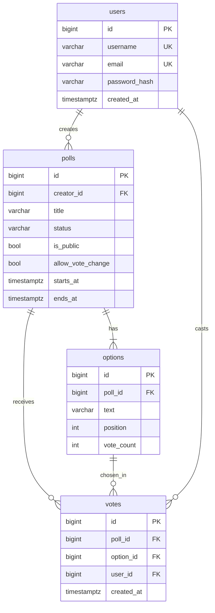
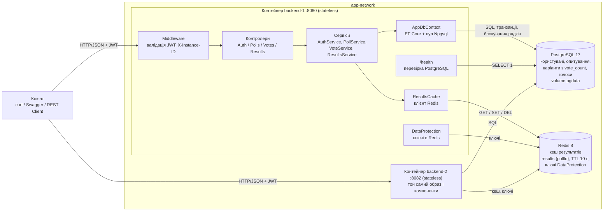

# Платформа опитувань — Highload Systems Practice

Наш варіант — платформа опитувань у реальному часі. Проєкт розвивається від лаби 1 (MVP) до лаби 5 (навантажувальне тестування); методички та дизайн-документи — у [`docs/`](docs/).

> **Розгорнутий посібник до лаби 1** (архітектура, логіка, обґрунтування рішень, питання на захист): [`docs/lab1-guide.md`](docs/lab1-guide.md).
>
> Контекст для учасників і AI-агентів: [`CLAUDE.md`](CLAUDE.md) → [`docs/ai/`](docs/ai/status.md) (стан, рішення/ADR, контракти, runbook, журнал сесій).

**Стек:** C# / ASP.NET Core 10 · EF Core 10 + Npgsql · PostgreSQL 17 · JWT · FluentValidation · Docker Compose

## Швидкий старт

Потрібен лише Docker.

```bash
docker compose up -d --build
```

| Що | Адреса |
|---|---|
| API, інстанс `backend-1` | http://localhost:8080 |
| API, інстанс `backend-2` | http://localhost:8082 |
| Swagger UI | http://localhost:8080/swagger (або :8082) |
| Health check | http://localhost:8080/health (або :8082) |
| PostgreSQL (з хоста) | `localhost:5433`, БД/користувач/пароль `polling` |
| Redis (з хоста) | `localhost:6379`; консоль — `docker compose exec redis redis-cli` |
| Adminer (опційно) | `docker compose --profile tools up -d` → http://localhost:8081 |
| pgAdmin 4 | http://localhost:5050 (піднімається разом зі стеком, ~40 с), сервер `polling (docker)` уже додано, пароль БД `polling` |

Стек запускає два однакові інстанси backend з одного образу (лаба 2); заголовок `X-Instance-ID` у кожній відповіді показує, який із них її обробив (`backend-1` / `backend-2`). При старті backend сам застосовує міграції та заповнює порожню БД тестовими даними. Жодних ручних кроків не потрібно. Значення за замовчуванням можна перевизначити через `.env` (див. [`.env.example`](.env.example)).

```bash
docker compose restart postgres   # дані переживають перезапуск БД (named volume pgdata)
docker compose down -v            # повне очищення, включно з даними
```

### Тестові дані (сід)

| Дані | Значення |
|---|---|
| Користувачі | `user001@example.com` … `user500@example.com`, пароль `Password123!` |
| Опитування | 50 шт.: ~70% active, ~15% closed, ~15% draft, з голосами |
| Опитування #1 | «гаряче»: active, без голосів, `allowVoteChange = true` — ціль для write-сценарію в лабі 5 |

Генератор детермінований (фіксований seed), тож холодний старт дає ті самі дані.

### Локальна розробка без Docker для backend

```bash
docker compose up -d postgres redis
dotnet run --project src/PollingPlatform.Api   # http://localhost:5094/swagger, середовище Development
```

Нова міграція: `dotnet ef migrations add <Name> --project src/PollingPlatform.Api -o Data/Migrations`.

## API

Формат — JSON; помилки — RFC 7807 `application/problem+json`. Колекція запитів для демо: [`requests/polls.http`](requests/polls.http).

| Method | Endpoint | Auth | Призначення |
|---|---|---|---|
| POST | `/api/auth/register` | — | Реєстрація |
| POST | `/api/auth/login` | — | Вхід, повертає JWT |
| GET | `/api/auth/me` | JWT | Поточний користувач |
| POST | `/api/polls` | JWT | Створити опитування з варіантами (status `draft`) |
| GET | `/api/polls?status=&creatorId=&page=&pageSize=` | — | Список з фільтрами та пагінацією |
| GET | `/api/polls/{id}` | — | Деталі опитування та варіанти |
| PATCH | `/api/polls/{id}/publish` | автор | `draft → active` |
| PATCH | `/api/polls/{id}/close` | автор | Дострокове закриття, `active → closed` |
| DELETE | `/api/polls/{id}` | автор | Видалити (лише `draft`) |
| POST | `/api/polls/{id}/vote` | JWT | Проголосувати: 201 — новий голос, 200 — змінений або повторний |
| GET | `/api/polls/{id}/results` | — | Агреговані результати (голоси та відсотки) |
| GET | `/health` | — | Готовність сервісу та стан БД |

Кожна відповідь містить заголовок `X-Instance-ID` з ідентифікатором інстансу, який її обробив (hostname контейнера або змінна `INSTANCE_ID`).

**Правила видимості:** чернетку бачить лише її автор, для інших вона повертає 404. Непублічне опитування (`isPublic = false`) не показується в загальному списку, але доступне за прямим посиланням.

**Коди помилок:**

| Код | Коли |
|---|---|
| 400 | Запит неможливо розпарсити (битий JSON, невірний тип) |
| 401 | Немає токена або токен невалідний; невірний логін |
| 403 | Дія над чужим опитуванням |
| 404 | Опитування не існує або це чужа чернетка |
| 409 | Недопустимий перехід статусу; дублікат email чи username; повторний голос; голос поза часовим вікном |
| 422 | Валідація полів |
| 503 | БД тимчасово недоступна (транзієнтний збій після вичерпання повторів EF) |

**Голосування:** один голос на користувача на опитування — гарантує унікальний індекс `(poll_id, user_id)`, а не перевірка в коді. Якщо `allowVoteChange = true`, повторний запит змінює голос (200), а повтор того самого варіанта ідемпотентний і не змінює лічильники. Голос поза вікном `startsAt … endsAt` повертає 409 навіть для опитування зі статусом `active` — фонового закривача немає.

## Модель даних



Ключові обмеження:

- `UNIQUE(poll_id, user_id)` на `votes` гарантує один голос від користувача на опитування.
- `UNIQUE(poll_id, position)` на `options`.
- CHECK на `polls.status` і на умову `starts_at < ends_at`.
- `vote_count >= 0`.

Схема описана EF-міграціями в [`src/PollingPlatform.Api/Data/Migrations`](src/PollingPlatform.Api/Data/Migrations).

## Архітектура (Lab 2)

C4 Component Diagram: сервісний шар — два однакові stateless-інстанси з одного образу, весь стан — у централізованих сховищах. Компоненти показано для `backend-1`; `backend-2` — та сама збірка з тими самими компонентами.



- **Між запитами в процесі нічого не лишається:** бізнес-дані — у PostgreSQL, кеш результатів і ключі DataProtection — у Redis, ідентичність користувача — у JWT на боці клієнта. Тому будь-який інстанс обробить будь-який запит, і будь-який можна вбити без втрати даних.
- **Однакова конфігурація:** обидва інстанси — один YAML-якір у `docker-compose.yml` (той самий JWT-секрет і рядки підключення); відрізняються лише `INSTANCE_ID` і портом ([ADR 0021](docs/ai/decisions/0021-redis-and-two-backend-instances.md)).
- **Узгодженість записів** тримає PostgreSQL: транзакція «голос + лічильник», `UNIQUE(poll_id, user_id)`, `FOR UPDATE`; міграції й сід при одночасному старті серіалізуються блокуваннями в БД ([ADR 0022](docs/ai/decisions/0022-concurrent-startup-verified.md)).
- **Балансувальника ще немає** (лаба 3): клієнт сам обирає інстанс портом.
- Схема показує цільовий стан лаби 2: кеш результатів переїжджає з пам'яті процесу в Redis у задачі П2-3 (Учасник 2).

## Структура репозиторію

```
src/PollingPlatform.Api/
  Auth/          JWT, реєстрація/логін, ClaimsPrincipal.GetUserId()
  Polls/         CRUD і життєвий цикл опитувань
  Votes/         голосування: транзакція + атомарний лічильник
  Results/       агреговані результати і кеш у пам'яті процесу
  Domain/        сутності User, Poll, PollOption, Vote
  Data/          DbContext, конфігурації EF, міграції, сід
  Common/        бізнес-винятки → HTTP-коди, обробник помилок, X-Instance-ID
docker-compose.yml
requests/        колекції запитів для демо (polls.http, cross-instance.http)
scripts/         скрипти перевірок лаб (cross-instance.sh)
docs/            методички та дизайн-документи
docs/lab2/       розподіл задач лаби 2 між учасниками
docs/ai/         контекст для AI-агентів: стан, ADR, контракти, runbook, журнал сесій
CLAUDE.md        точка входу для Claude Code
```

## Розподіл відповідальності (RACI)

R — Responsible, A — Accountable, C — Consulted, I — Informed.

| Модуль | Учасник 1 | Учасник 2 |
|---|---|---|
| Каркас, Docker, мережі, volumes | R/A | I |
| Схема БД, міграції, сід | R/A | C |
| Автентифікація (JWT) | R/A | I |
| CRUD і життєвий цикл опитувань | R/A | I |
| Голосування (POST /vote) | I | R/A |
| Результати + кеш | I | R/A |
| Обробка помилок | C | R/A |
| Bottleneck Analysis | C | R/A |
| README, OpenAPI, схема C4 | R | R |
| Лаба 2: Redis, два інстанси, одночасний старт | R/A | C |
| Лаба 2: ключі DataProtection у Redis | R/A | I |
| Лаба 2: кеш результатів у Redis | C | R/A |
| Лаба 2: аудит стану | R (платформа) | R/A (голосування, результати) |
| Лаба 2: Stateless Request Flow | I | R/A |
| Лаба 2: cross-instance перевірка | R/A | C |
| Лаба 2: тест втрати інстансу | C | R/A |

## High-Load сценарій

Пікова операція системи — **масове голосування в одне опитування в останні хвилини перед його завершенням**: тисячі конкурентних `POST /api/polls/{id}/vote`, кожен з яких перевіряє унікальність голосу і оновлює лічильник, плюс паралельний потік `GET /results` для лайв-дашборду. Ціль для навантажувального тесту — «гаряче» опитування #1 із сіду.

## Bottleneck Analysis

Формат: **Компонент / Root Cause / Симптоматика**. Аналіз теоретичний (лаба 1); кількісне підтвердження — у лабі 5.

### 1. Оновлення лічильника `options.vote_count`

- **Компонент:** `UPDATE options SET vote_count = vote_count + 1` у транзакції `POST /vote` — рядок одного популярного варіанта.
- **Root Cause:** Lock Contention. Усі голоси за один варіант оновлюють **той самий рядок**; row-level lock у PostgreSQL серіалізує їх, і паралельність на цій ділянці вироджується в чергу. Голоси за різні варіанти конкурують лише за `votes` (вставки в різні сторінки індексу дешевші).
- **Симптоматика:** зростання p99 на `POST /vote` при майже незмінному p50, черга транзакцій у `pg_locks`, `lock_waits` у логах, у гіршому разі — deadlock або statement timeout.
- **Стан:** інкремент виконується на рівні SQL (не load-modify-save), а зміна голосу блокує рядок голосу користувача (`SELECT … FOR UPDATE`) і оновлює два лічильники в порядку зростання id (ADR 0017). Без блокування паралельні зміни голосу одним користувачем розсинхронізовували лічильники по варіантах (або падали з 500 на `CHECK vote_count >= 0`), хоча загальна `SUM(vote_count) = COUNT(votes)` зберігалася, — тому перевіряти треба **по кожному варіанту**, а не сумою. Перевірено: 200 паралельних голосів різних користувачів, 40 паралельних змін голосу одним користувачем, 100 зустрічних змін (A→B і B→A) — лічильники точні, deadlock немає. Серіалізація на рядку популярного варіанта лишається і є головним кандидатом на точку насичення в лабі 5.

### 2. `GET /results` як read-intensive навантаження

- **Компонент:** ендпоінт агрегованих результатів — найчастіше читання (дашборд оновлюється в усіх глядачів одночасно).
- **Root Cause:** без кешу кожен запит іде в БД по агрегат. Читань на порядок більше, ніж записів, тож саме вони з'їдають CPU та I/O основної БД.
- **Симптоматика:** падіння Throughput/RPS, зростання CPU і I/O Wait на контейнері БД, деградація *усіх* ендпоінтів, бо вони ділять один connection pool.
- **Стан:** пом'якшено на двох рівнях — агрегат читається з денормалізованого `vote_count` (без `COUNT`/`JOIN` по `votes`), а відповідь кешується в пам'яті процесу з явною інвалідацією на голос, publish, close і delete. Кеш **навмисно локальний** (ADR 0013): у лабі 2 він розійдеться між інстансами, у лабі 4 переїде в Redis із Cache-Aside, TTL і fallback.

### 3. Вичерпання пулу з'єднань до БД

- **Компонент:** пул Npgsql між backend і PostgreSQL (спільний для всіх ендпоінтів).
- **Root Cause:** Connection Pool Exhaustion. Транзакції з п.1 тримають з'єднання довше, ніж зазвичай, бо чекають на лок. При сплеску голосів вільні з'єднання закінчуються, і запити стають у чергу ще до того, як дійдуть до БД.
- **Симптоматика:** час очікування з'єднання в метриках пулу, таймаути на рівні API, різке зростання Error Rate при майже незавантаженому CPU БД — класична ознака, що вузьке місце не в обчисленнях, а в очікуванні.
- **Стан:** пул обмежено до 30 з'єднань на інстанс (`Maximum Pool Size`, змінна `DB_MAX_POOL_SIZE`, ADR 0018). Раніше пул Npgsql за замовчуванням (100) дорівнював `max_connections` PostgreSQL (100): після навантаження один інстанс забирав усі з'єднання, і БД відмовляла навіть `psql` (`too many clients already`); з двома інстансами в лабі 2 це була б гарантована відмова. Правило: *інстанси × розмір пулу ≤ `max_connections` − 3*. Тепер надлишкові запити чекають на вільне з'єднання в пулі — саме це очікування і є вимірюваною формою цього bottleneck у лабі 5. Транзієнтні збої БД повертають **503**, а не 500, а `/health` відповідає не довше 2 с (ADR 0019), — у лабі 3 за ним балансувальник вимикатиме вузол.

### 4. N+1 при створенні опитування з багатьма варіантами

- **Компонент:** `POST /api/polls` з до 20 варіантами.
- **Root Cause:** наївний ORM-код вставляє кожен варіант окремим запитом — N round-trip до БД замість одного.
- **Симптоматика:** латентність створення росте лінійно з кількістю варіантів; на тлі мережевої затримки до БД саме round-trip, а не сама вставка, домінує в часі відповіді.
- **Стан:** усунено — опитування і всі його варіанти зберігаються одним `SaveChanges`, EF відправляє їх батчем (ADR 0007). Залишено в аналізі як приклад проблеми, яку легко внести назад необережною правкою.

## Лабораторна 2: Stateless-архітектура

Вимоги — [`docs/labs/Lab2 - Stateless Architecture.md`](docs/labs/Lab2%20-%20Stateless%20Architecture.md), розподіл задач — [`docs/lab2/`](docs/lab2/). Кожен підрозділ заповнює вказаний учасник у своїй гілці.

### Аудит стану

Класифікація за трьома категоріями методички: **Ephemeral / Local Safe**, **Shared / Externalized**, **Critical Stateful Dependencies** (підлягають вилученню).

#### Платформа: інфраструктура, Auth, опитування, старт БД

| Елемент | Категорія | Обґрунтування |
|---|---|---|
| Сесії користувачів | **Shared / Externalized** — серверних сесій немає | Ідентичність — у підписаному JWT на боці клієнта (claim `sub`), перевіряється підписом без звернення до сховища ([ADR 0006](docs/ai/decisions/0006-stateless-jwt-auth.md)). Cookie сервер не видає |
| `Jwt:Secret`, issuer, audience | **Shared** (конфігурація) | Однакові на всіх інстансах — приходять зі спільного блоку змінних у `docker-compose.yml` |
| Користувачі, опитування, варіанти, статуси | **Shared / Externalized** | PostgreSQL; переходи `draft → active → closed` — умовні `UPDATE`/`DELETE` з умовою в `WHERE` ([ADR 0004](docs/ai/decisions/0004-atomic-status-transitions.md)), унікальність email/username — індекси БД |
| Міграції та сід при старті | **Shared** | Серіалізуються блокуваннями в PostgreSQL (`LOCK TABLE` історії міграцій, `pg_advisory_xact_lock`), а не в процесі ([ADR 0022](docs/ai/decisions/0022-concurrent-startup-verified.md)) |
| Ключі DataProtection | ~~Critical~~ → **Shared** | Були у файловій системі кожного контейнера; винесено в Redis (див. нижче, [ADR 0023](docs/ai/decisions/0023-dataprotection-keys-in-redis.md)) |
| `JwtTokenService`, `PasswordHasher` (singleton) | **Ephemeral / Local Safe** | Лише незмінні налаштування і потокобезпечні обробники, жодних даних між запитами |
| `TimeProvider`, `IConnectionMultiplexer` (singleton) | **Ephemeral / Local Safe** | Системний годинник; з'єднання з Redis — інфраструктура, дані лежать у Redis |
| Пул з'єднань Npgsql, метадані моделі EF | **Ephemeral / Local Safe** | Інфраструктура процесу, відтворюється при старті; бюджет 2 × 30 = 60 ≤ 97 з'єднань ([ADR 0018](docs/ai/decisions/0018-connection-pool-budget.md)) |
| `AppDbContext`, `AuthService`, `PollService` (scoped) | **Ephemeral** | Живуть один запит і знищуються після відповіді |
| `InstanceIdentity` (`X-Instance-ID`) | **Ephemeral / Local Safe** | Навмисно різний на кожному інстансі — діагностика, на бізнес-логіку не впливає |
| Статичний масив тем сідера `DataSeeder.Topics` | **Ephemeral / Local Safe** | Незмінні константи (`static readonly`), однакові в кожному образі |
| `/health` | **Ephemeral / Local Safe** | Кожна перевірка відкриває власне з'єднання, нічого не зберігає ([ADR 0019](docs/ai/decisions/0019-health-check-timeout.md)) |
| Логи | **Ephemeral / Local Safe** | stdout контейнера (`docker compose logs`) |

Фонових задач, таймерів, in-memory колекцій з даними, блокувань у процесі (`lock`, `SemaphoreSlim`) і файлових сесій у платформній частині немає (пошук по `src/`).

**Доказ, що сесій немає** (стек з двома інстансами):

| Крок | Інстанс | Результат |
|---|---|---|
| `POST /api/auth/register` | `backend-2` | 201 |
| `POST /api/auth/login` тим самим користувачем | `backend-1` | 200, токен; заголовка `Set-Cookie` немає |
| `GET /api/auth/me` з цим токеном | `backend-2`, потім `backend-1` | 200 на обох, той самий користувач |
| той самий токен зі зміненим останнім символом | `backend-2` | 401 — довіра тримається на підписі, а не на пам'яті інстансу |

**Приклад прихованої affinity.** Тимчасовий третій інстанс з іншим `Jwt__Secret` (`docker compose run`, порт 8083) на токен від `backend-1` відповідає `401 invalid_token: The signature key was not found`, а `backend-2` з тим самим секретом — 200. Якби кожен інстанс генерував секрет сам (наприклад, при старті), користувач був би «прив'язаний» до інстансу, що видав токен, — і ніякої помилки в коді б не було видно, доки не з'явиться другий інстанс.

#### Голосування й результати

_Заповнює Учасник 2 (П2-1)._

### Усунені in-memory залежності

_Кеш результатів — Учасник 2 (П2-2, П2-3)._

**Ключі DataProtection (Учасник 1).** ASP.NET Core завжди реєструє DataProtection і за замовчуванням зберігає ключі у файловій системі контейнера — у кожного інстансу свій набір, і він зникає разом з контейнером. Ми DataProtection зараз не використовуємо (автентифікація — JWT), але це прихована прив'язка до інстансу: cookie чи antiforgery-токен, виданий одним інстансом, інший не розшифрував би.

| | До | Після |
|---|---|---|
| Де ключі | `/home/app/.aspnet/DataProtection-Keys` у кожному контейнері | Redis, список `DataProtection-Keys`, назва застосунку `polling-platform` на всіх інстансах |
| Скільки наборів ключів | по одному на інстанс | один спільний |
| У логах | `Storing keys in a directory ... that may not be persisted outside of the container` | попередження немає |
| Після перестворення контейнерів | нові ключі | той самий ключ із Redis |

Перевірка: `docker compose exec redis redis-cli LRANGE DataProtection-Keys 0 -1` — один ключ і після холодного старту, і після `docker compose rm -sf backend-1 backend-2 && docker compose up -d`. Рішення — [ADR 0023](docs/ai/decisions/0023-dataprotection-keys-in-redis.md).

### Stateless Request Flow: `POST /api/polls/{id}/vote`

_Заповнює Учасник 2 (П2-5)._

### Мульти-інстансне розгортання

Потрібен лише Docker. Одна команда піднімає PostgreSQL, Redis і два інстанси backend з одного образу; міграції та сід виконуються автоматично, навіть коли обидва інстанси стартують одночасно.

```bash
docker compose up -d --build        # postgres, redis, backend-1, backend-2 (+ pgAdmin)
docker compose ps                   # стан контейнерів
```

| Інстанс | Адреса | `X-Instance-ID` |
|---|---|---|
| `backend-1` | http://localhost:8080 | `backend-1` |
| `backend-2` | http://localhost:8082 | `backend-2` |

Порти змінюються через `.env` (`API_PORT`, `API2_PORT`). Який інстанс обробив запит — видно в заголовку відповіді:

```bash
curl -i http://localhost:8080/health   # X-Instance-ID: backend-1
curl -i http://localhost:8082/health   # X-Instance-ID: backend-2
```

Керування окремим інстансом і спільними сховищами:

```bash
docker compose logs -f backend-2                   # логи одного інстансу
docker compose stop backend-1                      # плавна зупинка
docker compose kill backend-1                      # аварійна зупинка (SIGKILL)
docker compose start backend-1                     # повернути інстанс (після stop/kill Docker сам не перезапускає)
docker compose exec redis redis-cli KEYS '*'       # що лежить у Redis
docker compose down -v                             # повне очищення, наступний up — холодний старт
```

Приклади запитів для перевірки узгодженості між інстансами — у наступному підрозділі.

### Перевірка cross-instance консистентності

Ланцюжок запитів, де кроки йдуть на різні інстанси (п. 2.5 методички: POST → Instance 1, GET → Instance 2, PUT → Instance 2, GET → Instance 1). PUT у нашому API немає — зміну стану робить `PATCH …/publish`. Cookies не використовуються, інстанс обирається портом, тож sticky sessions немає.

```bash
bash scripts/cross-instance.sh     # curl; кожен крок друкує X-Instance-ID, HTTP-код і ключове поле
```

Те саме вручну — [`requests/cross-instance.http`](requests/cross-instance.http) (VS Code REST Client / Rider / Visual Studio).

| Крок | Запит | Інстанс | Очікування |
|---|---|---|---|
| 1 | `POST /api/auth/login` | `backend-1` | 200, токен |
| 2 | `POST /api/polls` | `backend-1` | 201, `draft` |
| 3 | `GET /api/polls/{id}` | `backend-2` | `draft` — токен від `backend-1` прийнято |
| 4 | `PATCH /api/polls/{id}/publish` | `backend-2` | `active` |
| 5 | `GET /api/polls/{id}` | `backend-1` | `active` |
| 6 | `GET /api/polls/{id}/results` | `backend-2` | `totalVotes = 0` |
| 7 | `POST /api/polls/{id}/vote` | `backend-1` | 201 |
| 8 | `GET /api/polls/{id}/results` | `backend-2` | `totalVotes = 1` |

**Поки кеш результатів у пам'яті процесу** (до П2-3) кроки 1–7 узгоджені, а крок 8 повертає `totalVotes: 0`: голос скинув кеш лише на `backend-1`, а `backend-2` до 10 с (TTL) віддає копію, яку закешував на кроці 6. Опитування, статуси й токени живуть у PostgreSQL і JWT, тому розходяться лише результати — саме їх виносить у Redis П2-3.

### Відмовостійкість: втрата інстансу

_Заповнює Учасник 2 (П2-7)._
