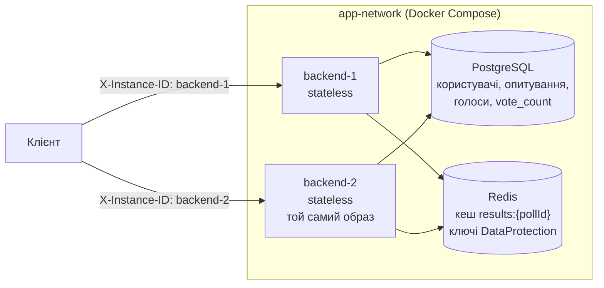
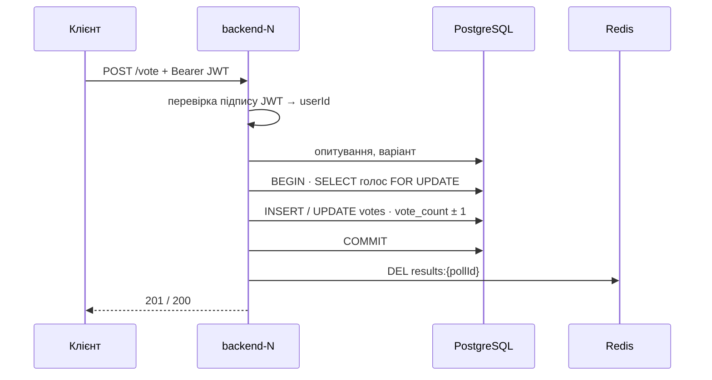

# Лабораторна робота № 2 — Stateless-архітектура

**Платформа опитувань** · Учасник 1 — платформа (інфраструктура, БД, автентифікація, життєвий цикл опитувань) ·
Учасник 2 — ядро голосування (голоси, результати, кеш, обробка помилок)

Стек: ASP.NET Core 10 · PostgreSQL 17 · Redis 8 · Docker Compose. Повний звіт — [README, розділ «Лабораторна 2»](../../README.md#лабораторна-2-stateless-архітектура).

---

## 1. Якщо коротко, то

Бекенд не тримає між запитами нічого, що потрібно наступному запиту: бізнес-дані — у PostgreSQL, спільні тимчасові
дані — у Redis, ідентичність користувача — у JWT на боці клієнта. Аудит знайшов **дві critical-залежності** від
пам'яті процесу — обидві усунено. Два однакові інстанси з одного образу обслуговують будь-який запит; аварійна
зупинка інстансу посеред голосування **не втрачає і не дублює жодного голосу**.

## 2. Архітектура



| Де живе стан | Що саме |
|---|---|
| PostgreSQL | користувачі, опитування, варіанти, голоси, лічильники `vote_count` — джерело правди |
| Redis | кеш агрегованих результатів (спільний для всіх інстансів), ключі DataProtection |
| JWT у клієнта | хто такий користувач — сесій на сервері немає |
| Процес (навмисно локальне) | `X-Instance-ID`, пул з'єднань, логи — діагностика й інфраструктура, не бізнес-стан |

## 3. Аудит стану (2.1)

| Категорія | Що знайшли |
|---|---|
| **Ephemeral / Local Safe** | scoped-сервіси й `DbContext`; singleton без змінних полів (`JwtTokenService`, `PasswordHasher`, `ResultsCache` після переносу); константи; пул з'єднань; логи |
| **Shared / Externalized** | усі дані в PostgreSQL; `vote_count ± 1` у SQL; «один голос» — `UNIQUE(poll_id, user_id)` у БД; серіалізація змін голосу — `FOR UPDATE` у БД; сід — `pg_advisory_xact_lock`; JWT замість сесій; однаковий секрет JWT на всіх інстансах |
| **Critical Stateful Dependencies** | ① кеш результатів в `IMemoryCache` кожного процесу; ② ключі DataProtection у файловій системі контейнера — **обидва усунено** |

**Аудит коду** — не «на око», а пошуком усіх конструкцій, що можуть тримати стан у процесі:

```bash
grep -rnE "\bstatic\b|AddSingleton|AddHostedService|IMemoryCache|AddMemoryCache|Concurrent[A-Z]|lock *\(|SemaphoreSlim|Interlocked|Timer|BackgroundService|\bFile\.|Directory\.|Session|ThreadStatic|AsyncLocal|AddExceptionHandler" src/PollingPlatform.Api --include=*.cs | grep -v /Migrations/
```

Кожен збіг пояснено в README «Аудит коду». **Жодного** `IMemoryCache`, `lock`, `Concurrent*`, таймера, фонового
сервісу, роботи з файлами чи сесій; до лаби 2 той самий пошук знаходив `AddMemoryCache()`.

## 4. Усунені залежності від пам'яті процесу (2.2)

**① Кеш результатів → Redis** ([ADR 0026](../ai/decisions/0026-results-cache-in-redis.md)). Було: голос через
`backend-1` інвалідував кеш лише в `backend-1`, тож `backend-2` до 10 с віддавав старі числа, а щойно опубліковане
опитування — взагалі **404** (у кеші лежав статус `draft`). Стало: ключ `results:{pollId}` у Redis, TTL 10 с,
`DEL` після коміту голосу та при publish / close / delete — одна інвалідація для всіх інстансів.

| Демо `scripts/results-cache-demo.py` | До (кеш у процесі) | Після (кеш у Redis) |
|---|---|---|
| Голос через backend-1 → результати з backend-2 одразу | старі числа до 10 с | нові числа, той самий `generatedAt` на обох |
| Publish через backend-1 → сторонній читає з backend-2 | **404** до 10 с | 200 |

**② Ключі DataProtection → Redis** ([ADR 0023](../ai/decisions/0023-dataprotection-keys-in-redis.md)). Кожен
контейнер генерував свої ключі у власній файловій системі — захищене одним інстансом інший не розшифрував би.
Тепер один набір ключів у Redis і однакова назва застосунку на всіх інстансах.

**Нова залежність — нова відмова: Redis недоступний** ([ADR 0027](../ai/decisions/0027-redis-unavailable.md)):
читання результатів — 503 з ProblemDetails (не 500); голос, уже закомічений у PostgreSQL, повертає 201, а не
помилку; після старту Redis усе працює без перезапуску backend.

## 5. Stateless Request Flow: `POST /api/polls/{id}/vote` (2.3)

| Вимога | Як у нас |
|---|---|
| Вхідні параметри й токен | `Authorization: Bearer <JWT>` → `userId` з підпису (секрет з env, однаковий на всіх); `pollId` з маршруту, `optionId` з тіла |
| Читання зі shared storage | PostgreSQL: статус і часове вікно опитування, `allowVoteChange`, чи належить варіант опитуванню |
| Атомарні зміни | одна транзакція: голос `FOR UPDATE` → `INSERT` або зміна голосу → `vote_count ± 1` → `COMMIT`; після коміту — `DEL results:{pollId}` у Redis |
| Нічого в пам'яті після відповіді | `VoteService` і `DbContext` scoped — знищуються разом із запитом; наступний запит може піти на інший інстанс |



## 6. Кілька інстансів і узгодженість між ними (2.4, 2.5)

- **Два інстанси з одного образу** — один YAML-якір у compose, відрізняються лише `INSTANCE_ID`; заголовок
  `X-Instance-ID` у кожній відповіді ([ADR 0021](../ai/decisions/0021-redis-and-two-backend-instances.md),
  [0012](../ai/decisions/0012-instance-id-and-health.md)).
- **Одночасний старт на порожній БД** — 12 холодних стартів: міграції й сід рівно один раз (500 користувачів,
  50 опитувань), окремий «мігратор» не потрібен ([ADR 0022](../ai/decisions/0022-concurrent-startup-verified.md)).
- **Cross-Instance Consistency без sticky sessions** — `scripts/cross-instance.sh`, 8 кроків, **8 / 8**:

| # | Запит | Інстанс | Результат |
|---|---|---|---|
| 1–2 | логін, створення опитування | backend-1 | токен, `draft` |
| 3–4 | читання, publish | backend-2 | токен від іншого інстансу прийнято → `active` |
| 5–6 | читання, результати | backend-1 / backend-2 | `active`, `totalVotes = 0` |
| 7–8 | голос → результати | backend-1 → backend-2 | одразу `totalVotes = 1` |

- **Конкурентні голоси через обидва процеси** — `scripts/concurrency-checks.py`: 200 користувачів одночасно → усі
  201; один користувач 40 паралельних змін → рівно один рядок голосу; зустрічні зміни A→B і B→A → без deadlock;
  лічильники по кожному варіанту = кількості голосів.

## 7. Втрата інстансу посеред голосування (2.5)

`scripts/kill-test.py`: 400 користувачів × 2 опитування = **800 голосів**, 32 потоки, після 10 % —
`docker compose kill backend-1`.

| Перевірка | Результат |
|---|---|
| Кожен голос записано рівно один раз (рядків `votes` = користувачів) | ✓ 800 з 800 |
| Лічильники по кожному варіанту = рядкам голосів | ✓ 0 розбіжностей |
| Обірвані транзакції | PostgreSQL сам відкотив незакомічені — «голосу без лічильника» не буває |
| Повтор голосу, що встиг закомітитись | 409 від `UNIQUE` — подвійного голосу немає |
| Інстанс після `docker compose start` | здоровий за 2–3 с і **одразу** віддає ті самі результати — без «прогріву» |

## 8. Live-демо

```bash
docker compose down -v
docker compose -f docker-compose.yml -f docker-compose.debug.yml up -d --build   # backend-1 :8091, backend-2 :8092
export API1=http://127.0.0.1:8091 API2=http://127.0.0.1:8092
curl -i http://localhost:8091/health          # X-Instance-ID: backend-1
curl -i http://localhost:8092/health          # X-Instance-ID: backend-2
I1=http://localhost:8091 I2=http://localhost:8092 bash scripts/cross-instance.sh    # 8 / 8
python scripts/results-cache-demo.py          # «no» двічі — кеш спільний
python scripts/kill-test.py                   # аварійна зупинка під час голосування
```

> З лаби 3 перед інстансами стоїть балансувальник, і `kill-test.py` голосує через нього — вузол обирає HAProxy, а не
> клієнт. Рівно той код, що був на кінець лаби 2: `git switch --detach 2633293` (інстанси на :8080 / :8082).

## 9. Теорія

**Stateless ≠ «без даних».** Даних багато, але між запитами їх немає в пам'яті процесу. Тому будь-який інстанс
можна вбити, перезапустити або додати без втрати даних і без «прогріву».

**Ризики прихованої affinity** — коли відповідь мовчки залежить від того, на який інстанс потрапив запит:

| Ризик | Як проявляється | У нас |
|---|---|---|
| Локальний кеш | інстанси віддають різні дані | був — перенесено в Redis |
| Sticky sessions | маскують локальний стан; падіння вузла = втрата сесії; нерівне навантаження | не використовуємо — JWT |
| Різні секрети / ключі на інстансах | токен або cookie працює лише там, де виданий | однаковий секрет з env; ключі DataProtection у Redis |
| Файли в контейнері | зникають з контейнером, невидимі іншим | немає |
| Лічильники, rate limit у пам'яті | кожен інстанс рахує своє, ліміт × N | `vote_count` у PostgreSQL |
| `lock` / `SemaphoreSlim` у процесі | не серіалізують запити між інстансами | `FOR UPDATE` і advisory lock у БД |
| Фонові задачі, WebSocket | дублювання на кожному інстансі; з'єднання прив'язане до вузла | немає; для лайв-дашборду знадобиться backplane (Redis pub/sub) |

**Чесні межі (тема лаби 4):** результат, порахований до коміту голосу, може потрапити в кеш уже після інвалідації —
застарілість до 10 с; повного fallback на БД при падінні Redis ще немає.
