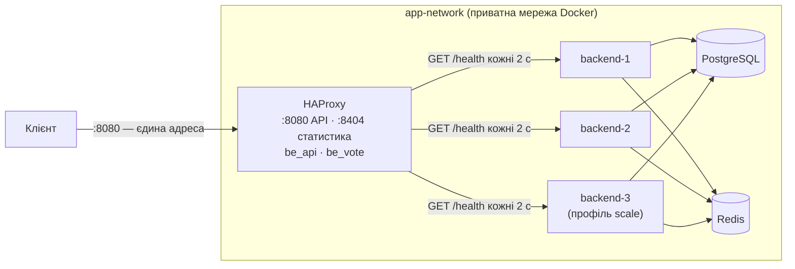
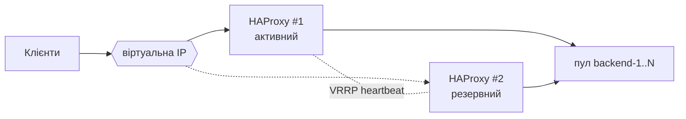

# Лабораторна робота № 3 — Горизонтальне масштабування і балансування навантаження

**Платформа опитувань** · Учасник 1 — балансувальник, пул інстансів, health checks, алгоритми ·
Учасник 2 — експерименти з навантаженням, відмова вузла під час голосування, scale-out, bottleneck

Стек: HAProxy 3.4 · ASP.NET Core 10 · PostgreSQL 17 · Redis 8 · Docker Compose. Повний звіт —
[README, розділ «Лабораторна 3»](../../README.md#лабораторна-3-горизонтальне-масштабування), конфіг —
[`haproxy/haproxy.cfg`](../../haproxy/haproxy.cfg).

---

## 1. Результат одним абзацом

Перед пулом із 2–3 stateless-інстансів стоїть **HAProxy — єдина точка входу**; інстанси ззовні недоступні. Алгоритм
балансування перемикається наживо однією командою. Активні й пасивні health checks виключають вузол за
**0.3–1.2 с**, а повтори на живий вузол дають **0 помилок у клієнта** при `stop` і `kill` вузла — і для читання, і
для голосування. Для нашого профілю навантаження найкращий — **Least Connections** (з повільним вузлом ×6
пропускної здатності проти Round Robin). Після масштабування compute-шару наступне обмеження — **рядкові
блокування гарячих лічильників у PostgreSQL**.

## 2. Архітектура



- Назовні відкриті лише порти балансувальника; `backend-N` доступні тільки всередині `app-network` (2.2).
- `backend-3` додається командою `docker compose --profile scale up -d` — HAProxy знаходить його через Docker DNS
  сам, без перезапуску.
- Дві секції: `be_api` — увесь трафік; `be_vote` — `POST /api/polls/{id}/vote` з повтором уже відправленого голосу.

**Чому HAProxy, а не Nginx:** у безкоштовному HAProxy є активні health checks по `/health`, пасивні перевірки, усі
алгоритми з методички і сторінка статистики; у відкритому Nginx активних перевірок немає (лише в платному NGINX Plus).

## 3. Алгоритми балансування (2.3)

Перемикання наживо, без перезбирання і перезапуску контейнера (м'який reload, 0 помилок під навантаженням):

```bash
bash scripts/lb-algorithm.sh leastconn        # roundrobin | leastconn | weighted | source
python scripts/lb-distribution.py             # 300 запитів → розподіл по X-Instance-ID
```

| Алгоритм | Однакові вузли: 2 / 3 інстанси | Повільний вузол (+200 мс): частка на нього · RPS · p95 · p99 | Коли обирати |
|---|---|---|---|
| Round Robin | 50 / 50 · 33 / 33 / 33 % | 50 % · ≈ 300 · 209 мс · ≈ 215 мс | однакові вузли, однакові короткі запити |
| **Least Connections** | 53 / 47 · 31 / 34 / 35 % | **2.5 % · 1 700–2 000 · 23–28 мс** · ≈ 215 мс | запити різної тривалості, вузол може деградувати |
| Weighted 3 : 1 | 75 / 25 · 60 / 20 / 20 % | частку задає вага, а не стан вузла | вузли різної відомої потужності |
| IP Hash (`source`) | 0 / 100 · 0 / 100 / 0 % | — | лише для stateful-сервісів |

**Експеримент з асиметричним навантаженням** (2.3.3): `backend-2` сповільнено middleware на 200 мс на кожен запит
(крім `/health` — вузол «повільний, але живий»), 32 потоки × 20 с, 3 прогони кожного алгоритму.

- **Round Robin** не бачить повільного вузла: половина клієнтів чекає 200 мс, швидкий вузол простоює (CPU ≈ 35 %).
- **Least Connections** бачить, що повільний вузол довше тримає з'єднання, і шле нові запити на швидкий: RPS ×6,
  p95 ×8 нижчий, швидкий вузол завантажений повністю (CPU ≈ 255 %).
- **p99 однаковий** (≈ 215 мс): на повільний вузол усе одно йде 2.5 % запитів, а це більше за 1 %. Щоб прибрати
  хвіст, вузол треба виводити з пулу або знижувати йому вагу.
- **IP Hash** віддав усе одному вузлу: усі запити з хоста приходять з однієї адреси шлюзу Docker — так само, як
  тисячі клієнтів за NAT.

**Вибір для нашої системи — Least Connections:** тривалість запитів дуже різна (читання з кешу — мілісекунди, голос у
гаряче опитування під блокуванням — до секунди), а на однакових вузлах він поводиться як Round Robin.

## 4. Health checks і відмовостійкість (2.4)

| Механізм | Налаштування | Що дає |
|---|---|---|
| `GET /health` | `SELECT 1` до PostgreSQL з таймаутом 2 с; 200 або 503 | статус готовності; Redis навмисно не перевіряється |
| Активна перевірка | кожні 2 с, 2 невдачі → поза пулом, 2 успіхи → назад | вузол без БД (degraded) виключається сам |
| Пасивна перевірка | `observe layer4` | перша ж помилка з'єднання на живому запиті виключає вузол |
| Повтор, коли не вдалося з'єднатися | `retries 2` + `option redispatch` | на інший вузол, безпечно для будь-якого методу |
| Повтор обірваного запиту | GET — у `be_api`; голос — у `be_vote` | POST загалом не повторюємо (дубль опитування); голос — безпечно |

**Чому повтор голосу безпечний:** голос і лічильник — одна транзакція: на вбитому вузлі вона або закомічена цілком,
або відкочена PostgreSQL. Повтор після коміту отримує 409 від `UNIQUE(poll_id, user_id)` — подвійного голосу не буває.

**«Пастка 503» — свідомо обійдена:** API чесно віддає 503, коли недоступні Redis або БД, — з усіх інстансів
одночасно. Якби балансувальник вважав це відмовою вузла, падіння Redis вимкнуло б увесь пул. Тому 5xx не
спостерігаються і не повторюються.

**Відмова вузла — результати** (2 інстанси, потік запитів, посеред — `docker compose stop` / `kill` вузла):

| Сценарій | Прогонів | Помилок у клієнта | Вузол поза пулом через | Дані |
|---|---|---|---|---|
| Читання | 2 × stop + 2 × kill, ≈ 76 тис. запитів | **0** | 0.34 – 0.52 с | — |
| Голосування | 6 × kill + 1 × stop, 5 600 голосів | **0** | 0.9 – 1.2 с | кожен голос рівно один раз, лічильники узгоджені |
| Падіння Redis | 2 | 0 «чужих» — клієнт бачить 503 від API, вузли лишаються в пулі | — | голос записано один раз |
| Падіння PostgreSQL | 1 | 503 від HAProxy за ~3 мс замість 13–19 с очікування | ~4.6 с (усі вузли) | — |

Як це покращувалось для голосування (той самий тест, 800 голосів, `kill` вузла):

| Конфігурація | Помилок у клієнта | Вузол поза пулом |
|---|---|---|
| Лише TCP-перевірки, без повторів на інший вузол | 52, 16 голосів втрачено | 11.2 с |
| + `/health`, `redispatch`, пасивна перевірка | 6 × 502 | 0.9 с |
| + окрема секція `be_vote` з повтором голосу і буферизацією запиту | **0** | **0.9–1.2 с** |

Після `docker compose start` вузол повертається в пул сам за 4–8 с (майже весь час — старт ASP.NET) і одразу
віддає ті самі дані — стану, який треба «прогрівати», в інстансі немає.

## 5. Scale-out і наступний bottleneck (2.5)

На одній машині (24 ядра) контейнери без лімітів CPU ділять одне залізо: один інстанс сам обробляв ≈ 5 000 читань/с,
тож 1, 2, 3 інстанси давали однаковий результат. Щоб змоделювати «інстанс = окремий сервер», кожному backend
обмежили CPU одним ядром:

| Інстансів | Читання, RPS | p99 читання | Запис, RPS | Сесій PostgreSQL у черзі на `Lock` |
|---|---|---|---|---|
| 1 | 1 491 | 167 мс | 108 (backend на 96 % CPU) | — |
| 2 | 2 785 (× 1.87) | 116 мс | 153 | 26 з ≈ 28 |
| 3 | 3 218 (× 2.16) | 106 мс | 242 → далі стеля ≈ 250–300 | 26–29 з ≈ 30 |

- **Читання масштабується** — воно не торкається PostgreSQL (результати з кешу Redis), інстанси нічого не ділять.
- **Запис упирається в ≈ 250–300 RPS** незалежно від кількості інстансів.

| Кандидат з методички | Що показали заміри | Обмежує? |
|---|---|---|
| **Shared Storage Locks** | майже всі активні сесії PostgreSQL чекають на рядкове блокування `options.vote_count` гарячого опитування | **так — головне обмеження запису** |
| Database connection pool | 77–79 з'єднань на трьох інстансах при бюджеті 90 | поки ні — наступне: кожен інстанс +30 з'єднань, ліміт 100 |
| CPU Load Balancer | ≈ 3 ядра з 24 при ≈ 5 000 RPS | ні |
| Network I/O | усе в межах одного хоста, відповіді ≈ 0.5 КБ | ні |

Масштабування compute-шару не прискорює спільне сховище: транзакції, що змінюють один рядок, PostgreSQL виконує по
черзі. Шляхи далі — кеш читань (лаба 4), шардований лічильник (кілька рядків замість одного), пакетне / асинхронне
оновлення лічильників, PgBouncer для з'єднань.

## 6. Live-демо (процедура захисту)

```bash
docker compose down -v && docker compose up -d --build     # холодний старт; статистика: http://localhost:8404/stats
curl -i http://localhost:8080/health                        # X-Instance-ID чергується
curl http://localhost:8082/health                           # connection refused — інстанси ззовні недоступні
```

| Пункт процедури | Команда | Що видно |
|---|---|---|
| 1. Розподіл по Instance ID | `python scripts/lb-distribution.py` | 50 / 50, збігається зі сторінкою статистики |
| 2. Live-переключення алгоритму | `bash scripts/lb-algorithm.sh leastconn` / `weighted` + `lb-distribution.py` | 0 помилок під час reload; weighted ≈ 75 / 25 |
| 2a. Різниця в поведінці | повільний вузол + `python scripts/load.py --scenario read` для RR і LC | RR ≈ 300 rps 50 / 50 → LC ≈ 1 750 rps 97 / 3 |
| 3. Симуляція аварії — читання | `python scripts/lb-failover.py --kill` | `client saw 0 non-2xx`, вузол DOWN за ≈ 0.5 с, потім UP сам |
| 3. Симуляція аварії — голосування | `python scripts/kill-test.py` | `errors the client saw: 0`, `ALL CHECKS PASSED` |
| Scale-out | `docker compose --profile scale up -d` + `lb-distribution.py` | `backend-3` у пулі за ~9 с, 33 / 33 / 33 |

## 7. Single Point of Failure — сам балансувальник

Один HAProxy: якщо він упав, система недоступна, хоч усі backend-и живі.



| Спосіб | Як працює | Обмеження |
|---|---|---|
| **Keepalived / VRRP** | два балансувальники ділять віртуальну IP; активний шле heartbeat, при його падінні резервний забирає VIP за 1–3 с | потрібна спільна L2-мережа; active-passive — резервний простоює |
| **DNS Round Robin** | кілька A-записів на різні балансувальники | DNS кешується (TTL), немає health check-ів — клієнт може ходити на мертву адресу |
| Керований хмарний LB | балансувальник як сервіс у кількох зонах доступності | залежність від провайдера |

Після усунення SPOF балансувальника наступними SPOF лишаються PostgreSQL і Redis (по одному екземпляру) — це
реплікація і Redis Sentinel / Cluster, поза межами цієї лаби. У навчальному стенді один HAProxy — свідомо.
