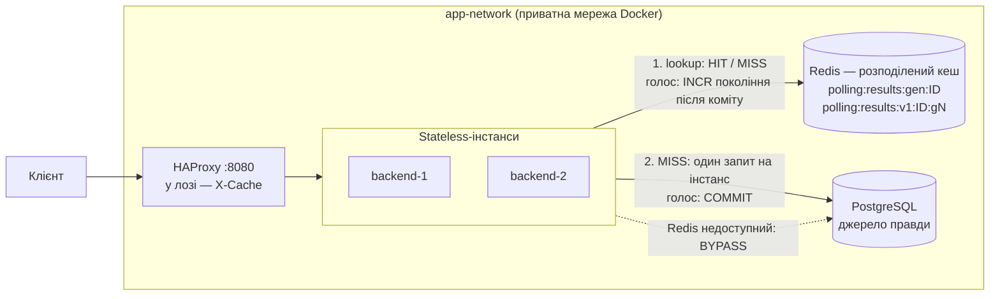

# Лабораторна робота № 4 — Розподілене кешування і узгодженість даних

**Платформа опитувань** · за домовленістю учасників лабу 4 виконав Учасник 1; Учасник 2 — рев'ю

Стек: Redis 8 · HAProxy 3.4 · ASP.NET Core 10 · PostgreSQL 17 · Docker Compose. Повний звіт —
[README, розділ «Лабораторна 4»](../../README.md#лабораторна-4-розподілене-кешування), рішення — ADR 0041–0044 у
[`docs/ai/decisions/`](../ai/decisions/README.md).

---

## 1. Результат одним абзацом

Агреговані результати опитування — найчастіше читання системи — кешуються в **одному Redis, спільному для всіх
інстансів**, за патерном **Cache-Aside**. Ключ містить **покоління** опитування: кожен голос, публікація, закриття чи
видалення після коміту збільшує покоління, тому наступне читання **гарантовано** бачить зміну (перевірено: 0
застарілих читань, тоді як проста інвалідація `DEL` давала їх у кожному прогоні). TTL залежить від статусу опитування
(10 с / 1 год) з розкидом проти Avalanche. Джерело даних видно в заголовку `X-Cache` і в лозі балансувальника. Без
Redis система працює далі, читаючи прямо з PostgreSQL (`X-Cache: BYPASS`, 0 помилок). Проти Cache Stampede —
об'єднання одночасних промахів (single-flight): ≈ 1 звернення до БД на інстанс замість 7–14.

## 2. Архітектура



- Redis — окремий контейнер у тій самій мережі; усі інстанси працюють з одними ключами (2.2). Без збереження на диск:
  після рестарту порожній, тож не може повернути пропущене під час збою.
- Детальна схема компонентів і діаграма послідовності (HIT, MISS, BYPASS, інвалідація) — README «Архітектура з
  шаром кешу».

## 3. Що кешуємо і чому (2.1)

| Ендпоінт | Читання vs запис | Застарілість | Рішення |
|---|---|---|---|
| `GET /polls/{id}/results` | тисячі читань дашборду на одне гаряче опитування | секунди прийнятні | **кешуємо** — відповідь однакова для всіх, без параметрів |
| `GET /polls?…` (каталог) | помірно, не піковий шлях | десятки секунд | ні — видимість залежить від користувача, багато параметрів |
| `GET /polls/{id}` | раз на виборця | статус має мінятися швидко | ні — не на піковому шляху |
| Читання всередині `POST /vote` | тисячі на піку | **жодної**: застарілий `active` пропустить голос у закрите опитування | ні — ризик без виграшу |
| `/auth/login`, `/auth/me`, `/health` | — | — | ні — безпека, персональні дані, живий стан |

## 4. Cache-Aside, ключі і TTL (2.3, 2.4)

1. Lookup: один Lua-скрипт читає покоління і значення. 2. **HIT** — відповідь з Redis, БД не зачіпається.
3. **MISS** — PostgreSQL → `SET … EX` під поколінням, прочитаним до запиту в БД.

| Ключ | Що | TTL |
|---|---|---|
| `polling:results:gen:{pollId}` | покоління: +1 на кожну мутацію | без TTL |
| `polling:results:v1:{pollId}:g{покоління}` | агрегат результатів (JSON) | `active` / `draft` — 10 с, `closed` — 1 год, + 0–20 % |

Шаблон `domain:entity:format:id:state`; `v1` — версія формату значення; хешу параметрів немає, бо відповідь від
параметрів не залежить. TTL — страховка на випадок втраченої інвалідації: довгий лише для закритих опитувань, які вже
не зміняться.

## 5. Інвалідація (2.5)

Голос, publish, close, delete після коміту → `INCR` покоління + видалення старого значення. Наступне читання шукає
нове покоління → MISS → свіжі дані з БД. На відміну від простого `DEL`, покоління закриває гонку «агрегат прочитаний
до коміту, записаний у кеш після інвалідації».

`scripts/cache-race-check.py` — 60 раундів × 8 одночасних голосів, 12 читачів, контрольне читання після кожного:

| Інвалідація | Застарілих читань після 201 (раундів із 60, 5 прогонів) |
|---|---|
| `DEL` | 2, ≥ 3, ≥ 3, 5, 4 |
| **покоління** | **0, 0, 0, 0, 0** |

## 6. Метрики HIT / MISS і cold vs hot (2.6.1, 2.6.2)

```text
$ curl -si localhost:8080/api/polls/1/results | grep -i x-cache
x-cache: MISS
$ docker compose logs lb | grep results          # приклад із прогону 2026-11-02
fe_api be_api/backend-1 0/0/0/51/51 200 ... {MISS} "GET /api/polls/73/results HTTP/1.1"
fe_api be_api/backend-2 0/0/0/5/5   200 ... {HIT}  "GET /api/polls/73/results HTTP/1.1"
```

`scripts/cache-latency.py`, 3 × 500 пар (cold = перше читання після інвалідації, hot = наступне):

| | p50 | p95 | p99 |
|---|---|---|---|
| cold (MISS) | ≈ 3.8 мс | 4.8–5.5 мс | 6.5–8.2 мс |
| hot (HIT) | ≈ 2.0 мс | 2.5–2.7 мс | ≈ 3.7 мс |

Запит до БД дешевий за конструкцією (денормалізований лічильник), тож головний виграш — не мілісекунди, а **відсутність
звернень до БД** при HIT (див. §7).

## 7. Fallback і навантаження (2.6.3)

`docker stop redis` → читання йде прямо в PostgreSQL, клієнт отримує **200 з `X-Cache: BYPASS`**; голоси
записуються; `/health` не залежить від Redis, тож балансувальник не виключає вузли.

| Redis зупинено | До лаби 4 | Лаба 4 |
|---|---|---|
| `GET /results` | 503 через 5.2 с | **200 BYPASS за десятки мс** |
| `POST /vote` | 201 через 5.9 с | 201 за десятки мс (до ~200 мс), наступне читання вже його бачить |
| Після `start redis` | — | MISS → HIT, дані свіжі, рестарт backend не потрібен |

Під навантаженням (24 читачі + 8 виборців, 15 с на фазу, 2 інстанси):

| Фаза | Читань/с | p95 | `X-Cache` | Запитів у БД за читаннями/с | Помилок |
|---|---|---|---|---|---|
| Читання, кеш | **2730** | 16 мс | HIT 100 % | **0** | 0 |
| Читання + голоси, кеш | 1769 | 28 мс | HIT 47 % | 209 (на 116 голосів/с) | 0 |
| Читання, Redis зупинено | 1355 | 39 мс | BYPASS 100 % | 1355 | 0 |
| Читання + голоси, Redis зупинено | 1323 | 35 мс | BYPASS 100 % | 1323 | 0 |

## 8. Cache Stampede і теорія (§4 п. 4)

У нас stampede спричиняє **інвалідація**: кожен голос у гаряче опитування скидає кеш, і всі глядачі промахуються
разом. **Single-flight у процесі** — одночасні промахи інстансу чекають один спільний запит до БД.
`scripts/cache-stampede-check.py`, 100 одночасних читань одразу після інвалідації:

| | Запитів у БД на одну інвалідацію |
|---|---|
| без захисту | 6.7–14.4 (до 98 зі 100) |
| **single-flight** | **≈ 2 на 2 інстанси, ≈ 3 на 3** |

| Тема | Суть | У нас |
|---|---|---|
| Stampede / Thundering Herd | багато одночасних промахів по одному ключу → однакові запити в БД | single-flight; розподілений lock — наступний крок для великої кількості інстансів |
| Avalanche | масове одночасне спливання / падіння всього кешу | jitter TTL 0–20 %, fail-fast + fallback на БД |
| LRU vs LFU | витіснення давно невикористаних vs рідко використовуваних | при ліміті пам'яті — `volatile-lru`: ключі без TTL не витісняються, а старі покоління (часто читані раніше) — першими |
| Expiration vs Invalidation | пасивне спливання за TTL vs активне скидання при зміні | інвалідація — основний механізм, TTL — страховка |

## 9. Live-демо (процедура захисту)

```bash
docker compose down -v && docker compose up -d --build     # холодний старт, без ручних кроків
```

| Пункт процедури | Команда | Що видно |
|---|---|---|
| 1. Cache Hit / Miss | `python scripts/cache-demo.py --pause` (крок 1) | MISS → HIT на іншому інстансі; покоління і TTL у Redis |
| 2. Інвалідація | той самий скрипт (крок 2) | голос → покоління +1 → MISS зі свіжими даними → HIT; close → TTL ≈ 1 год |
| 3. Fallback | той самий скрипт (крок 3) або `docker stop polling-platform-redis-1` | 200 `BYPASS`, голос проходить, `/health` 200; після `start` — MISS → HIT |
| Гарантія свіжості | `python scripts/cache-race-check.py` | `0 of 60` |
| Stampede | `python scripts/cache-stampede-check.py` | ≈ 1 запит до БД на інстанс |
