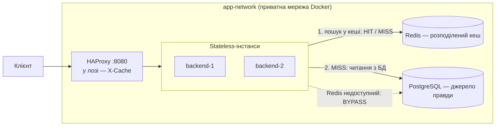

# Лабораторна робота № 4 — Розподілене кешування і узгодженість даних

**Платформа опитувань** · Redis 8 · ASP.NET Core 10 · PostgreSQL 17 · HAProxy 3.4 · Docker Compose

Повний звіт з усіма замірами — [README, розділ «Лабораторна 4»](../../README.md#лабораторна-4-розподілене-кешування).
Рішення — ADR [0041](../ai/decisions/0041-results-cache-target-keys-and-ttl.md) (ключі й TTL),
[0042](../ai/decisions/0042-x-cache-header-and-cache-logs.md) (`X-Cache`),
[0043](../ai/decisions/0043-redis-down-fallback-to-db.md) (fallback),
[0044](../ai/decisions/0044-single-flight-against-cache-stampede.md) (stampede).

---

## 1. Результат

Агреговані результати опитування — найчастіше читання в системі — кешуються в **одному Redis, спільному для всіх
інстансів бекенду**, за патерном **Cache-Aside**. Кожна зміна опитування (голос, публікація, закриття, видалення)
збільшує **покоління** в ключі кешу, тому наступне читання гарантовано бачить зміну: 0 застарілих читань, тоді як
просте видалення ключа давало їх у кожному прогоні. Джерело даних видно в заголовку `X-Cache`. Без Redis система
працює далі, читаючи з PostgreSQL. Одночасні промахи об'єднуються в один запит до БД на інстанс.

## 2. Архітектура



Redis — окремий контейнер у тій самій мережі; усі інстанси працюють з одними ключами. Збереження на диск вимкнене:
після перезапуску Redis порожній і не може повернути запис, інвалідацію якого пропустив під час збою.

**Де в репозиторії:** Redis — [`docker-compose.yml`](../../docker-compose.yml#L90) (`--save ""`); одне з'єднання на
процес — [`Program.cs`](../../src/PollingPlatform.Api/Program.cs#L55); детальна схема й діаграма послідовності — README
«Архітектура з шаром кешу».

## 3. Що кешуємо і чому (2.1)

| Ендпоінт | Читання проти запису | Допустима застарілість | Рішення |
|---|---|---|---|
| `GET /polls/{id}/results` | тисячі читань дашборду на одне гаряче опитування | секунди | **кешуємо** — відповідь однакова для всіх, без параметрів |
| `GET /polls?…` (каталог) | помірно, не піковий шлях | десятки секунд | ні — видимість залежить від користувача, багато параметрів |
| `GET /polls/{id}` | раз на виборця | статус має мінятися швидко | ні — не на піковому шляху |
| Читання всередині `POST /vote` | тисячі на піку | жодної: застарілий `active` пропустив би голос у закрите опитування | ні |
| `/auth/login`, `/auth/me`, `/health` | — | — | ні — безпека, персональні дані, живий стан |

**Де в репозиторії:** обґрунтування — README «Вибір об'єкта кешування», ADR 0041.

## 4. Cache-Aside (2.3)

1. **Пошук у кеші** — один Lua-скрипт у Redis читає покоління і значення за один запит.
2. **HIT** — відповідь із Redis, PostgreSQL не зачіпається.
3. **MISS** — читання з PostgreSQL, запис у Redis з TTL під поколінням, прочитаним **до** запиту в БД, відповідь клієнту.

**Де в репозиторії:**
- алгоритм — [`ResultsService.GetAsync`](../../src/PollingPlatform.Api/Results/ResultsService.cs#L15) (вибір HIT / MISS / BYPASS — рядки 27–36);
- пошук — [`ResultsCache.GetAsync`](../../src/PollingPlatform.Api/Results/ResultsCache.cs#L70), Lua-скрипт [`LookupScript`](../../src/PollingPlatform.Api/Results/ResultsCache.cs#L46);
- запис — [`ResultsCache.SetAsync`](../../src/PollingPlatform.Api/Results/ResultsCache.cs#L97).

## 5. Схема ключів і TTL (2.4)

| Ключ | Що зберігає | TTL |
|---|---|---|
| `polling:results:gen:{pollId}` | покоління: +1 на кожну зміну опитування | без TTL |
| `polling:results:v1:{pollId}:g{покоління}` | агрегат результатів (JSON) | активне / чернетка — 10 с, закрите — 1 год, + випадкові 0–20 % |

- Шаблон `domain:entity:format:id:state`; `v1` — версія формату значення; хешу параметрів немає, бо відповідь від
  параметрів не залежить.
- TTL — страховка на випадок втраченої інвалідації: довгий лише для закритих опитувань, які вже не зміняться.
  Розкид 0–20 % не дає записам, створеним одночасно, одночасно спливти (Cache Avalanche).

**Де в репозиторії:** ключі — [`GenerationKey` / `ValueKeyPrefix`](../../src/PollingPlatform.Api/Results/ResultsCache.cs#L146);
TTL — [`OpenTtl`, `ClosedTtl`, `TtlJitter`](../../src/PollingPlatform.Api/Results/ResultsCache.cs#L36) і
[`TtlFor`](../../src/PollingPlatform.Api/Results/ResultsCache.cs#L140); обґрунтування — ADR 0041.

## 6. Інвалідація (2.5)

Після коміту голосу, публікації, закриття чи видалення покоління опитування збільшується на 1, а значення
попереднього покоління видаляється. Наступне читання шукає нове покоління → MISS → свіжі дані з БД.

Чому покоління, а не просте видалення ключа: при видаленні можлива гонка — агрегат прочитали з БД **до** коміту
голосу, а записали в кеш **після** видалення, і застарілі числа висять до кінця TTL. З поколіннями такий запис лягає
під старе покоління, яке вже ніхто не читає.

| Інвалідація (`scripts/cache-race-check.py`, 60 раундів × 8 одночасних голосів, 12 читачів) | Раундів із застарілим читанням, п'ять прогонів |
|---|---|
| видалення ключа (`DEL`) | 2, ≥ 3, ≥ 3, 5, 4 |
| **покоління** | **0, 0, 0, 0, 0** |

**Де в репозиторії:**
- скрипт інвалідації — [`InvalidateScript`](../../src/PollingPlatform.Api/Results/ResultsCache.cs#L53), метод [`InvalidateAsync`](../../src/PollingPlatform.Api/Results/ResultsCache.cs#L119);
- виклики після коміту — голос: [`VoteService.cs`](../../src/PollingPlatform.Api/Votes/VoteService.cs#L31); publish / close / delete: [`PollService.cs`](../../src/PollingPlatform.Api/Polls/PollService.cs#L95) (рядки 95, 109, 129);
- перевірка — [`scripts/cache-race-check.py`](../../scripts/cache-race-check.py), README «Інвалідація».

## 7. Метрики HIT / MISS і холодний проти гарячого запиту (2.6.1, 2.6.2)

Кожна відповідь `GET /results` має заголовок `X-Cache`: `HIT` (з Redis), `MISS` (з БД, тепер закешовано), `BYPASS`
(Redis недоступний). Те саме значення HAProxy пише у свій лог.

```text
$ curl -si localhost:8080/api/polls/1/results | grep -i x-cache
x-cache: MISS
$ docker compose logs lb | grep results
fe_api be_api/backend-1 0/0/0/51/51 200 ... {MISS} "GET /api/polls/73/results HTTP/1.1"
fe_api be_api/backend-2 0/0/0/5/5   200 ... {HIT}  "GET /api/polls/73/results HTTP/1.1"
```

| `scripts/cache-latency.py`, 3 × 500 пар | p50 | p95 | p99 |
|---|---|---|---|
| холодний (MISS) | ≈ 3.8 мс | 4.8–5.5 мс | 6.5–8.2 мс |
| гарячий (HIT) | ≈ 2.0 мс | 2.5–2.7 мс | ≈ 3.7 мс |

Запит до БД дешевий за конструкцією (результати — сума готових лічильників `vote_count`), тож головний виграш кешу —
відсутність звернень до БД: 2 730 читань/с з кешем — 0 запитів до PostgreSQL.

**Де в репозиторії:** заголовок — [`ResultsController.cs`](../../src/PollingPlatform.Api/Results/ResultsController.cs#L20);
лог HAProxy — [`haproxy.cfg`](../../haproxy/haproxy.cfg#L39) (`capture response header X-Cache`); заміри —
[`scripts/cache-latency.py`](../../scripts/cache-latency.py), README «`X-Cache` і логування», «Cold vs Hot».

## 8. Fallback: Redis недоступний (2.6.3)

`docker stop redis` → читання йде прямо в PostgreSQL, клієнт отримує **200 з `X-Cache: BYPASS`**; голоси
записуються; `/health` від Redis не залежить, тож балансувальник не виключає вузли.

| Redis зупинено | До лаби 4 | Лаба 4 |
|---|---|---|
| `GET /results` | 503 через 5.2 с | **200 BYPASS за десятки мс** |
| `POST /vote` | 201 через 5.9 с | 201 за десятки мс, наступне читання вже його бачить |
| Після `start redis` | — | MISS → HIT, дані свіжі, перезапуск backend не потрібен |

| Під навантаженням (24 читачі + 8 виборців, 2 інстанси) | Читань/с | p95 | `X-Cache` | Запитів у БД від читань/с | Помилок |
|---|---|---|---|---|---|
| Читання, кеш | 2 730 | 16 мс | HIT 100 % | 0 | 0 |
| Читання + голоси, кеш | 1 769 | 28 мс | HIT 47 % | 209 | 0 |
| Читання, Redis зупинено | 1 355 | 39 мс | BYPASS 100 % | 1 355 | 0 |

**Де в репозиторії:** перехід на БД — [`ResultsService.cs`](../../src/PollingPlatform.Api/Results/ResultsService.cs#L36)
(гілка `Bypass`), обробка недоступного Redis — [`ResultsCache.GetAsync`](../../src/PollingPlatform.Api/Results/ResultsCache.cs#L70);
швидка відмова клієнта (fail-fast, таймаут 1 с) — [`Program.cs`](../../src/PollingPlatform.Api/Program.cs#L51);
перевірка — [`scripts/redis-outage-check.py`](../../scripts/redis-outage-check.py), README «Fallback: Redis недоступний», ADR 0043.

## 9. Cache Stampede (§4)

Кожен голос у гаряче опитування скидає кеш, і всі глядачі одночасно промахуються. **Single-flight**: одночасні
промахи в межах інстансу чекають один спільний запит до БД.

| `scripts/cache-stampede-check.py`, 100 одночасних читань після інвалідації | Запитів у БД на одну інвалідацію |
|---|---|
| без захисту | 6.7–14.4 (до 98 зі 100) |
| **single-flight** | **≈ 2 на 2 інстанси, ≈ 3 на 3** |

**Де в репозиторії:** [`ResultsSingleFlight.cs`](../../src/PollingPlatform.Api/Results/ResultsSingleFlight.cs#L23),
виклик — [`ResultsService.cs`](../../src/PollingPlatform.Api/Results/ResultsService.cs#L33); README «Захист від Cache
Stampede», ADR 0044.

## 10. Теорія (§4 п. 4)

| Тема | Суть | У нас |
|---|---|---|
| Stampede / Thundering Herd | багато одночасних промахів по одному ключу → однакові запити в БД | single-flight у процесі |
| Avalanche | масове одночасне спливання записів або падіння всього кешу | розкид TTL 0–20 %, fail-fast + fallback на БД |
| LRU vs LFU | витіснення давно невикористаних vs рідко використовуваних записів | при ліміті пам'яті — `volatile-lru`: лічильники поколінь без TTL не витісняються, старі покоління — першими |
| Expiration vs Invalidation | пасивне спливання за TTL vs активне скидання при зміні | інвалідація — основний механізм, TTL — страховка |

## 11. Live-демо

```bash
docker compose down -v && docker compose up -d --build     # холодний старт, без ручних кроків
```

| Пункт процедури | Команда | Що видно |
|---|---|---|
| 1. Cache Hit / Miss | `python scripts/cache-demo.py --pause` (крок 1) | MISS → HIT на іншому інстансі; покоління і TTL у Redis |
| 2. Інвалідація | той самий скрипт (крок 2) | голос → покоління +1 → MISS зі свіжими даними → HIT |
| 3. Fallback | той самий скрипт (крок 3) | Redis зупинено → 200 `BYPASS`, голос проходить; після запуску — MISS → HIT |
| Свіжість після запису | `python scripts/cache-race-check.py` | `0 of 60` |
| Stampede | `python scripts/cache-stampede-check.py` | ≈ 1 запит до БД на інстанс |

**Де в репозиторії:** [`scripts/cache-demo.py`](../../scripts/cache-demo.py).
