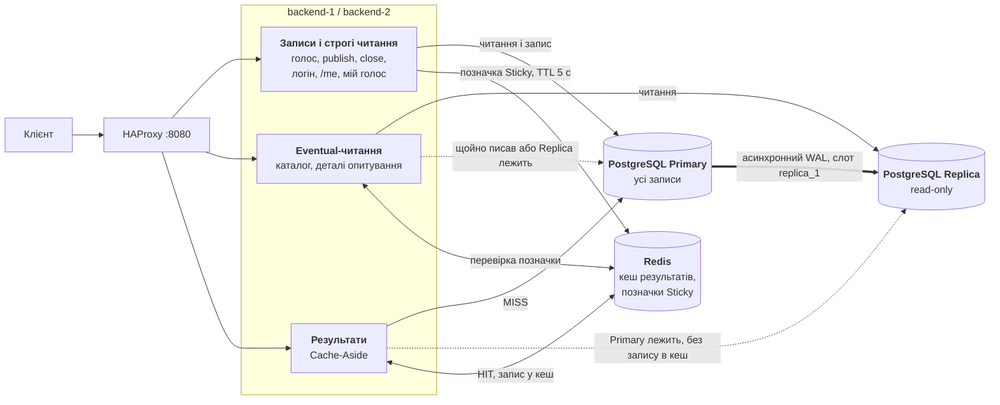
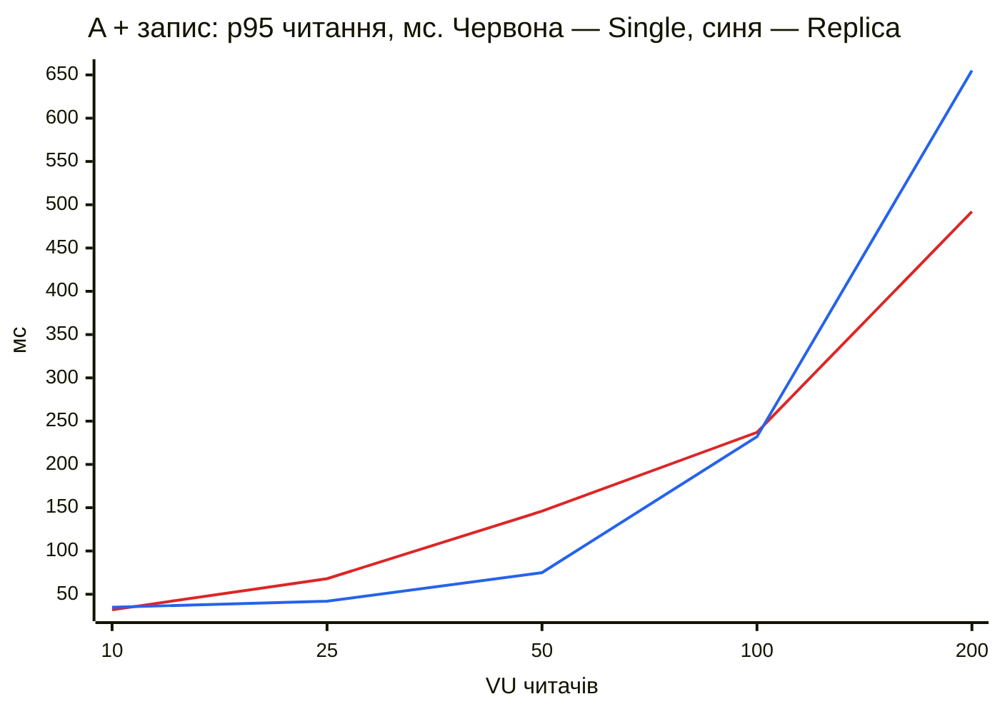
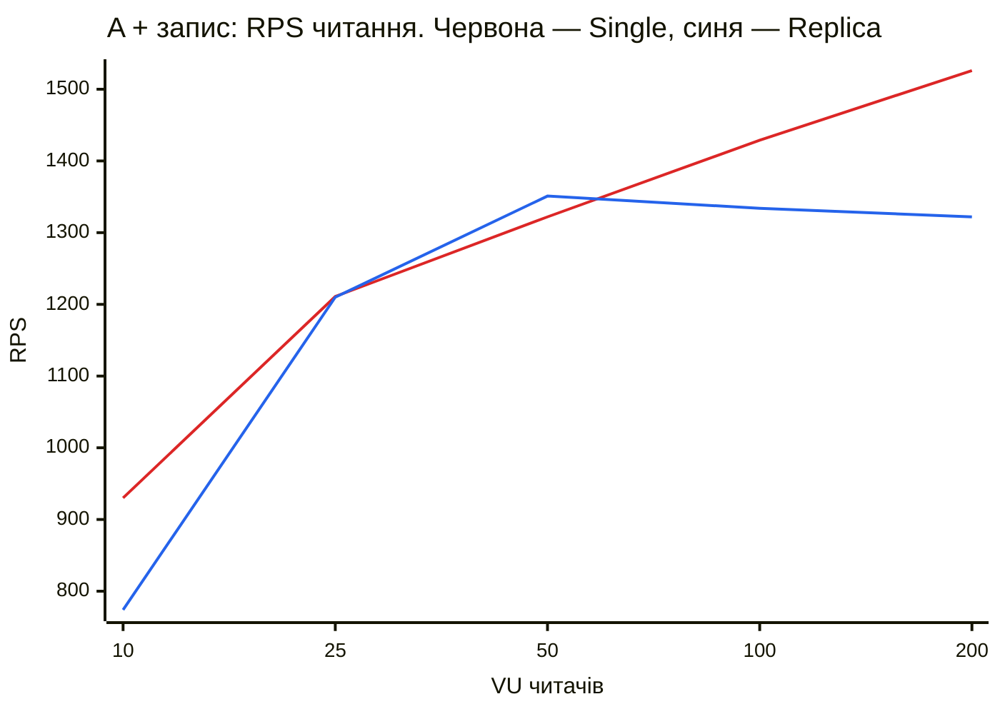

# Лабораторна робота № 6 — Реплікація БД і розділення читання та запису

**Платформа опитувань** · PostgreSQL 17 (потокова реплікація) · ASP.NET Core 10 + EF Core · Redis 8 · HAProxy 3.4 · k6 1.3.0 · Docker Compose

Повний звіт — [README, розділ «Лабораторна 6»](../../README.md#лабораторна-6-реплікація-бд-і-розділення-читання-та-запису); результати кожного окремого прогону навантаження — [`docs/lab6/load-comparison.md`](../lab6/load-comparison.md).
Рішення — ADR [0049](../ai/decisions/0049-primary-replica-topology.md) (топологія), [0050](../ai/decisions/0050-read-write-separation.md) (маршрутизація),
[0051](../ai/decisions/0051-read-after-write-sticky-routing.md) (Read-After-Write), [0052](../ai/decisions/0052-db-node-failures.md) (відмови), [0053](../ai/decisions/0053-replica-load-comparison.md) (вимірювання).

Кожен розділ побудовано однаково: **вимога методички → що зроблено → результат перевірки в числах → де це в репозиторії.**

---

## 1. Результат коротко

| Вимога | Результат |
|---|---|
| 2.1 Primary / Replica | два вузли PostgreSQL, асинхронна потокова реплікація, старт однією командою за 18 с |
| 2.2 Read/Write Separation | у коді застосунку: Primary за замовчуванням, на репліку — лише дозволені читання; `X-DB-Node` у кожній відповіді |
| 2.3 Класифікація, затримка, Stale Read | Stale Read показано з керованою затримкою 3 с; реальна затримка — від 4 мс на простої до 206 мс під навантаженням |
| 2.4 Read-After-Write | Session Sticky Routing: автор бачить свою зміну одразу, сторонній читач — через 2.5–2.9 с |
| 2.5 Відмови | без репліки та без Primary — **0 помилок читання**; без Primary записи відхиляються з 503 за 9–104 мс |
| 2.6 Порівняння | репліка **не збільшує RPS**, але під змішаним навантаженням **удвічі знижує p95 читання** (146 → 75 мс на 50 VU) і прискорює запис на 40 %; ціна — −26 % RPS чистого запису на 10 VU |

## 2. Архітектура: топологія БД і потоки читання та запису (§3)



Суцільні лінії — звичайний шлях, пунктирні — запасний (користувач щойно писав або вузол лежить). Який вузол живий, у кожному backend-і щосекунди перевіряє `DbNodeMonitor` (розділ 6).

## 3. Топологія реплікації (2.1)

**Вимога:** Primary приймає мутації, Replica у режимі read-only відтворює журнал (WAL); показати, що мутації на Primary з'являються на Replica.

**Що зроблено:**

| Вузол | Роль | Налаштування |
|---|---|---|
| `postgres` | Primary, усі записи | `wal_level=replica`, роль `replicator` лише для реплікації, фізичний слот `replica_1`, `max_slot_wal_keep_size=1GB` |
| `postgres-replica` | read-only, асинхронно відтворює WAL | на порожньому томі сама робить `pg_basebackup`, `hot_standby_feedback=on` |

Реплікація **асинхронна**: COMMIT на Primary не чекає репліку. Слот тримає WAL, доки репліка його не забере, тож короткий простій репліки не потребує повторного копіювання.

**Результат перевірки** (`scripts/replication-check.py`, ≈ 11 с):

| Перевірка | Результат |
|---|---|
| Ролі вузлів | `postgres`: `pg_is_in_recovery = f`; `postgres-replica`: `t` |
| Потік WAL (`pg_stat_replication`) | `streaming \| async`, надіслане = відтворене, `replay_lag` 4–12 мс |
| Слот | `replica_1`, активний |
| Міграції й сід, виконані лише на Primary | на обох вузлах однаково: 500 користувачів, 50 опитувань, 177 варіантів, 5596 голосів, 1 міграція |
| INSERT, UPDATE (publish), DELETE через API | усі три з'явилися на репліці за 230–380 мс (разом із запуском `docker compose exec`, тобто верхня межа) |
| Запис напряму в репліку | відхилено: `cannot execute UPDATE in a read-only transaction` |
| `docker compose restart postgres` | репліка сама підключилась знову за ≈ 2 с |
| Зупинка і запуск репліки | наздогнала через слот, без нового `pg_basebackup` |

**Де в репозиторії:** [`docker-compose.yml`](../../docker-compose.yml), [`postgres/primary-init.sh`](../../postgres/primary-init.sh), [`postgres/replica-entrypoint.sh`](../../postgres/replica-entrypoint.sh), [`scripts/replication-check.py`](../../scripts/replication-check.py).

## 4. Read/Write Separation: яка операція на якому вузлі (2.2, 2.3)

**Вимога:** записи — лише на Primary; читання, яким достатньо eventual consistency, — на Replica; маршрутизація програмна або через проксі; перелік бізнес-операцій із поділом на eventual і strict.

**Що зроблено:** маршрутизація в застосунку — два пули з'єднань, по одному на вузол. Увесь код за замовчуванням працює з Primary, а на репліку веде лише окремий клас `ReadDb`. Помилка класифікації коштує зайвого навантаження на Primary, а не застарілих даних. Проксі не підходить: він не відрізнить два однакові `SELECT`, з яких лише один можна виконати на застарілих даних.

> **Правило одним реченням:** усе йде на Primary, крім двох читань — каталогу і деталей опитування, яким можна відстати на кілька мілісекунд; вони йдуть на Replica. Результати — окремий випадок, бо спершу шукаються в кеші (нижче).

### Записи → завжди Primary

Replica лише читає, тож писати можна тільки сюди.

| Ендпоінт | Що робить |
|---|---|
| `POST /api/auth/register` | реєстрація |
| `POST /api/polls` | створення опитування |
| `PATCH /api/polls/{id}/publish` | публікація |
| `PATCH /api/polls/{id}/close` | закриття |
| `DELETE /api/polls/{id}` | видалення чернетки |
| `POST /api/polls/{id}/vote` | голос або зміна голосу |

Разом із записом на Primary виконуються і **перевірки перед ним** (чи активне опитування, чи варіант із цього опитування), і **відповідь після нього** (наприклад, створене опитування). Застаріла перевірка відхилила б голос у щойно опублікованому опитуванні, а застаріла відповідь показала б не те, що записано.

### Читання, які мають бути свіжими (strict) → Primary

| Ендпоінт | Що робить | Чому не з репліки |
|---|---|---|
| `POST /api/auth/login` | вхід | щойно зареєстрований користувач має одразу ввійти |
| `GET /api/auth/me` | профіль поточного користувача | дані користувача мають бути поточні |
| `GET /api/polls/{id}/vote` | «мій голос» | користувач має побачити голос, який щойно віддав |

### Читання, яким можна трохи відстати (eventual) → Replica

| Ендпоінт | Що робить | Чому можна з репліки |
|---|---|---|
| `GET /api/polls` | каталог опитувань | якщо чуже опитування з'явиться в списку на кілька мілісекунд пізніше, нічого не зламається |
| `GET /api/polls/{id}` | деталі опитування | те саме |

### Окремий випадок: результати `GET /api/polls/{id}/results`

Результати спершу шукаються в кеші Redis, тому вузол залежить від ситуації:

| Ситуація | Звідки дані | Чому |
|---|---|---|
| є в кеші (HIT) | Redis, БД не використовується | — |
| немає в кеші (MISS) | **Primary** | результат кладеться в кеш, спільний для всіх; застарілий результат із репліки побачили б усі (виміряно нижче) |
| кеш вимкнено (режим із лаби 5) | Replica | відповідь ніде не зберігається, тож коротке відставання не шкодить |
| Primary лежить | Replica, але в кеш **не** записується | краще трохи застарілі результати, ніж помилка |

### Коли маршрут змінюється

| Ситуація | Що відбувається |
|---|---|
| користувач щойно щось записав | 5 с усі його читання йдуть на Primary, навіть каталог (Session Sticky, розділ 5) |
| лежить Replica | каталог і деталі теж ідуть на Primary (розділ 6) |
| лежить Primary | каталог, деталі й результати читаються з Replica; усе інше відповідає 503 `Read-Only Mode` (розділ 6) |

`GET /health` до БД не звертається: він відповідає зі стану монітора вузлів (розділ 6).

**Результат перевірки** (`scripts/rw-routing-check.py`, ≈ 15 с):

| Операція | `X-DB-Node` |
|---|---|
| каталог, деталі опитування | `replica` |
| логін, `/me` | `primary` |
| створення, publish, голос, «мій голос» | `primary` |
| результати, промах кешу | `primary` |
| результати, влучання в кеш | заголовка немає: БД не використовувалась |

Незалежний доказ — лічильники транзакцій самого PostgreSQL за 300 читань каталогу: **репліка +1206, Primary ≈ +30** (лише фонові перевірки).

**Чому промах кешу читає лише Primary — виміряно.** Тимчасово переключили промах на репліку й запустили `cache-race-check.py` (60 раундів: голос, потім контрольне читання):

| Промах кешу читає з | Застарілих відповідей, без штучної затримки | Із затримкою 200 мс |
|---|---|---|
| Replica (дослід, відкочено) | 11 і 6 раундів із 60 | 60 із 60 |
| Primary (реальний код) | 0 із 60 | 0 із 60 |

**Де в репозиторії:** [`Data/ReadDb.cs`](../../src/PollingPlatform.Api/Data/ReadDb.cs), [`Data/DbNodeTracking.cs`](../../src/PollingPlatform.Api/Data/DbNodeTracking.cs), [`Polls/PollService.cs`](../../src/PollingPlatform.Api/Polls/PollService.cs), [`Results/ResultsSingleFlight.cs`](../../src/PollingPlatform.Api/Results/ResultsSingleFlight.cs), [`scripts/rw-routing-check.py`](../../scripts/rw-routing-check.py).

## 5. Затримка реплікації, Stale Read і Read-After-Write (2.3, 2.4)

**Вимога:** зафіксувати або синтетично відтворити затримку реплікації; показати Stale Read одразу після запису; реалізувати один із механізмів захисту і показати, що він запобігає застарілим даним.

### Реальна затримка реплікації

Виміряно під час серії навантаження, без штучного гальмування (`replay_lag` з `pg_stat_replication`):

| Навантаження | Найбільша затримка |
|---|---|
| Простій | 4–12 мс |
| Лише читання (сценарій A) | 27 мс |
| Лише запис (сценарій B) | 69 мс |
| Читання + запис, до точки насичення (≤ 50 VU) | 206 мс |
| Читання + запис, вище точки насичення (100–200 VU) | від 0.5 с до 29.5 с, великий розкид між прогонами |

На одній машині власна затримка — мілісекунди, тож Stale Read людина не помітить. Для демонстрації затримка **відтворюється синтетично**: на репліці вмикається `recovery_min_apply_delay = 3s`, і вона відтворює кожну транзакцію на 3 с пізніше.

### Механізм захисту

З трьох механізмів методички використано два:
- **Explicit Primary Routing:** критичні читання завжди йдуть на Primary (таблиця розділу 4).
- **Session Sticky Routing:** після успішного запису всі читання цього користувача 5 с ідуть на Primary. Позначка `polling:sticky:{userId}` лежить у Redis, бо наступний запит може обслуговувати інший backend. Ставиться до відправки відповіді, тож клієнт не може її випередити.

Звірку LSN (Read-Your-Own-Writes Verification) не обрано: вона точніша, але потребує зберігати позицію WAL після кожного запису й звіряти її перед кожним читанням.

### Демонстрація (`scripts/stale-read-demo.py`, ≈ 36 с)

**Крок 1. Затримка 3 с, захист увімкнено:**

| Момент | Хто читає | Відповідь | Вузол | Що це показує |
|---|---|---|---|---|
| 0 с | автор створює й публікує опитування | 201, 200 | Primary | запис уже закомічено на Primary |
| одразу | сторонній читач | **404** | Replica | **Stale Read:** репліка ще не має запису, дані вузлів розходяться |
| одразу | автор (двічі) | **200** | Primary, на обох backend-ах | захист працює: позначка в Redis спільна для інстансів |
| через 2.5–2.9 с | сторонній читач | 200 | Replica | репліка відтворила транзакцію |
| через 6 с | автор | 200 | Replica | TTL позначки минув, автор знову читає з репліки |

**Крок 2. Затримка 3 с, захист вимкнено** (`STICKY_TTL_SECONDS=0`): автор одразу після публікації отримує **404 на власне опитування** з репліки. Саме від цього захищає механізм.

**Крок 3. Межа механізму, затримка 8 с при TTL 5 с:** одразу автор бачить опитування з Primary, але через 6 с позначка вже минула, а репліка ще відстає, тож автор отримує 404. **TTL має бути більшим за затримку реплікації.** До точки насичення запас більш ніж 20-кратний (206 мс проти 5 с), вище насичення затримка перевищувала TTL у 2 з 4 прогонів. Це відоме й записане обмеження.

Веб-інтерфейс перевірено в браузері із затримкою 3 с: після створення опитування сторінка відкривається одразу, без 404.

**Де в репозиторії:** [`Data/StickySessions.cs`](../../src/PollingPlatform.Api/Data/StickySessions.cs), [`Data/ReadDb.cs`](../../src/PollingPlatform.Api/Data/ReadDb.cs), [`scripts/stale-read-demo.py`](../../scripts/stale-read-demo.py).

## 6. Відмови вузлів БД (2.5)

**Вимога:** втрата Replica — читання переходять на Primary або контрольована помилка без падіння backend-ів; втрата Primary — записи блокуються з відповідною помилкою (Read-Only Mode), читання з Replica працює.

**Що зроблено:** `DbNodeMonitor` у кожному backend-і щосекунди перевіряє обидва вузли окремим з'єднанням поза пулом, щоб навантаження не виглядало як відмова, і реагує на першу невдалу спробу з'єднання живого запиту. `/health` віддає 503 лише тоді, коли лежать обидва вузли, тому без Primary HAProxy не виключає backend-и. **До цих змін** зупинена репліка давала 503 на читання каталогу через 8.6–10.6 с.

**Результат перевірки** (`scripts/db-failure-check.py`, ≈ 39 с; вузли зупиняються командою `docker compose stop`, у фоні весь час читають 4 клієнти):

| Відмова | Читання каталогу | Інші операції | `/health` | Відновлення після старту вузла |
|---|---|---|---|---|
| **Replica** | 768–807 читань, **0 помилок**, найповільніше 39–152 мс, далі з Primary | запис працює: 201 | 200 `Degraded` | читання знову на репліці за 0.7–1.3 с |
| **Primary** | 1120–1615 читань, **0 помилок**, найповільніше 34–42 мс, з Replica | деталі: 200 з Replica за 8–50 мс; результати: 200 з Replica за 59–85 мс; створення: 503 `Read-Only Mode` за 9–12 мс; голос — за 12–104 мс; логін — за 24–99 мс; `/me` — за 15–35 мс | 200 `Degraded` | записи працюють за 1.3–2.3 с, потік WAL — за 0.3–0.8 с |
| **Обидва** | контрольована 503 | контрольована 503 | 503 через 3.9–4.7 с | за 0.8–1.3 с |

Backend-и не перезапускались у жодному сценарії, лічильники голосів після тесту збігаються. Відповідь Read-Only Mode — це стандартна ProblemDetails: `503`, `title: "Read-Only Mode"`, `detail: "The primary database is unavailable: writes and strictly consistent reads are rejected. Please retry later."`

**Відомі межі:** перший запис одразу після падіння Primary чекає 4–8 с до своєї 503, поки монітор ще не знає про відмову; наступні відхиляються за мілісекунди. Нового лідера автоматично не призначено: методичка вимагає Read-Only Mode, а вибір лідера — теоретичне питання (розділ 8).

**Де в репозиторії:** [`Data/DbNodeMonitor.cs`](../../src/PollingPlatform.Api/Data/DbNodeMonitor.cs), [`Data/ReadDb.cs`](../../src/PollingPlatform.Api/Data/ReadDb.cs), [`scripts/db-failure-check.py`](../../scripts/db-failure-check.py).

## 7. Порівняння продуктивності: Single Primary проти Primary + Replica (2.6)

**Вимога:** скриптами лаби 5 протестувати обидві конфігурації; зафіксувати й порівняти Throughput (RPS), Latency p95 / p99 і точку насичення.

### Як міряли

- **Конфігурації:** Single Primary — репліку зупинено, її слот видалено, усі запити йдуть на один вузол. Primary + Replica — читання каталогу й деталей на репліці.
- **Середовище:** ноутбук i5-9300H (8 логічних потоків), кожен компонент на своєму потоці: backend-и, Primary, Replica, HAProxy — по 1 CPU; k6 — на 2 окремих потоках. Primary і Replica мають однакові ресурси.
- **Профіль лаби 5:** розігрів 20 с, далі 10 → 25 → 50 → 100 → 200 VU по 40 с. Кожен прогін — на чистому стеку, конфігурації чергуються.
- **Сценарії:** A — лише читання (результати, деталі, каталог); A + запис — сценарій A, поки 15 VU постійно голосують; B — лише голосування; C — наскрізний сценарій користувача.
- **Обсяг:** 17 прогонів, **0 % помилок у кожному ступені кожного прогону**. Таблиці нижче — середнє з 1–3 прогонів; кожен прогін окремо — у [`load-comparison.md`](../lab6/load-comparison.md).

У таблицях кожна комірка: **RPS · p95 · p99** (мс). Жирним — точка насичення: далі RPS майже не росте, а затримка росте.

### A: лише читання, кеш увімкнено (по 1 прогону)

| VU | Single Primary | Primary + Replica |
|---|---|---|
| 10 | 1223 · 20 · 29 | 1078 · 23 · 33 |
| 25 | **1816 · 49 · 78** | **1813 · 46 · 71** |
| 50 | 1787 · 122 · 186 | 1894 · 109 · 166 |
| 100 | 1833 · 230 · 335 | 1891 · 216 · 302 |
| 200 | 1870 · 442 · 615 | 1935 · 436 · 612 |

### A: лише читання, кеш вимкнено (середнє з 2 прогонів)

| VU | Single Primary | Primary + Replica |
|---|---|---|
| 10 | 865 · 26 · 36 | 897 · 25 · 38 |
| 25 | **1114 · 50 · 83** | **1115 · 48 · 81** |
| 50 | 1119 · 114 · 174 | 1137 · 108 · 159 |
| 100 | 1145 · 201 · 283 | 1106 · 203 · 293 |
| 200 | 1159 · 453 · 594 | 1120 · 471 · 617 |

### A + запис: читання, поки 15 VU голосують (Single — 2 прогони, Replica — 3)

| VU читачів | Single Primary | Primary + Replica |
|---|---|---|
| 10 | 930 · 32 · 50 | 774 · 35 · 56 |
| 25 | 1211 · 68 · 112 | 1210 · **42** · **66** |
| 50 | **1322 · 146 · 230** | **1351 · 75 · 125** |
| 100 | 1429 · 237 · 409 | 1334 · 232 · 673 |
| 200 | 1526 · 492 · 713 | 1322 · 655 · 1007 |

Самі 15 VU запису за весь прогін:

| | Single Primary | Primary + Replica |
|---|---|---|
| RPS запису | 140 | **196 (+40 %)** |
| p95 запису, мс | 428 | **222** |
| p99 запису, мс | 1021 | **403** |





### B: лише запис (Single — 2 прогони, Replica — 3)

| VU | Single Primary | Primary + Replica |
|---|---|---|
| 10 | **424 · 47 · 67** | **312 · 78 · 136** |
| 25 | 348 · 326 · 656 | 292 · 405 · 840 |
| 50 | 242 · 1165 · 2270 | 217 · 1286 · 2709 |
| 100 | 210 · 1802 · 3530 | 198 · 1950 · 3669 |
| 200 | 198 · 2560 · 4409 | 188 · 2748 · 4635 |

### C: наскрізний сценарій (по 1 прогону)

| VU | Single Primary | Primary + Replica |
|---|---|---|
| 10 | 71 · 13 · 26 | 70 · 15 · 25 |
| 25 | 176 · 15 · 33 | 178 · 12 · 21 |
| 50 | 354 · 18 · 38 | 351 · 18 · 37 |
| 100 | **634 · 84 · 156** | **592 · 135 · 276** |
| 200 | 687 · 447 · 698 | 659 · 469 · 706 |

### Точки насичення

| Сценарій | Single Primary: VU · RPS · p95 · p99 | Primary + Replica: VU · RPS · p95 · p99 | Різниця |
|---|---|---|---|
| A, кеш увімк. | 25 · 1816 · 49 · 78 | 25 · 1813 · 46 · 71 | немає |
| A, кеш вимк. | 25 · 1114 · 50 · 83 | 25 · 1115 · 48 · 81 | немає |
| A + запис | 50 · 1322 · 146 · 230 | 50 · 1351 · **75 · 125** | та сама точка, але **p95 і p99 майже вдвічі менші** |
| B, запис | 10 · 424 · 47 · 67 | 10 · 312 · 78 · 136 | **−26 % RPS**: ціна передачі WAL |
| C, workflow | 100 · 634 · 84 · 156 | 100 · 592 · 135 · 276 | невелика; по одному прогону, тож це не висновок |

### Чому RPS не росте: ресурси на 50 VU

| Сценарій | Конфігурація | CPU backend-ів | CPU Primary | CPU Replica | Транзакцій/с: Primary / Replica |
|---|---|---|---|---|---|
| A, кеш вимк. | Single Primary | 74 % | 86 % | — | 2503 / — |
| A, кеш вимк. | Primary + Replica | 86 % | **2 %** | **97 %** | 5 / 2618 |
| A + запис | Single Primary | 86 % | **98 %** | — | 1867 / — |
| A + запис | Primary + Replica | **97 %** | 75 % | 96 % | 1341 / 1441 |
| C | Primary + Replica | 48 % | 50 % | **6 %** | 1222 / 5 |

- **Лише читання:** уся робота переїжджає на репліку того самого розміру, а Primary простоює на 2 %. Сумарна потужність та сама, тож RPS не змінюється. Щоб масштабувати пропускну здатність, потрібні кілька реплік або читання ще й із Primary.
- **Читання + запис:** у Single Primary читання й запис ділять один CPU (98 %), і читання чекають. З реплікою вони розведені на різні вузли, тож затримка читання падає вдвічі, а запис прискорюється на 40 %. Далі впирається вже CPU backend-ів (97 %), тому RPS теж не росте.
- **Сценарій C:** репліка майже не працює (6 % CPU, 5 транзакцій/с). Користувач голосує в кожній ітерації частіше, ніж раз на 5 с, тож Session Sticky постійно веде його читання на Primary. Це ціна гарантії Read-After-Write.

### Висновок для 2.6

Одна репліка того самого розміру **не підвищує пропускну здатність**: точки насичення збігаються. Її кількісний ефект — **ізоляція читання від запису**: до точки насичення p95 читання 146 → 75 мс, p99 230 → 125 мс, запис +40 %. Ціна — до −26 % RPS чистого запису і затримка реплікації, яка вище насичення доходила до 29.5 с. Вище точки насичення перевага зникає.

**Обмеження вимірювань:** один ноутбук, сусідні логічні потоки ділять фізичне ядро, 1–3 прогони на конфігурацію, у Single під змішаним навантаженням великий розкид (на 50 VU: 1201 і 1444 RPS). Тому висновки — лише про великі різниці. Числа не порівнюються з лабою 5: її міряли на іншій машині. Перша версія серії була спотворена (слот зупиненої репліки сповільнював запис Single у 1.6 раза); це знайдено, виправлено, а уражені прогони переміряно.

**Де в репозиторії:** [`load-tests/series-lab6.sh`](../../load-tests/series-lab6.sh), [`load-tests/docker-compose.loadtest-8cpu.yml`](../../load-tests/docker-compose.loadtest-8cpu.yml), [`load-tests/report.py`](../../load-tests/report.py), [`docs/lab6/load-comparison.md`](../lab6/load-comparison.md).

## 8. Теорія (п. 4 процедури захисту)

**Синхронна, асинхронна, напівсинхронна реплікація.**
- **Асинхронна:** COMMIT чекає лише власний журнал; репліка отримує зміни згодом. Швидко, але при падінні Primary непередані транзакції втрачаються, а читання з репліки можуть бути застарілими.
- **Синхронна:** COMMIT чекає підтвердження від репліки (у PostgreSQL — `synchronous_standby_names` і `synchronous_commit`). Підтверджені дані не втрачаються, але кожен запис повільніший, а без репліки записи зупиняються.
- **Напівсинхронна:** COMMIT чекає, поки хоча б одна репліка **отримала** зміни, але не обов'язково застосувала їх; при таймауті система переходить в асинхронний режим. Компроміс між першими двома.
- **У нас:** асинхронна. Лаба досліджує затримку, а синхронна зупиняла б усі голоси при втраті репліки.

**Split-Brain.** Два вузли одночасно вважають себе Primary і приймають записи, тож дані розходяться, і автоматично їх не об'єднати. Виникає, коли мережа розділила вузли. Захист: кворум (лідера обирає більшість), примусова зупинка старого лідера (fencing / STONITH), номери епох. **У нас** неможливий за побудовою: репліка сама не стає Primary. Ціна — без Primary записи стоять.

**CAP.** Коли мережа розділена, система вибирає: узгодженість (C, відмовити) або доступність (A, відповісти, можливо застарілими даними). Вибір робиться для кожної операції окремо. **У нас** без Primary запис і логін обирають C (503), а каталог і деталі — A (відповідь із репліки).

**PACELC.** Доповнює CAP: якщо розділення немає (Else), система все одно вибирає між затримкою (L) і узгодженістю (C). **У нас** асинхронна реплікація — це вибір L: COMMIT не чекає репліку, а платимо можливим Stale Read. Session Sticky точково повертає C для автора запису.

**Вибір нового лідера, Raft.** Щоб автоматично замінити Primary, вузли мають домовитися, хто лідер. Raft ділить час на терми; лідер шле серцебиття; без нього вузол після випадкового таймауту стає кандидатом і збирає голоси більшості; голос отримує лише кандидат із не старішим журналом, тому новий лідер має всі закомічені записи. Для відмови f вузлів потрібно 2f + 1 вузол, тож **двох вузлів замало**: жоден не збере більшість сам. На практиці для PostgreSQL це Patroni з etcd (Raft) і `pg_promote()`. **У нас** не реалізовано: методичка вимагає Read-Only Mode.

## 9. Live-демо

```bash
docker compose down -v && docker compose up -d --build   # ≈ 20 с зібраними образами, без ручних кроків
python scripts/replication-check.py --pause
python scripts/rw-routing-check.py --pause
python scripts/stale-read-demo.py --pause
python scripts/db-failure-check.py --pause
```

| Пункт процедури | Скрипт | Тривалість без пауз | Що має показати в кінці |
|---|---|---|---|
| 1. Реплікація | `replication-check.py` | ≈ 11 с | `streaming \| async`, мутації на репліці, запис у репліку відхилено, `ALL PASSED` |
| 2. Розділення читання і запису | `rw-routing-check.py` | ≈ 15 с | `X-DB-Node` кожної операції, лічильники транзакцій, `ALL PASSED` |
| 2. Stale Read і Read-After-Write | `stale-read-demo.py` | ≈ 36 с | 404 у стороннього, 200 в автора, 404 без захисту, `ALL PASSED` |
| 3. Відмови | `db-failure-check.py` | ≈ 39 с | 0 помилок читання, 503 `Read-Only Mode`, `ALL PASSED`; паралельно http://localhost:8404/stats |
| 4. Теорія | — | — | розділ 8 цієї сторінки |
