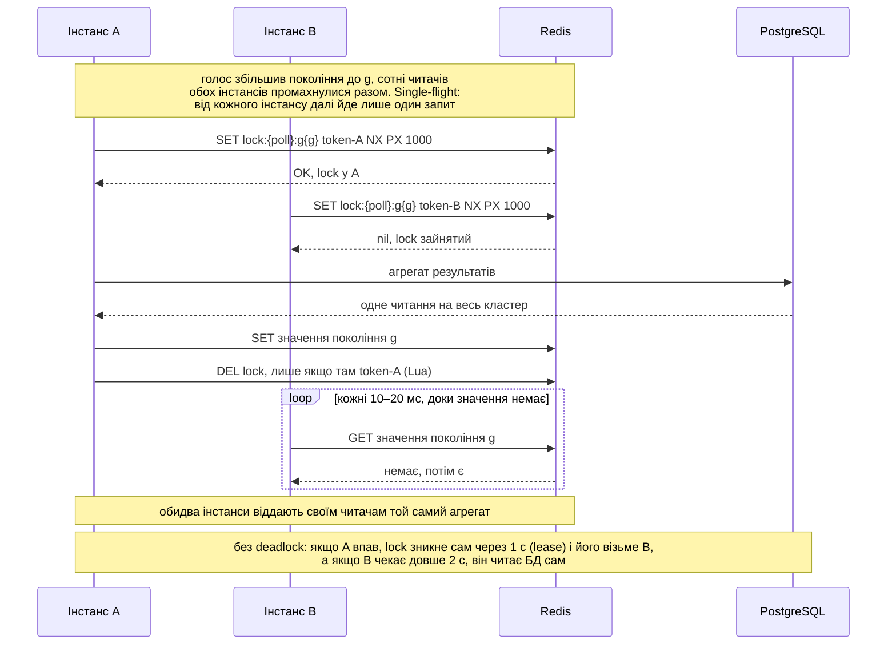

# Лабораторна робота № 8 — Інженерія стійкості: Cache Stampede, Avalanche, Penetration

**Платформа опитувань** · ASP.NET Core 10 + EF Core · Redis 8 · PostgreSQL 17 (два шарди, кожен Primary + Replica) · HAProxy 3.4 · k6 1.3.0 · Docker Compose

Повний звіт — [README, розділ «Лабораторна 8»](../../README.md#лабораторна-8-інженерія-стійкості-кешу), Failure Modes і Resilience Profile — [`docs/lab8/resilience-profile.md`](../lab8/resilience-profile.md).
Рішення — ADR [0060](../ai/decisions/0060-stampede-experiment.md) (експеримент), [0061](../ai/decisions/0061-distributed-lock-for-results-miss.md) (distributed lock),
[0062](../ai/decisions/0062-avalanche-and-ttl-jitter.md) (avalanche і jitter), [0063](../ai/decisions/0063-negative-caching.md) (negative caching), [0064](../ai/decisions/0064-lab8-comparison-series.md) (серія вимірювань).

---

## 1. Результат

Stampede на кеші результатів відтворено (500 одночасних читачів — 486 звернень до БД на одне скидання ключа) і усунено
двома рівнями координації: **single-flight на інстансі + distributed lock у Redis — рівно одне звернення на весь кластер**,
без deadlock (lease і обмежене очікування). Синхронне спливання TTL розмазує розкид `Base ± 20 %`, запити до неіснуючих
опитувань відсікає Negative Caching (до БД доходить 0.15 % замість 100 %).

## 2. Об'єкт кешування (2.1)

`GET /api/polls/{id}/results` — агреговані результати гарячого опитування (лайв-дашборд), Cache-Aside у Redis з
поколіннями з лаби 4. Кожен голос скидає ключ, і всі глядачі промахуються разом; кожен промах займає з'єднання з пулу
(30 на інстанс), за яке змагаються транзакції голосів. Агрегат дешевий (1–2 мс), тож для важкого агрегату є
перемикач `RESULTS_LOAD_DELAY_MS` (`pg_sleep`, за замовчуванням 0); у звіті — обидва варіанти.

Звернення до БД рахує сам PostgreSQL: `pg_stat_statements`, запит агрегату позначено тегом `-- results-load`.

## 3. Cache Stampede і Thundering Herd (2.2)

500 VU чекають спільного моменту, k6 скидає ключ (`INCR` покоління, як голос), усі читають одночасно; агрегат + 50 мс:

| Захист | Звернень до БД на одне скидання ключа | p95 |
|---|---|---|
| немає | **485.8** з 500 читачів | 1207 мс |
| single-flight (лаба 4) | 2.2 — ≈ по одному на кожен з 2 інстансів | 272 мс |
| **single-flight + distributed lock** | **1.0** | 322 мс |

Без захисту пул з'єднань вичерпується, запити стоять у черзі за з'єднанням — сплеск на Primary.

## 4. Distributed lock (2.4)



| Відмова самого lock | Як перевірено | Результат |
|---|---|---|
| власник lock помер і не звільнив його | `scripts/lock-check.py`: скрипт сам ставить «мертвий» lock із чужим token і lease 1 с, потім 50 одночасних читачів (і окремо 200) | кожен читач отримав відповідь `HTTP 200` через 1.01–1.02 с, тобто одразу після спливу lease; 1 звернення до БД; ключів lock не лишилося |
| читання довше за lease | затримка читання 1.5 с при lease 1 с | 2 звернення до БД замість 1, 0 % помилок; чужий lock ніхто не зняв (звільнення — Lua зі звіркою token) |
| Redis недоступний | `scripts/redis-outage-check.py` | lock не використовується, результати читаються з БД (`X-Cache: BYPASS`) |

## 5. Cache Avalanche і TTL Jitter (2.3, 2.5)

832 ключі прогріті одночасно, 300 VU 60 с, без голосів (ключі зникають лише за TTL), агрегат + 50 мс:

| TTL | Звернень до БД за секунду: пік / медіана | Активних сесій БД, пік | p95: під час хвилі / між хвилями |
|---|---|---|---|
| 10 с без розкиду | **269** / 6 (хвилі кожні 10 с, між ними простій) | 26 | 370 / 245 мс |
| **10 с ± 20 %** | 162 / 58 (з третього циклу — рівно 30–120/с) | 17 | 285 / 236 мс |

Графік по секундах — у README.

## 6. Cache Penetration і Negative Caching (2.6)

«Опитування немає» кешується маркером `not-found` на 30 с ± 20 %. Створення опитування збільшує покоління свого id —
закешоване «немає» не сховає нове опитування (`scripts/negative-cache-check.py`). 200 VU, 100 неіснуючих id по колу:

| Режим | Частка запитів, що дійшли до БД | RPS | p95 |
|---|---|---|---|
| без захисту (ні lock, ні негативного кешу) | 100 % | 953 | 515 мс |
| lock без негативного кешу | 56 % — одночасні запити до того самого id об'єднуються | 1259 | 288 мс |
| **lock + negative caching** | **0.15 %** | 3217 | 137 мс |

Межа: якщо кожен запит — новий id, маркер не допомагає (Redis росте на ключ ~106 байт на запит); потрібен Bloom filter.

## 7. Порівняльна матриця (2.7)

500 VU, ключ скидається кожні 200 мс, агрегат + 50 мс, медіана 3 повторів, 0 % помилок:

| Режим / Показник | Кількість запитів до СУБД (на інвалідацію) | Throughput (RPS) | p95 Latency | p99 Latency | Error Rate (%) |
|---|---|---|---|---|---|
| **Unprotected (Stampede)** | 123.7 | 1075 | 1485 мс | 1662 мс | 0.00 |
| **Protected (Single-flight)** | 2.2 | 3765 | 294 мс | 387 мс | 0.00 |
| **Protected (Lock)** | **1.0** | 3420 | 257 мс | 397 мс | 0.00 |

На справжньому агрегаті: без захисту 79.5 звернення / 2487 RPS / p95 706 мс → Lock 1.0 / 3740 RPS / p95 289 мс.
Ціна для звичайного читання (сценарій A лаби 5): −7 % RPS на 50 VU, 0 на 200 VU.

**Failure Modes:** deadlock неможливий (lease 1 с, очікування ≤ 2 с); сплив lease дає зайве читання, а не помилку;
пам'ять negative cache ≈ частота різних неіснуючих id × TTL; SWR не реалізовано — застарілість дорівнювала б часу
оновлення і ламала б «після голосу бачу свій голос». Повний аналіз і **Resilience Profile** системи за лаби 2–8 —
[`docs/lab8/resilience-profile.md`](../lab8/resilience-profile.md).

## 8. Теорія (п. 4 процедури)

| Поняття | Суть |
|---|---|
| Cache Stampede | один гарячий ключ зник — багато одночасних запитів перераховують те саме |
| Thundering Herd | сам удар по ресурсу: багато очікувачів одночасно йдуть у БД |
| Cache Avalanche | багато ключів зникають разом (однаковий TTL, рестарт кешу) |
| Cache Penetration | запити до того, чого немає ніде, — кеш ніколи не допомагає |
| Redlock | lock на більшості з N незалежних Redis із запасом на дрейф годинників; без fencing token не гарантує одного власника (пауза GC, стрибок годинника) — для efficiency-lock, як у нас, достатньо одного Redis |
| Bloom filter | m бітів, k хешів: «точно немає» або «можливо є», без хибно-негативних; ≈ 9.6 біта на елемент при 1 % хибних спрацювань |
| XFetch | дострокове оновлення з імовірністю, що росте до спливання TTL і з вартістю перерахунку: `now − delta·β·ln(rand()) ≥ expiry`; проти stampede через TTL (у нас його дає інвалідація) |

## 9. Live-демо

```bash
docker compose down -v && docker compose -f docker-compose.yml -f load-tests/docker-compose.loadtest-lab8.yml up -d --build
RESULTS_LOAD_DELAY_MS=50 bash load-tests/stampede.sh None burst -e ROUNDS=1    # 480–500 звернень до БД
RESULTS_LOAD_DELAY_MS=50 bash load-tests/stampede.sh Lock burst -e ROUNDS=1    # 1 звернення
python scripts/lock-check.py
python scripts/negative-cache-check.py
RESULTS_STAMPEDE_PROTECTION=None bash load-tests/penetration.sh false          # 100 % до БД
bash load-tests/penetration.sh true                                           # ≈ 0.15 %
```

| Пункт процедури | Що показати |
|---|---|
| 1. Live-демо Cache Stampede | `stampede.sh None burst` — звернення до БД з `pg_stat_statements` |
| 2. Live-демо захисту, зменшення до 1 | `stampede.sh Lock burst`, `lock-check.py`, матриця з розділу 7 |
| 3. Демо Negative Caching | `negative-cache-check.py`, `penetration.sh false` / `true` |
| 4. Теорія | розділ 8 цієї сторінки |
