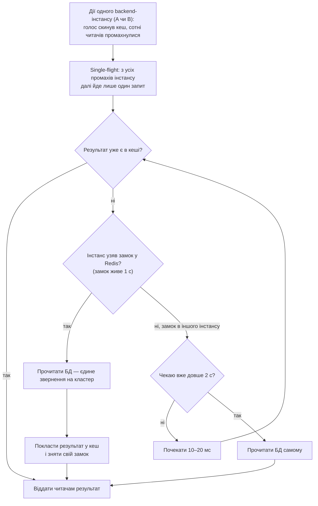

# Лабораторна робота № 8 — Інженерія стійкості: Cache Stampede, Avalanche, Penetration

**Платформа опитувань** · ASP.NET Core 10 + EF Core · Redis 8 · PostgreSQL 17 (два шарди, кожен Primary + Replica) · HAProxy 3.4 · k6 1.3.0 · Docker Compose

Повний звіт — [README, розділ «Лабораторна 8»](../../README.md#лабораторна-8-інженерія-стійкості-кешу), Failure Modes і Resilience Profile — [`docs/lab8/resilience-profile.md`](../lab8/resilience-profile.md).
Рішення — ADR [0060](../ai/decisions/0060-stampede-experiment.md) (експеримент), [0061](../ai/decisions/0061-distributed-lock-for-results-miss.md) (distributed lock),
[0062](../ai/decisions/0062-avalanche-and-ttl-jitter.md) (avalanche і jitter), [0063](../ai/decisions/0063-negative-caching.md) (negative caching), [0064](../ai/decisions/0064-lab8-comparison-series.md) (серія вимірювань).

---

## 1. Результат

Stampede на кеші результатів відтворено (500 одночасних читачів — 486 звернень до БД на одне скидання ключа) і усунено
двома рівнями координації: **single-flight на інстансі + distributed lock у Redis — рівно одне звернення на весь кластер**,
без deadlock (lease і обмежене очікування). Синхронне спливання TTL розмазує розкид `Base ± 20 %`, запити до неіснуючих
опитувань відсікає Negative Caching (до БД доходить 0.15 % замість 100 %).

## 2. Об'єкт кешування (2.1)

`GET /api/polls/{id}/results` — агреговані результати гарячого опитування (лайв-дашборд), Cache-Aside у Redis з
поколіннями з лаби 4. Кожен голос скидає ключ, і всі глядачі промахуються разом; кожен промах займає з'єднання з пулу
(30 на інстанс), за яке змагаються транзакції голосів. Агрегат дешевий (1–2 мс), тож для важкого агрегату є
перемикач `RESULTS_LOAD_DELAY_MS` (`pg_sleep`, за замовчуванням 0); у звіті — обидва варіанти.

Звернення до БД рахує сам PostgreSQL: `pg_stat_statements`, запит агрегату позначено тегом `-- results-load`.

## 3. Cache Stampede і Thundering Herd (2.2)

500 VU чекають спільного моменту, k6 скидає ключ (`INCR` покоління, як голос), усі читають одночасно; агрегат + 50 мс:

| Захист | Звернень до БД на одне скидання ключа | p95 |
|---|---|---|
| немає | **485.8** з 500 читачів | 1207 мс |
| single-flight (лаба 4) | 2.2 — ≈ по одному на кожен з 2 інстансів | 272 мс |
| **single-flight + distributed lock** | **1.0** | 322 мс |

Без захисту пул з'єднань вичерпується, запити стоять у черзі за з'єднанням — сплеск на Primary.

## 4. Distributed lock (2.4)

**Задача.** У нас два однакові backend-інстанси (A і B). Коли голос скидає кеш гарячого опитування, сотні читачів на
**кожному** з них промахуються одночасно. Single-flight з лаби 4 об'єднує промахи лише всередині одного інстансу, тож у
БД однаково йде по запиту від кожного — 2 на два інстанси, N на N інстансів. Методичка вимагає довести до **одного**.

**Ідея.** Перед читанням БД інстанс бере в Redis «замок» (lock) — спільний для всіх інстансів ключ, який може мати лише
один інстанс одночасно. Хто взяв замок — читає БД і кладе результат у кеш. Хто не взяв — не йде в БД, а чекає, поки
результат з'явиться в кеші.

Замок бере **backend-інстанс** (наш сервіс), а не база даних: PostgreSQL про замок нічого не знає. Redis тут — просто
спільне місце, яке бачать усі інстанси (пам'ять кожного інстансу окрема, тож домовитися «через себе» вони не можуть).

**Як це працює (кроки з боку двох інстансів; блок-схема нижче — те саме з боку одного інстансу):**
1. A і B одночасно просять у Redis замок: `SET lock … NX PX 1000` — «створи ключ, лише якщо його ще немає, і видали
   сам через 1 с».
2. Redis відповідає A `OK` (замок у A), а B — `nil` (замок уже зайнятий).
3. A читає агрегат з PostgreSQL — **це єдине звернення до БД на весь кластер** — кладе результат у кеш і знімає замок.
4. B тим часом кожні 10–20 мс перевіряє кеш і, щойно результат з'явився, бере його звідти.
5. Обидва інстанси віддають своїм читачам той самий результат.

**Чому не буває вічного очікування (deadlock).** Замок має термін дії 1 с (lease): якщо A аварійно зупиниться, не
знявши замок, Redis сам видалить ключ через 1 с, і замок візьме B. Крім того, B не чекає довше 2 с — після цього
читає БД сам. Знімає замок лише той, хто його взяв: у ключі записана випадкова мітка (token) інстансу, і видалення
відбувається, тільки якщо мітка збігається.



**Що це дає на практиці.** На двох інстансах різниця «2 звернення проти 1» для БД майже непомітна: у серії вимірювань
Lock дав навіть на 9 % менше RPS, ніж single-flight, зате нижчий p95 (розділ 7). Користь замка росте з кількістю
інстансів: single-flight дає по зверненню від кожного (N), замок — завжди одне.

**Що буде, якщо щось піде не так** (критерій «без deadlock, коректні таймаути»):

| Ситуація | Як перевірено | Результат |
|---|---|---|
| інстанс, що взяв замок, аварійно зупинився і не зняв його | `scripts/lock-check.py`: скрипт сам ставить у Redis замок від імені неіснуючого інстансу (його ніхто ніколи не зніме), потім 50 одночасних читачів (і окремо 200) | замок зник сам через 1 с; кожен читач отримав відповідь `HTTP 200` через 1.01–1.02 с; 1 звернення до БД; зайвих ключів не лишилося |
| читання з БД триває довше за термін замка | затримка читання 1.5 с при терміні замка 1 с | замок встигає зникнути, і його бере другий інстанс: 2 звернення до БД замість 1, але 0 % помилок; перший інстанс не зняв чужий замок |
| Redis недоступний | `scripts/redis-outage-check.py` | замок не використовується, результати читаються прямо з БД (`X-Cache: BYPASS`), сервіс працює |

## 5. Cache Avalanche і TTL Jitter (2.3, 2.5)

832 ключі прогріті одночасно, 300 VU 60 с, без голосів (ключі зникають лише за TTL), агрегат + 50 мс:

| TTL | Звернень до БД за секунду: пік / медіана | Активних сесій БД, пік | p95: під час хвилі / між хвилями |
|---|---|---|---|
| 10 с без розкиду | **269** / 6 (хвилі кожні 10 с, між ними простій) | 26 | 370 / 245 мс |
| **10 с ± 20 %** | 162 / 58 (з третього циклу — рівно 30–120/с) | 17 | 285 / 236 мс |

Графік по секундах — у README.

## 6. Cache Penetration і Negative Caching (2.6)

«Опитування немає» кешується маркером `not-found` на 30 с ± 20 %. Створення опитування збільшує покоління свого id —
закешоване «немає» не сховає нове опитування (`scripts/negative-cache-check.py`). 200 VU, 100 неіснуючих id по колу:

| Режим | Частка запитів, що дійшли до БД | RPS | p95 |
|---|---|---|---|
| без захисту (ні lock, ні негативного кешу) | 100 % | 953 | 515 мс |
| lock без негативного кешу | 56 % — одночасні запити до того самого id об'єднуються | 1259 | 288 мс |
| **lock + negative caching** | **0.15 %** | 3217 | 137 мс |

Межа: якщо кожен запит — новий id, маркер не допомагає (Redis росте на ключ ~106 байт на запит); потрібен Bloom filter.

## 7. Порівняльна матриця (2.7)

500 VU, ключ скидається кожні 200 мс, агрегат + 50 мс, медіана 3 повторів, 0 % помилок:

| Режим / Показник | Кількість запитів до СУБД (на інвалідацію) | Throughput (RPS) | p95 Latency | p99 Latency | Error Rate (%) |
|---|---|---|---|---|---|
| **Unprotected (Stampede)** | 123.7 | 1075 | 1485 мс | 1662 мс | 0.00 |
| **Protected (Single-flight)** | 2.2 | 3765 | 294 мс | 387 мс | 0.00 |
| **Protected (Lock)** | **1.0** | 3420 | 257 мс | 397 мс | 0.00 |

На справжньому агрегаті: без захисту 79.5 звернення / 2487 RPS / p95 706 мс → Lock 1.0 / 3740 RPS / p95 289 мс.
Ціна для звичайного читання (сценарій A лаби 5): −7 % RPS на 50 VU, 0 на 200 VU.

**Failure Modes:** deadlock неможливий (lease 1 с, очікування ≤ 2 с); сплив lease дає зайве читання, а не помилку;
пам'ять negative cache ≈ частота різних неіснуючих id × TTL; SWR не реалізовано — застарілість дорівнювала б часу
оновлення і ламала б «після голосу бачу свій голос». Повний аналіз і **Resilience Profile** системи за лаби 2–8 —
[`docs/lab8/resilience-profile.md`](../lab8/resilience-profile.md).

## 8. Теорія (п. 4 процедури)

| Поняття | Суть |
|---|---|
| Cache Stampede | один гарячий ключ зник — багато одночасних запитів перераховують те саме |
| Thundering Herd | сам удар по ресурсу: багато очікувачів одночасно йдуть у БД |
| Cache Avalanche | багато ключів зникають разом (однаковий TTL, рестарт кешу) |
| Cache Penetration | запити до того, чого немає ніде, — кеш ніколи не допомагає |
| Redlock | lock на більшості з N незалежних Redis із запасом на дрейф годинників; без fencing token не гарантує одного власника (пауза GC, стрибок годинника) — для efficiency-lock, як у нас, достатньо одного Redis |
| Bloom filter | m бітів, k хешів: «точно немає» або «можливо є», без хибно-негативних; ≈ 9.6 біта на елемент при 1 % хибних спрацювань |
| XFetch | дострокове оновлення з імовірністю, що росте до спливання TTL і з вартістю перерахунку: `now − delta·β·ln(rand()) ≥ expiry`; проти stampede через TTL (у нас його дає інвалідація) |

## 9. Live-демо (§4: пп. 1–3 процедури захисту)

```bash
docker compose down -v && docker compose -f docker-compose.yml -f load-tests/docker-compose.loadtest-lab8.yml up -d --build
RESULTS_LOAD_DELAY_MS=50 bash load-tests/stampede.sh None burst -e ROUNDS=1    # 480–500 звернень до БД
RESULTS_LOAD_DELAY_MS=50 bash load-tests/stampede.sh Lock burst -e ROUNDS=1    # 1 звернення
python scripts/lock-check.py
python scripts/negative-cache-check.py
RESULTS_STAMPEDE_PROTECTION=None bash load-tests/penetration.sh false          # 100 % до БД
bash load-tests/penetration.sh true                                           # ≈ 0.15 %
```

| Пункт процедури | Що показати |
|---|---|
| 1. Live-демо Cache Stampede | `stampede.sh None burst` — звернення до БД з `pg_stat_statements` |
| 2. Live-демо захисту, зменшення до 1 | `stampede.sh Lock burst`, `lock-check.py`, матриця з розділу 7 |
| 3. Демо Negative Caching | `negative-cache-check.py`, `penetration.sh false` / `true` |
| 4. Теорія | розділ 8 цієї сторінки |

## 10. Вивід команд — пп. 1–3 процедури (записано під час прогонів)

Справжній вивід терміналу — на випадок захисту без піднятого стеку. Генеральний прогін 2026-11-18 з холодного старту
(стек здоровий за 23 с, усе демо ≈ 3 хв); `lock-check` і `negative-cache-check` — 2026-11-17.

**П. 1 — Stampede без захисту** (`RESULTS_LOAD_DELAY_MS=50 bash load-tests/stampede.sh None burst -e ROUNDS=1`):

```text
  latency ms: avg 1196.2  p50 1246.3  p95 1386.1  p99 1393.9  max 1397.3
RESULT None burst, load delay 50 ms: 500 DB loads (pg_stat_statements, warm-up 0 excluded) for 1 invalidations = 500.0 per invalidation
```

**П. 2 — захист** (`… stampede.sh SingleFlight burst -e ROUNDS=1`, потім `… Lock burst -e ROUNDS=1`):

```text
  latency ms: avg 226.6  p50 177.6  p95 410.3  p99 415.0  max 418.0
RESULT SingleFlight burst, load delay 50 ms: 2 DB loads (pg_stat_statements, warm-up 1 excluded) for 1 invalidations = 2.0 per invalidation
  latency ms: avg 161.1  p50 163.9  p95 193.4  p99 210.2  max 220.7
RESULT Lock burst, load delay 50 ms: 1 DB loads (pg_stat_statements, warm-up 0 excluded) for 1 invalidations = 1.0 per invalidation
```

Та сама кількість — прямо з PostgreSQL після прогону `Lock`:

```text
 calls | ms
-------+-----
     1 | 0.1
(1 row)
```

`python scripts/lock-check.py` — замок від інстансу, що аварійно зупинився (сам не знімається):

```text
poll 1: generation -> 141, planted polling:results:lock:1:g141 = dead-owner, PX 1000 (never released)
  50 simultaneous readers: statuses [200], latency ms min 989 / median 1000 / max 1009, answered 1011-1024 ms after the dead lock was planted
  distinct generatedAt: 1, DB loads (pg_stat_statements): 1, lock keys left in Redis: 0
  OK   all readers got 200
  OK   nobody answered before the lease expired
  OK   nobody waited much longer than the lease
  OK   exactly one DB load
  OK   no lock keys left
ALL CHECKS PASSED
```

**П. 3 — Negative Caching**, `python scripts/negative-cache-check.py`:

```text
1. GET /api/polls/9999999/results: 150 reads, statuses [404], DB loads 1, polling:results:v1:9999999:g0 = not-found, PTTL 24618 ms
2. next id 62: before create 404 (negative entry: True), created id 62, author reads results: 200 draft
3. delete draft 62: 204, results afterwards: 404
  OK   missing poll: all 404
  OK   missing poll: one DB load for 150 reads
  OK   missing poll: negative entry with TTL <= 36 s
  OK   future poll id: 404 and a negative entry before create
  OK   created poll got that id
  OK   created poll: results 200 at once, not the cached 404
  OK   deleted draft: results 404
ALL CHECKS PASSED
```

`RESULTS_STAMPEDE_PROTECTION=None bash load-tests/penetration.sh false`, потім `bash load-tests/penetration.sh true`:

```text
RESULT None, negative caching false, ids 100: 27442 DB lookups for 27442 requests (100.00 %), Redis +0 keys, +1 KiB
RESULT Lock, negative caching true, ids 100: 151 DB lookups for 93593 requests (0.16 %), Redis +88 keys, +10 KiB
```
