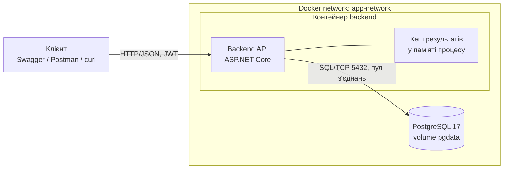
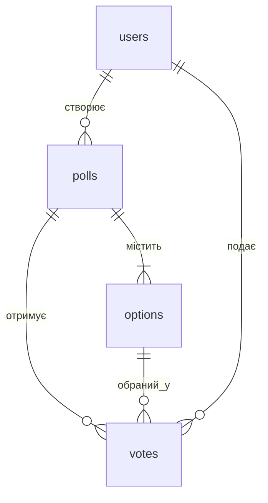
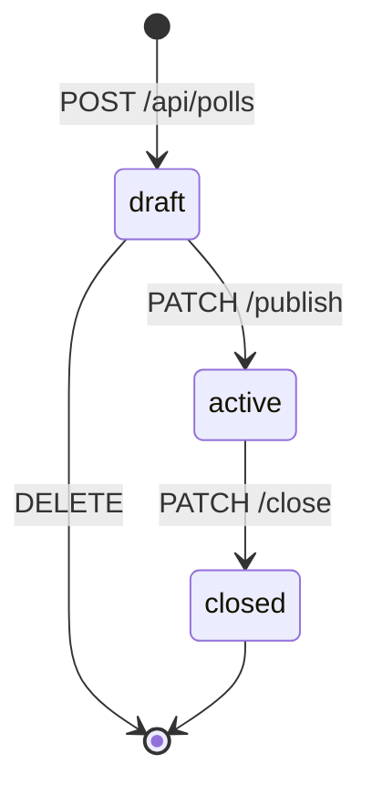
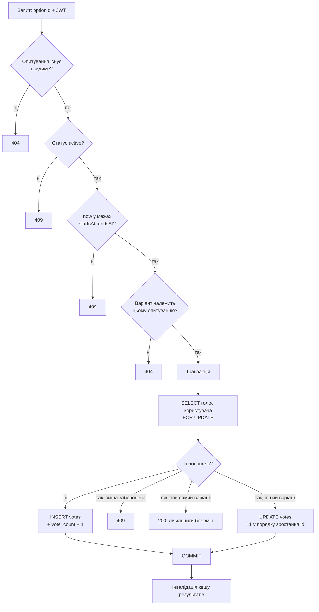

# Лабораторна 1: посібник до системи

Пояснення того, що побудовано, чому саме так і як воно працює. Призначення — підготовка до захисту:
на ньому кожного учасника питають про **всю** систему, а не лише про його частину.

Супутні документи: [`README.md`](../README.md) — коротко і для стороннього; [`docs/ai/decisions/`](ai/decisions/README.md) —
рішення з обґрунтуванням (ADR); [`docs/ai/runbook.md`](ai/runbook.md) — як запускати й перевіряти.

---

## 1. Що це за система

**Платформа опитувань у реальному часі.** Користувач створює опитування з варіантами відповідей, публікує його,
інші голосують, усі бачать результати, що оновлюються.

Домен обрано не через складність, а через **характер навантаження**. Курс називається «Інженерія
високонавантажувальних систем», і оцінюють тут архітектуру, відтворюваність і глибину аналізу вузьких місць,
а не багатство бізнес-правил. Опитування дають:

- **Природну точку конкуренції.** Тисяча людей одночасно голосує в одне опитування — усі пишуть в один рядок
  лічильника. Це справжня проблема, а не вигадана.
- **Різку асиметрію читань і записів.** Голос — один на користувача. Читань результатів — багато й постійно.
  Саме на цій асиметрії будується кешування в лабі 4.
- **Просте навантажувальне тестування.** У лабі 5 треба згенерувати тисячі запитів. Тут це тривіально: беремо
  N користувачів і б'ємо в один ендпоінт. У складнішому домені (наприклад, бронювання місць) кожен віртуальний
  користувач потребував би власного вільного ресурсу, інакше 99% запитів впали б з конфліктом — і ви міряли б
  не продуктивність, а кількість помилок.

Проєкт наскрізний: лаби 2–5 нарощуються на цей самий код (stateless → масштабування → кешування → навантаження).

---

## 2. Стек і чому саме він

| Шар | Технологія | Чому |
|---|---|---|
| Backend | C# / ASP.NET Core 10 (контролери) | Статична типізація, вбудовані DI/валідація/OpenAPI |
| ORM | EF Core 10 + Npgsql | Міграції як код, батчинг вставок, retry-стратегія |
| БД | PostgreSQL 17 | Реляційна з ACID — для грошей і голосів транзакції обов'язкові |
| Автентифікація | JWT (stateless) | Див. §7 — критично для лаб 2–3 |
| Валідація | FluentValidation | Правила окремо від DTO, зрозумілі 422-помилки |
| Документація API | Swashbuckle (Swagger UI) | Живий клієнт для демонстрації на захисті |
| Розгортання | Docker Compose | Вимога лаби: весь стек однією командою |

Деталі та альтернативи — ADR [0001](ai/decisions/0001-tech-stack.md).

---

## 3. Архітектура

### Що працює зараз (лаба 1)



Три складові: **клієнт → backend → БД**, плюс кеш **усередині** процесу backend. Те, що кеш намальований
всередині контейнера, а не поруч із ним, — не дрібниця, а суть проблеми, яку розв'язує лаба 2 (§11).

### Куди це росте

Спроєктована (але ще не реалізована) повна картина: перед backend стає балансувальник із кількома репліками
(лаба 3), кеш переїжджає в Redis як окремий вузол (лаби 2 і 4), опційно з'являється черга повідомлень
із воркером для асинхронної агрегації голосів.

### Це моноліт чи мікросервіси

**Моноліт** — один застосунок, який розмовляє з БД і кешем. І це свідомий вибір:

- Лаби прямо вимагають масштабувати **репліки одного застосунку** («два паралельні екземпляри на основі єдиної
  кодової бази»). З мікросервісами завдання лаби 3 просто не складається — незрозуміло, що класти в upstream-пул.
- **Горизонтальне масштабування ≠ мікросервіси.** Stateless-моноліт піднімається в N однакових копій за
  балансувальником і масштабується так само. Мікросервіси вирішують організаційну проблему (незалежні релізи,
  окремі команди), а не пропускну здатність.
- Ядро системи — атомарна операція «вставити голос + оновити лічильник» в одній транзакції. Рознесення її по
  сервісах з різними базами перетворило б це на розподілену транзакцію з компенсаціями.

Коректне формулювання для захисту: **модульний моноліт у розподіленій системі** — застосунок монолітний,
але система розподілена (БД, кеш, згодом балансувальник і репліки — окремі вузли, що спілкуються мережею).

---

## 4. Модель даних

Чотири сутності (вимога лаби — мінімум три):



| Таблиця | Призначення | Ключове |
|---|---|---|
| `users` | Користувачі | `UNIQUE(email)`, `UNIQUE(username)`, пароль як PBKDF2-хеш |
| `polls` | Опитування | `status` (draft/active/closed), `is_public`, `allow_vote_change`, `starts_at`, `ends_at` |
| `options` | Варіанти відповіді | `UNIQUE(poll_id, position)`, **`vote_count`** — денормалізований лічильник |
| `votes` | Голоси | **`UNIQUE(poll_id, user_id)`** — один голос на користувача |

### Два обмеження, на яких тримається вся логіка

**`UNIQUE(poll_id, user_id)` на `votes`.** Це і є гарантія «один голос на людину». Не перевірка в коді — саме
індекс. Чому: два одночасні запити можуть обидва пройти перевірку «чи він уже голосував?» до того, як хоч один
встигне записатись. База ж фізично не дасть вставити другий рядок. Перевірка в коді потрібна лише для гарного
повідомлення про помилку на типовому шляху.

**`options.vote_count` — денормалізація.** Можна було б рахувати `COUNT(*) FROM votes WHERE option_id = ...`
на кожне читання, але тоді кожен перегляд результатів сканує таблицю голосів. Готовий лічильник робить читання
миттєвим — ціною конкуренції за один рядок при записі. Це свідомий trade-off, і саме він породжує вузьке місце №1
(§13). Інваріант, який мусить виконуватись завжди, — **для кожного варіанта окремо**:

```sql
-- кількість варіантів, у яких лічильник не збігається з реальними голосами; має бути 0
SELECT count(*) FROM options o
WHERE o.vote_count <> (SELECT count(*) FROM votes v WHERE v.option_id = o.id);
```

Перевірка сумою — `SUM(vote_count) = COUNT(votes)` — **недостатня**. Зміна голосу — це завжди −1 одному варіанту і
+1 іншому, тож сума зберігається навіть тоді, коли лічильники окремих варіантів уже неправильні. Саме так у лабі 1
пропустили справжній баг (§8, ADR [0017](ai/decisions/0017-serialize-vote-changes.md)).

Схема описана EF-міграціями (`Data/Migrations`), а не SQL-скриптами руками: міграції версіонуються разом із кодом
і застосовуються автоматично. Деталі конвенцій — ADR [0007](ai/decisions/0007-database-conventions.md).

---

## 5. API

| Метод | Ендпоінт | Доступ | Призначення |
|---|---|---|---|
| POST | `/api/auth/register` | — | Реєстрація |
| POST | `/api/auth/login` | — | Вхід, повертає JWT |
| GET | `/api/auth/me` | JWT | Поточний користувач |
| POST | `/api/polls` | JWT | Створити опитування (статус `draft`) |
| GET | `/api/polls` | — | Список із фільтрами та пагінацією |
| GET | `/api/polls/{id}` | — | Деталі та варіанти |
| PATCH | `/api/polls/{id}/publish` | автор | `draft → active` |
| PATCH | `/api/polls/{id}/close` | автор | `active → closed` |
| DELETE | `/api/polls/{id}` | автор | Видалити (лише `draft`) |
| POST | `/api/polls/{id}/vote` | JWT | Проголосувати |
| GET | `/api/polls/{id}/results` | — | Агреговані результати |
| GET | `/health` | — | Готовність сервісу та стан БД |

Вимога лаби — мінімум 5 бізнес-ендпоінтів; у нас 11 плюс службовий `/health`.

### Правила видимості

- **Чужа чернетка → 404, а не 403.** 403 означав би «воно існує, але тобі не можна» — це вже витік інформації.
  Для стороннього чернетки просто не існує.
- **Непублічне опитування** (`is_public = false`) не показується в загальному списку, але доступне за прямим
  посиланням — модель «за посиланням», а не сувора приватність.
- **Автор завжди бачить свої** опитування в списку, у будь-якому статусі.

Обґрунтування — ADR [0003](ai/decisions/0003-visibility-rules.md).

### Коди помилок і чому саме такі

| Код | Коли | Чому не інакше |
|---|---|---|
| 400 | Запит неможливо розпарсити (битий JSON, невірний тип) | Зарезервовано саме для цього |
| 401 | Немає/невалідний токен, невірний пароль | — |
| 403 | Дія над чужим **не-чернетковим** опитуванням | Для чернетки був би витік факту існування → 404 |
| 404 | Не існує, або чужа чернетка, або варіант не з цього опитування | — |
| 409 | Недопустимий перехід статусу, повторний голос, голос поза часовим вікном | Стан ресурсу конфліктує із запитом |
| 422 | Валідація полів | Запит зрозумілий, але дані не проходять правила |
| 503 | Транзієнтний збій БД | Не 500: клієнту є сенс повторити (§9) |

Розділення **400 і 422** — свідоме: 400 каже «я тебе не зрозумів», 422 — «зрозумів, але так не можна».
Щоб відсутні поля потрапляли у валідатор (422), а не відсікались автоматично (400), усі поля DTO
оголошені nullable і вимкнено неявний `[Required]`. ADR [0005](ai/decisions/0005-error-handling.md).

---

## 6. Життєвий цикл опитування



Статус — не просто поле, а те, що визначає дозволені операції: голосувати можна лише в `active`, видалити —
лише `draft` (у чернетці ще немає голосів, тож немає що втратити).

**Чому окремий `publish`, а не публікація одразу при створенні.** Чернетку можна спокійно доредагувати або
видалити; після публікації опитування стає видимим і починає збирати голоси. ADR [0002](ai/decisions/0002-poll-lifecycle-publish.md).

**Чому переходи статусу — це умовний UPDATE.** Наївний код «прочитати → перевірити → записати» має гонку:
між перевіркою і записом інший запит може змінити статус. Тому перехід виконується одним запитом з умовою:

```sql
UPDATE polls SET status = 'closed' WHERE id = @id AND status = 'active'
```

Якщо змінено 0 рядків — хтось нас випередив, повертаємо 409. ADR [0004](ai/decisions/0004-atomic-status-transitions.md).

**Важливий нюанс:** опитування може мати статус `active`, коли `ends_at` уже в минулому. Фонового процесу,
який закриває прострочені опитування, немає — це зайва складність для лаби. Тому **дати перевіряє сам
ендпоінт голосування**. Це типове питання на захисті.

---

## 7. Автентифікація

JWT, підписаний симетричним ключем; пароль — PBKDF2 (`PasswordHasher<User>`).

**Чому не серверні сесії.** Сесія — це стан на конкретному інстансі. У лабі 2 треба довести, що будь-який
інстанс обробить будь-який запит без sticky sessions, а в лабі 3 — що балансувальник може кидати запити
куди завгодно. Stateless-токен дає це безкоштовно: інстанс перевіряє підпис і дістає `sub` (id користувача),
нічого нікуди не звіряючи.

Це приклад рішення, прийнятого в лабі 1 **заради лаб 2–3**. Якби ми почали із сесій, довелось би переписувати.
ADR [0006](ai/decisions/0006-stateless-jwt-auth.md).

---

## 8. Ядро системи: голосування

Найважливіша частина. Саме її розбирають на захисті.

### Що відбувається на `POST /api/polls/{id}/vote`



### П'ять рішень, які тут важливі

**1. Одна транзакція на вставку голосу і оновлення лічильника.**
Якщо вставка пройде, а оновлення лічильника — ні, лічильник розійдеться з реальною кількістю голосів,
і результати показуватимуть неправду. Транзакція робить ці дві зміни нерозривними.

**2. Інкремент на рівні SQL, а не «прочитати-змінити-записати».**

```sql
UPDATE options SET vote_count = vote_count + 1 WHERE id = @optionId
```

Наївний варіант (`прочитати 10 → порахувати 11 → записати 11`) при паралельних голосах втрачає оновлення:
два запити читають 10, обидва пишуть 11, один голос зникає. Це класична **lost update**. SQL-інкремент
виконується атомарно всередині БД. Але сам по собі він захищає лише **лічильник** — від гонки на рівні
логіки (див. рішення 4) він не рятує.

**3. Джерело істини — унікальний індекс, а не перевірка в коді.**
Перевірка «чи він уже голосував» потрібна для зрозумілої помилки, але гарантію дає індекс: при гонці
другий `INSERT` падає з `UniqueViolation`, і ми перетворюємо це на 409.

**4. Зміна голосу серіалізується блокуванням рядка — і це виправлення реального бага.**
Перша версія читала наявний голос звичайним `SELECT`. Рев'ю знайшло гонку: N паралельних запитів
**одного** користувача на зміну голосу всі встигали прочитати той самий старий варіант, і кожен робив йому −1.
На свіжому опитуванні лічильник ішов у мінус, `CHECK (vote_count >= 0)` відхиляв запис — 23 з 40 запитів
падали з **500**. На опитуванні з великими лічильниками помилок не було взагалі — лічильники **мовчки**
розсинхронізовувались (38 замість 50).

Чому цього не помітила початкова перевірка 40 паралельними голосами: вона рахувала **суму**, а кожна зміна —
це −1 і +1, тож сума лишалась правильною. Звідси правило: перевіряти по кожному варіанту (§4).

Виправлення:

- наявний голос читається з `SELECT … FOR UPDATE` — паралельні запити того самого користувача стають у
  чергу на цьому рядку, і кожен наступний бачить уже оновлений варіант;
- два лічильники при зміні оновлюються **в порядку зростання id**. Інакше зустрічні зміни (один користувач
  A→B, інший B→A) брали б блокування в протилежному порядку — класичний deadlock.

Блокування — на рядок голосу конкретного користувача, тож між **різними** виборцями конкуренції не додає.
ADR [0017](ai/decisions/0017-serialize-vote-changes.md).

**5. Транзакція загорнута в execution strategy.**
У EF увімкнено повтор при транзієнтних збоях. Така стратегія не вміє сама повторити явну транзакцію —
тому весь блок загортається в `db.Database.CreateExecutionStrategy().ExecuteAsync(...)`, і при збої
повторюється цілком. Забути це — типова помилка, EF кине виняток у рантаймі. ADR [0008](ai/decisions/0008-ef-retry-strategy.md).

### Зміна голосу

Якщо `allow_vote_change = true`:

- **інший варіант** → оновлюємо рядок голосу і рухаємо обидва лічильники (−1 старому, +1 новому) в тій самій
  транзакції → **200**;
- **той самий варіант** → нічого не змінюємо → **200** (ідемпотентність). Це захищає від подвійного кліку
  й від повторів у навантажувальному тесті: повтор не має вважатись помилкою.

Якщо `allow_vote_change = false` — повторний голос завжди **409**.

**Що перевірено після виправлення:** 200 паралельних голосів різних користувачів; 40 паралельних змін голосу
одним користувачем — усі 200, рівно один рядок голосу, лічильники точні; 100 зустрічних змін A→B і B→A —
лічильники точні, deadlock немає.

Деталі та відомі межі — ADR [0014](ai/decisions/0014-vote-transaction-and-counter.md), [0015](ai/decisions/0015-vote-and-results-api-shape.md), [0017](ai/decisions/0017-serialize-vote-changes.md).

---

## 9. Результати та кешування

`GET /api/polls/{id}/results` повертає загальну кількість голосів, кількість і відсоток по кожному варіанту.

**Звідки беруться числа.** З `options.vote_count`, а не з `COUNT(*)` по `votes`. Тобто найчастіша операція
читання не чіпає таблицю голосів узагалі.

**Кеш.** Відповідь кладеться в пам'ять процесу з TTL 10 секунд і **явною інвалідацією** при кожній зміні,
що впливає на результати: голос, а також publish, close і delete опитування. Спершу інвалідація була лише на
голос і закриття — рев'ю показало, що після publish стороннім до 10 с ішов 404 (у кеші лишався статус `draft`),
а після delete — результати вже видаленого опитування. Правило: **усе, що змінює голоси або статус опитування,
інвалідує кеш.** TTL тут — не основний механізм, а страховка.

**Відома межа.** Якщо `GET /results` порахував агрегат до коміту голосу, а поклав у кеш уже після інвалідації,
застаріле значення проживе до 10 с. Для лаби 1 це прийнятно; розбирається в лабі 4 разом зі стратегіями кешування.

**Одна деталь, яка здається дрібницею.** У кеші зберігається не лише відповідь, а й `creator_id`. Завдяки цьому
перевірка видимості (чи це чужа чернетка) робиться в пам'яті, без звернення до БД. Інакше кеш економив би
агрегацію, але однаково бив би в базу на кожен запит — і сенс кешування здебільшого зникав би.

**`generatedAt`** — момент, коли агрегат порахували з БД. При попаданні в кеш воно не змінюється. Це дає змогу
показати роботу кешу на захисті без спеціальних заголовків: два однакові запити поспіль повертають той самий
`generatedAt`.

---

## 10. Обробка помилок

Сервіси **кидають винятки**, а не повертають коди помилок. Кожен виняток успадковує `AppException` і **сам
знає свій HTTP-статус**, тому централізований обробник не має switch по типах — він просто бере `StatusCode`.
Додати нову доменну помилку = додати клас-нащадок, обробник підхопить її автоматично.

Усі помилки віддаються у форматі RFC 7807 (`application/problem+json`) із `traceId`; помилки валідації
додатково містять список полів.

**Транзієнтні збої БД → 503, а не 500.** Якщо база недоступна чи перевантажена, це інфраструктурна проблема,
після якої запит має сенс повторити, а не баг застосунку. Практична цінність: у лабі 3 балансувальник за цим
кодом вимикатиме вузол з пулу, у лабі 5 k6 відрізнить інфраструктурну відмову від помилки коду.
EF при цьому вже вичерпав власні повтори, тож 503 означає стійкий збій. ADR [0016](ai/decisions/0016-transient-db-errors-503.md).

---

## 11. Persistence і розгортання

### Міграції та сід

Міграції застосовуються **автоматично при старті** backend — це пряма вимога лаби «жодних ручних кроків».
Сід заповнює порожню базу тестовими даними і виконується під **advisory lock** PostgreSQL: якщо колись
стартують два інстанси одночасно (а це вже лаба 2), сід відпрацює рівно один раз. ADR [0009](ai/decisions/0009-startup-migrations-and-seed-locking.md).

Сід детермінований (фіксований seed) — холодний старт завжди дає ті самі дані:

- 500 користувачів `user001@example.com` … `user500@example.com`, пароль `Password123!`;
- 50 опитувань із голосами;
- **опитування №1 — «гаряче»**: активне, без голосів, `allow_vote_change = true`, завершується через рік.

**Навіщо аж 500 користувачів у лабі 1.** Заради лаби 5. Унікальний індекс `(poll_id, user_id)` означає, що
200 віртуальних користувачів не можуть голосувати одним акаунтом — усі, крім першого, отримають 409, і замість
навантаження ви виміряєте потік помилок. Пул акаунтів дешево створити зараз і дорого прикручувати потім.
ADR [0010](ai/decisions/0010-seed-data.md).

### Docker Compose

Основні сервіси — `backend` і `postgres`. Разом зі стеком стартує pgAdmin для перегляду БД (http://localhost:5050,
сервер уже зареєстрований); Adminer лишився як опційний, під профілем `tools`.

- **Мережа** `app-network` — контейнери бачать одне одного за іменами (`postgres:5432`). Назовні відкрито лише
  потрібне: API (8080), БД для інструментів (5433), pgAdmin (5050).
- **Пул з'єднань** обмежено до 30 на інстанс. Пул Npgsql за замовчуванням (100) дорівнював ліміту з'єднань самого
  PostgreSQL — після навантаження один інстанс забирав усі, і БД відмовляла навіть `psql`. Правило на лаби 2–3:
  *кількість інстансів × розмір пулу ≤ `max_connections` − 3*. ADR [0018](ai/decisions/0018-connection-pool-budget.md).
- **Volume** `pgdata` — саме він робить БД «повноцінною». Дані переживають перезапуск і видалення контейнера;
  зникають лише при явному `docker compose down -v`. Перевірка цього — окремий пункт процедури захисту.
- **Healthcheck** на postgres — backend стартує лише після того, як база готова приймати з'єднання.

Порт бази на хості — **5433**, а не 5432: на машині одного з учасників уже працює локальний PostgreSQL.
ADR [0011](ai/decisions/0011-local-environment.md).

### Заділ на наступні лаби

`GET /health` (перевіряє з'єднання з БД) і заголовок `X-Instance-ID` у кожній відповіді зроблені вже зараз,
хоча лаба 1 їх не вимагає: у лабі 2 треба показувати, який інстанс обробив запит, у лабі 3 — віддавати
балансувальнику стан вузла. ADR [0012](ai/decisions/0012-instance-id-and-health.md).

`/health` відповідає **не довше 2 с** навіть коли БД лежить: замість стандартної перевірки через DbContext —
власна проба (`SELECT 1` окремим з'єднанням) із таймаутом. Інакше при зупиненій БД відповідь затягувалась на
кілька секунд, і балансувальник у лабі 3 вирішував би про стан вузла надто пізно. ADR [0019](ai/decisions/0019-health-check-timeout.md).

---

## 12. Чому кеш навмисно «неправильний»

Найнеочевидніше рішення проєкту: кеш результатів лежить **у пам'яті процесу**, хоча всі знають, що правильно —
Redis.

Це зроблено свідомо. Лаба 2 — це **аудит стану**: треба знайти в застосунку локальний стан, показати, чим він
шкодить, і винести назовні. Якби ми одразу написали все stateless, на захисті не було б чого демонструвати.

Проблема, яку він створить у лабі 2, цілком реальна: при двох інстансах кеші розійдуться. Голос, що прийшов
на інстанс А, інвалідує кеш лише на А; інстанс Б ще секунди показуватиме старі числа. Це буде видно наживо
за заголовком `X-Instance-ID`.

У лабі 2 кеш переїде в Redis, у лабі 4 — оформиться як повноцінний Cache-Aside зі схемою ключів, TTL,
інвалідацією та поведінкою при відмові Redis. ADR [0013](ai/decisions/0013-lab1-in-process-results-cache.md).

**Правило для всіх, хто торкається коду:** не «виправляйте» це раніше часу.

---

## 13. High-Load сценарій і вузькі місця

**Піковий сценарій:** масове голосування в одне опитування в останні хвилини перед завершенням — тисячі
конкурентних `POST /vote` плюс постійний потік `GET /results` від лайв-дашборду.

Аналіз у форматі **Компонент / Причина / Симптоматика** (повна версія — в [`README.md`](../README.md)):

| # | Компонент | Причина | Як проявиться | Стан |
|---|---|---|---|---|
| 1 | Рядок `vote_count` популярного варіанта | **Lock contention**: усі голоси за один варіант оновлюють той самий рядок, row-level lock серіалізує їх | Стрибок p99 при майже незмінному p50, черга в `pg_locks` | Лічильники точні (SQL-інкремент + `FOR UPDATE` на зміну голосу, ADR 0017), але серіалізація лишається — головний кандидат на точку насичення |
| 2 | `GET /results` | Без кешу кожне читання йде в БД; читань набагато більше, ніж записів | Падіння RPS, зростання CPU та I/O Wait на БД | Пом'якшено: лічильник + кеш |
| 3 | Пул з'єднань до БД | Транзакції з п.1 тримають з'єднання довше, бо чекають на лок | Таймаути при **незавантаженому** CPU бази — ознака, що впираємось в очікування, а не в обчислення | Пул обмежено 30 на інстанс (ADR 0018) — замість відмови БД запити чекають у черзі пулу; 503 і `/health` за 2 с дадуть сигнал балансувальнику |
| 4 | `POST /polls` з багатьма варіантами | **N+1**: вставка кожного варіанта окремим запитом | Латентність росте лінійно з кількістю варіантів | Усунено: один `SaveChanges`, EF шле батчем |

Пункт 1 — наскрізний сюжет усього курсу: вузьке місце №1 в лабі 1 → розбіжність кешів у лабі 2 →
об'єкт кешування в лабі 4 → ймовірна точка насичення у write-сценарії лаби 5.

---

## 14. Розподіл робіт

| Блок | Учасник 1 | Учасник 2 |
|---|---|---|
| Каркас, Docker, мережі, volumes | R/A | I |
| Схема БД, міграції, сід | R/A | C |
| Автентифікація (JWT) | R/A | I |
| CRUD і життєвий цикл опитувань | R/A | I |
| Голосування | I | R/A |
| Результати та кеш | I | R/A |
| Обробка помилок | C | R/A |
| Bottleneck Analysis | C | R/A |

На захисті це **не звільняє** від питань по чужій частині — розподіл лише про те, хто писав код.

---

## 15. Питання на захист

**Чому «один голос на користувача» гарантує індекс, а не перевірка в коді?**
Два одночасні запити можуть обидва пройти перевірку до того, як хоч один запишеться. Індекс — фізичне
обмеження БД, обійти його неможливо. Перевірка в коді існує лише заради зрозумілої помилки.

**Чому лічильник оновлюється через `vote_count = vote_count + 1`?**
Щоб уникнути lost update. При читанні-і-записі два паралельні голоси прочитають те саме значення й запишуть
однакове — один голос зникне. SQL-інкремент атомарний усередині БД.

**Навіщо транзакція, якщо вставка і так атомарна?**
Атомарних операцій тут дві: вставка голосу і зміна лічильника. Без транзакції можлива ситуація, коли пройшла
одна з них, і лічильник розійдеться з реальною кількістю голосів.

**Якщо інкремент атомарний, звідки взялась гонка при зміні голосу?**
Атомарний інкремент захищає лише сам лічильник. Гонка була рівнем вище, у логіці: паралельні запити одного
користувача всі прочитали той самий старий варіант і кожен відняв від нього по одиниці. Виправлено
`SELECT … FOR UPDATE` на рядку голосу — запити того ж користувача стають у чергу, — і оновленням двох лічильників
у порядку зростання id, щоб зустрічні зміни не давали deadlock (ADR 0017).

**Чому перевіряти лічильники по кожному варіанту, а не сумою?**
Зміна голосу — це −1 одному варіанту і +1 іншому, сума при цьому не змінюється. Саме тому перевірка
`SUM(vote_count) = COUNT(votes)` пропустила гонку зміни голосу, а перевірка по варіантах її знайшла.

**Опитування `active`, але `ends_at` у минулому — це баг?**
Ні. Фонового закривача немає навмисно, тому часове вікно перевіряє ендпоінт голосування і повертає 409.

**Чому кеш у пам'яті процесу, це ж неправильно?**
Свідоме рішення: це об'єкт аудиту стану в лабі 2. При двох інстансах кеші розійдуться — і це буде наочною
демонстрацією проблеми локального стану. У лабі 2 він переїде в Redis.

**Чому чужа чернетка дає 404, а не 403?**
403 підтвердив би, що ресурс існує. Для стороннього чернетка не повинна існувати навіть як факт.

**У чому різниця між 400 і 422?**
400 — запит неможливо розпарсити. 422 — запит зрозумілий, але дані не проходять бізнес-правила.

**Чому транзієнтні помилки БД — це 503?**
500 означає баг застосунку, повторювати немає сенсу. 503 каже «інфраструктура тимчасово недоступна, спробуй
ще» — за цим кодом балансувальник вимикає вузол, а навантажувальний тест не зараховує це як помилку коду.

**Це моноліт чи мікросервіси, і чому?**
Моноліт — див. §3.

**Що станеться першим при зростанні навантаження?**
Серіалізація на рядку лічильника популярного варіанта, далі — вичерпання пулу з'єднань, бо транзакції довше
тримають з'єднання в очікуванні лока.

---

## 16. Як перевірити систему самостійно

Порядок дій і команди — у [`docs/ai/runbook.md`](ai/runbook.md). Коротко:

1. `docker compose down -v` → `docker compose up -d --build` — холодний старт без жодних ручних кроків.
2. Swagger на http://localhost:8080/swagger — пройти сценарій і **навмисно поламати** запити (подвійний голос,
   чужий варіант, порожнє тіло, без токена). Жоден випадок не повинен давати 500.
3. `docker compose restart postgres` — дані мають лишитись.
4. Перевірити інваріант **по кожному варіанту** (запит у §4) — має повернути `0`. Перевірка сумою тут не годиться.
5. Прочитати `README.md` очима стороннього: запуск, схема, API, RACI, вузькі місця.
