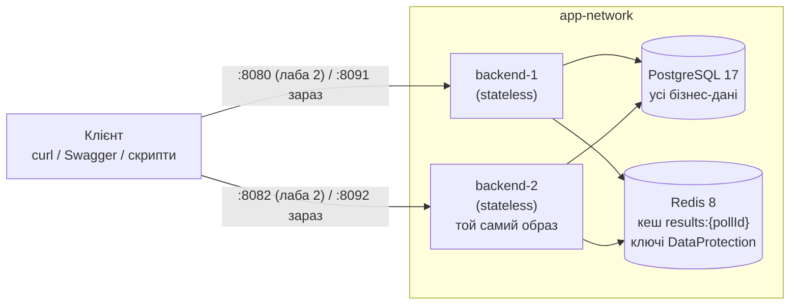

# Лабораторна 2: посібник до захисту — stateless-архітектура

Що змінилося в системі в лабі 2, чому саме так і як це показати на захисті. На захисті кожного учасника питають
про **всю** систему, тож тут пояснено і платформну частину (Учасник 1), і голосування з результатами (Учасник 2).

Як читати:

- **§0** — шпаргалка на одну хвилину;
- **§1–§9** — що зроблено і чому, з посиланнями на рішення (ADR);
- **§10** — як підняти стенд лаби 2 **зараз**, коли в `main` уже є балансувальник лаби 3;
- **§11** — сценарій захисту крок за кроком: команда → що побачимо → що сказати;
- **§12** — питання на захист з відповідями; **§13** — якщо щось пішло не так.

Супутні документи: [`README.md`](../README.md) → розділ «Лабораторна 2» (звіт з виводами скриптів),
[`docs/ai/decisions/`](ai/decisions/README.md) — ADR, [`docs/ai/runbook.md`](ai/runbook.md) — усі команди,
[`docs/lab1-guide.md`](lab1-guide.md) — як влаштовані голосування й результати.

---

## 0. Шпаргалка за одну хвилину

- **Stateless — це не «без даних».** Даних багато, але між запитами їх немає в пам'яті процесу: бізнес-стан —
  у PostgreSQL, спільні тимчасові дані — у Redis, ідентичність користувача — у JWT на боці клієнта.
- **Два однакові інстанси** `backend-1` і `backend-2` з одного образу; заголовок `X-Instance-ID` показує, хто
  відповів.
- **Аудит знайшов дві critical-залежності, обидві усунено:**
  1. кеш результатів у `IMemoryCache` кожного процесу → **Redis** (`results:{pollId}`, TTL 10 с, `DEL` при змінах);
  2. ключі DataProtection у файловій системі контейнера → **Redis** (один спільний набір ключів).
- **Решта вже була спільною з лаби 1:** JWT замість сесій, усі дані в PostgreSQL, «один голос» — `UNIQUE` в БД,
  серіалізація змін голосу — `FOR UPDATE` у БД, сід — `pg_advisory_xact_lock` у БД.
- **Доведено скриптами:** ланцюжок запитів через різні інстанси (8/8), кеш однаковий на обох інстансах одразу,
  конкурентні голоси через обидва процеси, вбивство інстансу посеред голосування — 800 з 800 голосів рівно по
  одному разу, Redis упав — читання 503, запис успішний.
- **Відомі межі (лаба 4):** гонка інвалідації кешу (застарілість до 10 с), немає fallback на БД при падінні Redis,
  ~5 с очікування на кожен запит до Redis під час його відмови.

---

## 1. Що вимагала лаба і де це в нас

| Вимога методички | Що зроблено | Де подивитися / чим доведено |
|---|---|---|
| 2.1 Аудит стану за трьома категоріями | Таблиця по всьому `src/` + пошук stateful-конструкцій у коді | README «Аудит стану», «Аудит коду»; §4 |
| 2.2 Прибрати прив'язку до пам'яті процесу | Кеш результатів і ключі DataProtection → Redis | ADR [0026](ai/decisions/0026-results-cache-in-redis.md), [0023](ai/decisions/0023-dataprotection-keys-in-redis.md); §5 |
| 2.2 Сесії й спільні дані — у зовнішньому сховищі | Сесій немає (JWT); дані — PostgreSQL; кеш і ключі — Redis | ADR [0006](ai/decisions/0006-stateless-jwt-auth.md); §6 |
| 2.2 Будь-який інстанс обробляє будь-який запит | Однакова конфігурація з одного YAML-якоря | `scripts/cross-instance.sh`, `scripts/concurrency-checks.py` |
| 2.3 Stateless Request Flow | `POST /api/polls/{id}/vote` — таблиця і sequence-діаграма | README «Stateless Request Flow»; §7 |
| 2.4 Два інстанси з одного образу + ідентифікація | `backend-1` / `backend-2`, `X-Instance-ID` | ADR [0021](ai/decisions/0021-redis-and-two-backend-instances.md), [0012](ai/decisions/0012-instance-id-and-health.md); §8 |
| 2.5 Cross-Instance Consistency без sticky sessions | Ланцюжок з 8 кроків, POST → 1, GET → 2, PATCH → 2, GET → 1, голос і результати | `scripts/cross-instance.sh`, `requests/cross-instance.http` |
| 2.5 Restart / Instance Loss | `docker compose kill` / `stop` посеред голосування | `scripts/kill-test.py`; §9 |
| 2.6 C4 Component Diagram | Два stateless-інстанси і централізовані сховища | README «Архітектура (Lab 2)» |
| §3 README: аудит, схема, розгортання, приклади запитів | Усе в README | розділ «Лабораторна 2» |

---

## 2. Stateless — що це насправді

**Визначення для захисту:** сервіс stateless, якщо результат обробки запиту не залежить від того, *на який
екземпляр* він потрапив, і після відповіді в пам'яті процесу не лишається нічого, що знадобиться наступному
запиту. Будь-який екземпляр можна вбити, перезапустити або додати — без втрати даних і без «прогріву».

Це **не** означає «система без стану». Стан є, просто він живе не в процесі:

| Який стан | Де живе | Чому там |
|---|---|---|
| Користувачі, опитування, варіанти, голоси, лічильники `vote_count` | PostgreSQL | джерело правди, транзакції, обмеження цілісності |
| Кеш агрегованих результатів | Redis | спільний для всіх інстансів, швидкий, дані можна перерахувати |
| Ключі DataProtection | Redis | один набір ключів на всі інстанси |
| Хто такий користувач | JWT у клієнта | сервер перевіряє підпис спільним секретом — сховище сесій не потрібне |
| Налаштування (секрет JWT, рядки підключення) | змінні оточення з `docker-compose.yml` | однакові на всіх інстансах |
| `X-Instance-ID`, пул з'єднань, логи | процес | **навмисно** локальне: діагностика та інфраструктура, не бізнес-стан |

**Чому це взагалі важливо:** горизонтальне масштабування (лаба 3) працює лише тоді, коли балансувальник може
відправити будь-який запит на будь-який вузол. Якщо вузол тримає щось своє, з'являється **прихована affinity** —
коректність відповіді залежить від того, куди потрапив запит (§12, питання про affinity).

---

## 3. Архітектура після лаби 2



- У лабі 2 балансувальника ще немає: клієнт сам обирає інстанс портом. З лаби 3 перед інстансами стоїть HAProxy,
  а прямий доступ — лише через `docker-compose.debug.yml` (§10).
- Повна C4 Component Diagram з компонентами всередині інстансу — README «Архітектура (Lab 2)».
- **Чому один образ і YAML-якір `x-backend`:** обидва сервіси отримують ту саму збірку і ті самі змінні (секрет JWT,
  рядки підключення). Відрізняються лише `INSTANCE_ID`. Якщо в одного з інстансів був би інший секрет, токен з
  одного не працював би на іншому — це і є прихована affinity, і її неможливо помітити, доки інстанс один.

---

## 4. Аудит стану

### Три категорії методички

| Категорія | Що це | Приклади в нас |
|---|---|---|
| **Ephemeral / Local Safe** | живе один запит або не містить даних | scoped-сервіси й `AppDbContext`; singleton без змінних полів (`JwtTokenService`, `PasswordHasher`, `TimeProvider`, `IConnectionMultiplexer`, `ResultsCache`); `static readonly`-константи; пул з'єднань; логи; `X-Instance-ID` |
| **Shared / Externalized** | бізнес-стан і сесії у зовнішньому сховищі | дані в PostgreSQL; `vote_count` змінюється SQL `± 1`; `UNIQUE(poll_id, user_id)`; `FOR UPDATE`; сід під advisory lock; JWT замість сесій; однаковий `Jwt:Secret` |
| **Critical Stateful Dependencies** | треба прибрати | кеш результатів у `IMemoryCache` і ключі DataProtection у файлах контейнера — **обидва усунено** |

Повна таблиця з обґрунтуванням кожного рядка — README «Аудит стану».

### Як ми шукали — і як це показати

Не «на око», а пошуком по коду всіх конструкцій, що можуть тримати стан у процесі: `static`, singleton-реєстрації,
`IMemoryCache`, `Concurrent*`, `lock`, `SemaphoreSlim`, таймери, фонові сервіси, файли, сесії, `AsyncLocal`:

```bash
grep -rnE "\bstatic\b|AddSingleton|AddHostedService|IMemoryCache|AddMemoryCache|Concurrent[A-Z]|lock *\(|SemaphoreSlim|Interlocked|Timer|BackgroundService|\bFile\.|Directory\.|Session|ThreadStatic|AsyncLocal|AddExceptionHandler" src/PollingPlatform.Api --include=*.cs | grep -v /Migrations/
```

- На кінець лаби 2 — **30 збігів**, кожен пояснено в README «Аудит коду» (константи, чисті статичні методи,
  singleton без даних, `pg_advisory_xact_lock` — блокування в PostgreSQL, а не в процесі).
- Зараз — **32**: у лабі 3 Учасник 2 додав `ArtificialDelayExtensions` (`static class` і `static` метод-розширення).
  Полів у нього немає, затримка читається з конфігурації один раз при старті — стану між запитами немає.
- **Жодного** `IMemoryCache`, `Concurrent*`, `lock (…)`, таймера, фонового сервісу, роботи з файлами чи сесій.
  До лаби 2 (`06692fe`) той самий пошук знаходив `AddMemoryCache()` і `ResultsCache(IMemoryCache cache)` — це і є
  усунена залежність.

**Чому singleton — не завжди стан.** Singleton небезпечний, лише коли має змінні поля з даними. `ResultsCache`
лишився singleton після переносу в Redis, бо в ньому тепер тільки посилання на з'єднання і логер. Так само
`GlobalExceptionHandler`: зареєстрований як singleton, але полів із даними немає.

---

## 5. Що прибрали з пам'яті процесу

### 5.1. Кеш результатів → Redis ([ADR 0026](ai/decisions/0026-results-cache-in-redis.md))

**Як було.** `GET /api/polls/{id}/results` рахував агрегат і клав його в `IMemoryCache` процесу на 10 с. Голос,
publish, close, delete інвалідували кеш — але **лише в процесі, який обробив зміну**.

**Що через це ламалося** (демо «до» — `scripts/results-cache-demo.py`, вивід у README):

1. **Застарілі числа.** Голос через `backend-1` → `backend-1` бачить `totalVotes=1`, а `backend-2` ще до 10 с віддає
   `0` і той самий `generatedAt` — свою стару копію.
2. **Застаріле рішення про доступ — сильніший приклад.** У кешованому записі лежать `Status` і `CreatorId`. Автор
   переглянув чернетку через `backend-2` → там закешовано `draft`. Після publish через `backend-1` сторонній
   отримує від `backend-2` **404**, хоча опитування вже публічне.

TTL обмежував розбіжність 10 секундами, але не прибирав її. Sticky sessions лише сховали б проблему: клієнт
«прилипав» би до одного інстансу, але різні клієнти однаково бачили б різне.

**Як стало.** `ResultsCache` працює через спільний `IConnectionMultiplexer`:

| | Значення | Чому |
|---|---|---|
| Ключ | `results:{pollId}` | той самий, що в лабі 1 — переносимо «як є» (схема ключів — лаба 4) |
| Значення | JSON (`System.Text.Json`) | читається в `redis-cli`, не залежить від порядку enum |
| TTL | 10 с, разом зі значенням (`SET … EX`) | страховка; основний механізм — інвалідація |
| Інвалідація | `DEL` після коміту голосу, при publish / close / delete | тепер одна для всіх інстансів |

**Доказ «після»:** той самий скрипт двічі пише `no`, а на кроці 3 обидва інстанси показують **однаковий
`generatedAt`** — агрегат порахував один інстанс, другий віддав цю саму копію з Redis.

**Чому Redis, а не PostgreSQL і не «просто прибрати кеш»:** кеш існує, щоб зняти читання з БД у гарячому сценарії
(лайв-дашборд результатів); кеш у тій самій БД цього не дає. Прибрати кеш — означає перенести все навантаження
читань на PostgreSQL, де вже вузьке місце — рядкові блокування `vote_count`.

**Що перенос НЕ виправив (чесно кажемо на захисті):** гонка «агрегат порахували до коміту голосу, а в кеш поклали
вже після `DEL`» — застаріле значення може прожити до 10 с навіть на одному інстансі. Це тема лаби 4 разом зі
схемою ключів, обґрунтуванням TTL, `X-Cache` і fallback на БД — за правилом проєкту не робимо раніше.

### 5.2. Ключі DataProtection → Redis ([ADR 0023](ai/decisions/0023-dataprotection-keys-in-redis.md))

ASP.NET Core **завжди** реєструє DataProtection і за замовчуванням тримає ключі у файловій системі контейнера. У
кожного інстансу — свій набір, і він зникає разом з контейнером; у логах було попередження «may not be persisted
outside of the container».

Ми DataProtection зараз не використовуємо (автентифікація — JWT), але це рівно той прихований файловий стан, який
шукає аудит: cookie або antiforgery-токен, виданий одним інстансом, інший не розшифрував би.

- **Рішення:** `SetApplicationName("polling-platform")` + `PersistKeysToStackExchangeRedis(redis, "DataProtection-Keys")`.
  Однакова назва застосунку — саме вона дає всім інстансам один набір ключів.
- **Чому Redis, а не PostgreSQL:** не потрібна міграція схеми, і це не бізнес-дані — поки DataProtection не
  використовується, їх втрата нічого не коштує.
- **Перевірка:** `docker compose exec redis redis-cli LRANGE DataProtection-Keys 0 -1` — один ключ і після холодного
  старту, і після перестворення контейнерів; попередження в логах зникло.

### 5.3. Нова залежність — нова відмова: Redis недоступний ([ADR 0027](ai/decisions/0027-redis-unavailable.md))

Перенос кешу в Redis додав зовнішню залежність. Без обробки її падіння давало 500 — і що гірше, `POST /vote`
повертав 500, **хоча голос уже був записаний**: клієнт повторив би запит і отримав 409 на голос, який пройшов.

| Операція при зупиненому Redis | Відповідь | Чому |
|---|---|---|
| `GET /results` | **503** ProblemDetails, «The cache is temporarily unavailable» | інфраструктурний збій, повтор має сенс; fallback на БД — лаба 4 |
| `POST /vote`, publish, close, delete | звичайний успіх (201 / 200 / 204) | інвалідація йде **після** коміту; її збій лише логується |
| Redis знову піднято | усе працює, результати свіжі | клієнт Redis перепідключається сам, без рестарту backend |

- **Ціна:** поки Redis лежить, кожен запит, що його торкається, чекає ~5 с (таймаут клієнта Redis).
- **Чому `/health` не перевіряє Redis** ([ADR 0021](ai/decisions/0021-redis-and-two-backend-instances.md)):
  Redis один на всіх. Якби він входив у `/health`, його падіння зробило б «хворими» всі інстанси одночасно, і
  балансувальник (лаба 3) вимкнув би весь пул — навіть для запитів, яким Redis не потрібен.

---

## 6. Що вже було stateless з лаби 1 — і чому це не випадковість

| Механізм | Чому це працює між інстансами | ADR |
|---|---|---|
| **JWT замість сесій** | ідентичність — у підписаному токені на клієнті; будь-який інстанс перевіряє підпис спільним секретом | [0006](ai/decisions/0006-stateless-jwt-auth.md) |
| **`UNIQUE(poll_id, user_id)`** | повтор голосу, що прийшов на інший інстанс, усе одно впирається в індекс БД → 409 | [0014](ai/decisions/0014-vote-transaction-and-counter.md) |
| **`vote_count = vote_count ± 1` у SQL** | лічильник змінює БД атомарно, а не процес | [0014](ai/decisions/0014-vote-transaction-and-counter.md) |
| **`SELECT … FOR UPDATE` на голосі** | рядкове блокування PostgreSQL серіалізує зміни голосу одного користувача, з якого б інстансу вони не прийшли | [0017](ai/decisions/0017-serialize-vote-changes.md) |
| **Умовні `UPDATE`/`DELETE` для статусу опитування** | перехід `draft → active → closed` атомарний у БД | [0004](ai/decisions/0004-atomic-status-transitions.md) |
| **Сід під `pg_advisory_xact_lock`** | два інстанси на порожній БД не засіють дані двічі | [0009](ai/decisions/0009-startup-migrations-and-seed-locking.md) |

**Ключова думка:** усі гарантії узгодженості тримає PostgreSQL, а не код у процесі. `lock` у C# серіалізує потоки
**одного** процесу — для двох інстансів він нічого не дає. Тому ми й не маємо жодного `lock (…)` у коді.

**Доказ, що сесій немає** (перевірено 2026-10-28): реєстрація на `backend-2` → логін на `backend-1` (жодного
`Set-Cookie`) → той самий токен дає 200 на `GET /api/auth/me` на обох інстансах → токен зі зміненим символом — 401.

**Приклад прихованої affinity** (для теорії): третій інстанс з **іншим** `Jwt__Secret` на той самий токен відповідає
`401 invalid_token: The signature key was not found`. Якби кожен інстанс генерував секрет сам при старті, користувач
був би прив'язаний до інстансу, що видав токен, — і в коді не було б видно жодної помилки.

---

## 7. Stateless Request Flow: `POST /api/polls/{id}/vote`

Це high-load сценарій проєкту, тож саме його ми розписали для 2.3. Чотири вимоги методички — чотири кроки:

1. **Вхід / context token.** `Authorization: Bearer <JWT>` → middleware перевіряє підпис секретом з env
   (`JWT_SECRET`, однаковий на всіх) → `userId` з claim `sub`. `pollId` — з маршруту, `optionId` — з тіла,
   валідатор (`optionId > 0`, інакше 422).
2. **Читання контексту зі shared storage.** PostgreSQL: опитування (видимість, статус, часове вікно,
   `allowVoteChange`) і чи належить варіант цьому опитуванню. У шляху голосування нічого не кешується.
3. **Атомарні зміни.** Одна транзакція в execution strategy EF: голос користувача `SELECT … FOR UPDATE` →
   новий голос (`INSERT` + `vote_count + 1`) **або** зміна (`UPDATE votes` + `± 1` у порядку зростання id варіантів)
   **або** нічого (той самий варіант) → `COMMIT`. Після коміту — `DEL results:{pollId}` у Redis.
4. **Нічого в пам'яті після відповіді.** `VoteService` і `AppDbContext` — scoped, знищуються разом із запитом;
   статичних полів з даними немає. Наступний запит того ж користувача може піти на інший інстанс.

> Останній крок став stateless саме в лабі 2: у лабі 1 інвалідація була `IMemoryCache.Remove` — запит голосування
> змінював пам'ять процесу, і ця зміна переживала запит.

**Якщо інстанс упаде на півдорозі** — це треба вміти розповісти:

| Момент смерті | Що з даними | Що бачить клієнт при повторі |
|---|---|---|
| до `COMMIT` | PostgreSQL відкочує транзакцію разом з обірваним з'єднанням; голосу без лічильника не буває | 201 — голос записується з нуля |
| після `COMMIT`, до відповіді | голос збережено рівно один раз | 409 від `UNIQUE` — подвійного голосу немає, але клієнт бачить 409 замість 201 |
| після `COMMIT`, до `DEL` у Redis | дані правильні | результати застаріють максимум на TTL 10 с |

Sequence-діаграма — README «Stateless Request Flow».

---

## 8. Два інстанси

- **Compose:** `backend-1` і `backend-2` з одного YAML-якоря `x-backend` — один образ `polling-platform/backend`, одні
  змінні. Відрізняються лише `INSTANCE_ID` (у лабі 2 — ще й портом 8080 / 8082) ([ADR 0021](ai/decisions/0021-redis-and-two-backend-instances.md)).
- **`X-Instance-ID`** — у кожній відповіді, з лаби 1 ([ADR 0012](ai/decisions/0012-instance-id-and-health.md)).
  Значення — `INSTANCE_ID` з env або hostname контейнера.
- **Одночасний старт на порожній БД** ([ADR 0022](ai/decisions/0022-concurrent-startup-verified.md)): обидва
  інстанси при старті застосовують міграції й сід. Перевірено 12 холодних стартів: міграції серіалізує провайдер EF
  (`LOCK TABLE "__EFMigrationsHistory"`), сід — наш `pg_advisory_xact_lock`. Сід завжди рівно один раз
  (500 користувачів, 50 опитувань), окремий сервіс-«мігратор» не потрібен. Очікуваний `fail: … SELECT migration_id`
  у логах на холодному старті — це запит до таблиці історії до її створення, не помилка.
- **Бюджет з'єднань** ([ADR 0018](ai/decisions/0018-connection-pool-budget.md)): кожен інстанс тримає до 30
  з'єднань, 2 × 30 = 60 зі 100 `max_connections` PostgreSQL. Без ліміту пул Npgsql (100 за замовчуванням) одного
  інстансу забирав усі з'єднання.

---

## 9. Відмовостійкість: інстанс помер посеред голосування

[`scripts/kill-test.py`](../scripts/kill-test.py) (Учасник 2): 400 сід-користувачів голосують у двох свіжих
опитуваннях — 800 голосів, 32 потоки, по черзі на обидва інстанси. Після ~10 % голосів —
`docker compose kill backend-1`. Клієнт, не отримавши відповіді, повторює запит на `backend-2` і далі шле туди
частку `backend-1` (у лабі 3 це робить балансувальник). Потім `docker compose start backend-1`.

Перевіряється: кожен голос завершився 201 (або 409 на повторі, перший запит якого встиг закомітитись), рядків
`votes` = користувачів, лічильники по кожному варіанту = рядкам, результати на `backend-2` = БД, `backend-1`
після старту здоровий за ~2–3 с і **одразу** віддає ті самі результати.

Прогін 2026-10-28 (стенд §10): `kill` — 6 запитів обірвано на льоту й повторено, PostgreSQL відкотив 1 відкриту
транзакцію, 800 з 800 голосів по одному разу; `stop` — 1 повтор, жодного обірваного з'єднання з БД.

- **`kill` проти `stop`.** `stop` = SIGTERM: ASP.NET доробляє прийняті запити й сам закриває з'єднання з БД —
  PostgreSQL не бачить жодного обриву. `kill` = SIGKILL: процес зникає миттєво з усіма відкритими транзакціями, і їх
  відкочує PostgreSQL (у його логах `unexpected EOF on client connection with an open transaction`).
- **Чому Docker не перезапустив контейнер**, хоча `restart: unless-stopped`: ручні `docker kill` / `stop` вимикають
  політику до наступного ручного старту — вона спрацьовує, лише коли процес падає сам.
- **Чому без «прогріву»:** стану, який треба відновлювати, в інстансі немає — голоси в PostgreSQL, кеш у Redis,
  ідентичність у JWT.

---

## 10. Як підняти стенд лаби 2 зараз (після лаби 3)

У `main` уже є лаба 3: backend-и сховані за HAProxy і **не публікують портів** — `:8082` з лаби 2 більше немає.
Код у `src/` з кінця лаби 2 відрізняється лише вимкненою за замовчуванням затримкою Учасника 2, тож показуємо лабу 2
на поточному коді, відкривши прямі порти до інстансів debug-файлом:

```bash
docker compose down -v                                                         # холодний старт: усе з нуля
docker compose -f docker-compose.yml -f docker-compose.debug.yml up -d --build  # + backend-1 на :8091, backend-2 на :8092
```

| Що | Адреса |
|---|---|
| `backend-1` напряму | http://localhost:8091 (Swagger `/swagger`) |
| `backend-2` напряму | http://localhost:8092 |
| через балансувальник (лаба 3, на захисті лаби 2 не потрібен) | http://localhost:8080 |

Скрипти лаби 2 беруть адреси інстансів зі змінних оточення. У Git Bash — один раз на сесію терміналу:

```bash
export API1=http://127.0.0.1:8091 API2=http://127.0.0.1:8092
```

`127.0.0.1`, а не `localhost`: на Windows відмова з'єднання з `localhost` триває ~4 с (спершу IPv6), а в
`kill-test.py` інстанс якраз убитий. У PowerShell: `$env:API1="http://127.0.0.1:8091"; $env:API2="http://127.0.0.1:8092"`.

Після захисту — назад до стандартного стеку: `docker compose up -d` (порти 8091/8092 зникнуть).

**Альтернатива — рівно той код, що був на кінець лаби 2** (якщо викладач попросить саме його): коміт `2633293`.

```bash
docker compose down -v
git switch --detach 2633293          # робоча копія має бути чистою
docker compose up -d --build         # backend-1 на :8080, backend-2 на :8082; скрипти працюють без змінних
# ... демо ...
docker compose down -v && git switch main
```

---

## 11. Сценарій захисту (репетиція С-5)

Процедура методички — три пункти: **аудит коду**, **live-демо** (запити через різні інстанси з `X-Instance-ID` +
аварійна зупинка без втрати даних), **теорія**. Нижче — повний прохід ≈ 15–20 хв. Кожен учасник має вміти провести
**будь-який** крок, не лише свій. Усі команди — з кореня репозиторію, у Git Bash.

### Крок 0. Холодний старт (≈ 1 хв)

```bash
docker compose down -v
docker compose -f docker-compose.yml -f docker-compose.debug.yml up -d --build
export API1=http://127.0.0.1:8091 API2=http://127.0.0.1:8092
curl -i http://localhost:8091/health      # 200, X-Instance-ID: backend-1
curl -i http://localhost:8092/health      # 200, X-Instance-ID: backend-2
```

**Сказати:** одна команда, жодних ручних кроків; обидва інстанси стартували одночасно на порожній БД, міграції й
сід виконались рівно один раз (ADR 0022). Два інстанси — один образ, відрізняються лише `INSTANCE_ID`.

### Крок 1. Аудит коду (≈ 3 хв) — п. 1 процедури

```bash
grep -rnE "\bstatic\b|AddSingleton|AddHostedService|IMemoryCache|AddMemoryCache|Concurrent[A-Z]|lock *\(|SemaphoreSlim|Interlocked|Timer|BackgroundService|\bFile\.|Directory\.|Session|ThreadStatic|AsyncLocal|AddExceptionHandler" src/PollingPlatform.Api --include=*.cs | grep -v /Migrations/
```

**Що побачимо:** 32 рядки; жодного `IMemoryCache`, `lock (`, `Concurrent`, `Timer`, `File.`, `Session`.

**Сказати:** відкрити README «Аудит коду» — кожен збіг пояснено; два з лаби 3 — `ArtificialDelayExtensions` (без
полів). Показати в коді «до/після»: `git show 06692fe:src/PollingPlatform.Api/Results/ResultsCache.cs | head -30`
(кеш на `IMemoryCache`) проти поточного `Results/ResultsCache.cs` (Redis). Потім — таблицю трьох категорій.

### Крок 2. Запити через різні інстанси (≈ 2 хв) — п. 2 процедури, перша частина

```bash
I1=http://localhost:8091 I2=http://localhost:8092 bash scripts/cross-instance.sh
```

**Що побачимо:** 8 кроків, біля кожного — `backend-1` або `backend-2`; у кінці `steps passed: 8 / 8; served by:
backend-1 x4 backend-2 x4`.

**Сказати:** логін і створення на `backend-1`, читання і publish на `backend-2` — токен від іншого інстансу прийнято,
cookies немає, отже sticky sessions немає. Крок 8: голос через `backend-1`, результати через `backend-2` одразу
`totalVotes: 1` — кеш спільний. У лабі 1 тут було б `0` до 10 с.

Те саме вручну — `requests/cross-instance.http` (змінити `@i1` / `@i2` на 8091 / 8092) або Swagger на обох портах.

### Крок 3. Кеш: «до» і «після» (≈ 2 хв)

```bash
python scripts/results-cache-demo.py
docker compose exec redis redis-cli KEYS '*'                 # results:N, DataProtection-Keys
docker compose exec redis redis-cli TTL results:1            # ≤ 10 після читання результатів опитування 1
```

**Що побачимо:** у Summary двічі `no`, на кроці 3 однаковий `generatedAt` на обох інстансах.

**Сказати:** «до» — у README (застарілі числа і 404 після publish); показати вивід «до» там. Однаковий
`generatedAt` = агрегат порахував один інстанс, другий віддав ту саму копію з Redis.

### Крок 4. Аварійна зупинка під час голосування (≈ 2 хв) — п. 2 процедури, друга частина

```bash
python scripts/kill-test.py           # SIGKILL посеред 800 голосів
python scripts/kill-test.py --stop    # за бажанням: штатна зупинка для порівняння
```

**Що побачимо:** `ALL CHECKS PASSED`: 800 з 800 голосів, кожен рівно один раз; лічильники = рядкам; `backend-1`
після `start` здоровий за ~2–3 с і одразу віддає ті самі результати.

**Сказати:** розповісти три моменти смерті з §7 (до коміту → відкат; після коміту → 409 на повторі; до `DEL` →
застарілість ≤ 10 с). Чому Docker не підняв контейнер сам. Чому немає прогріву.

### Крок 5. Конкуренція через два процеси і відмова Redis (≈ 2 хв, якщо попросять або є час)

```bash
python scripts/concurrency-checks.py     # ~16 с: 200 одночасних голосів, 40 паралельних змін, зустрічні зміни
python scripts/redis-outage-check.py     # ~25 с: зупиняє і знову запускає Redis сам
```

**Сказати:** гарантії голосування тримає PostgreSQL (транзакція, `UNIQUE`, `FOR UPDATE`, порядок блокувань), тому
вони працюють, навіть коли запити одного користувача приходять одночасно на різні процеси. При падінні Redis —
читання 503, запис успішний, відновлення без рестарту (ADR 0027).

### Крок 6. Перевірка даних (≈ 30 с)

```bash
docker compose exec -T postgres psql -U polling -d polling -tAc "SELECT count(*) FROM options o WHERE o.vote_count <> (SELECT count(*) FROM votes v WHERE v.option_id = o.id)"   # 0
```

**Сказати:** перевіряємо **по кожному варіанту**, а не сумою: зміна голосу — це −1 і +1, сума ховає гонку (ADR 0017).

### Крок 7. Теорія — п. 3 процедури

Дві обов'язкові теми методички: **stateless проти «без даних»** (§2) і **ризики прихованої affinity** (§12). Решта —
питання з §12.

### Чекліст репетиції

- [ ] холодний старт без ручних кроків, обидва інстанси healthy;
- [ ] аудит коду: 32 збіги, кожен можемо пояснити; «до/після» `ResultsCache`;
- [ ] `cross-instance.sh` 8/8 з чергуванням інстансів;
- [ ] `results-cache-demo.py` — двічі `no`;
- [ ] `kill-test.py` — `ALL CHECKS PASSED`;
- [ ] інваріант лічильників = 0;
- [ ] кожен учасник відповів на 3–4 питання з §12 про частину **іншого**;
- [ ] після репетиції — `docker compose up -d` (стандартний стек без портів 8091/8092).

Повний прохід 2026-10-28 на стенді з §10: холодний старт 16 с, `cross-instance.sh` 8/8, `results-cache-demo` — `no`
двічі, `concurrency-checks` — усі OK, `redis-outage-check` — усі OK (503 за 5.2 с, відновлення за 1.2 с), `kill-test`
з `kill` і зі `stop` — `ALL CHECKS PASSED`, доказ відсутності сесій і приклад affinity — як у §6.

---

## 12. Питання на захист

**Чим stateless-архітектура відрізняється від «системи без даних»?**
Stateless — про процес, а не про систему. Дані є, але живуть у зовнішніх сховищах (PostgreSQL, Redis) і в токені
клієнта. Процес між запитами нічого не пам'ятає, тому будь-який інстанс взаємозамінний, а вбити його можна без
втрати даних.

**Що таке прихована affinity і чим вона небезпечна?**
Коли коректність відповіді мовчки залежить від того, на який інстанс потрапив запит. Небезпечна тим, що з одним
інстансом її не видно — вона проявляється лише при масштабуванні. Наші приклади: кеш у пам'яті (різні числа і 404
після publish), різні JWT-секрети (401 на «чужому» інстансі), файлові ключі DataProtection. Інші типові: файли в
контейнері, лічильники й rate limit у пам'яті (ліміт множиться на N), `lock` у процесі, фонові задачі й таймери
(дублюються на кожному інстансі), WebSocket/SSE-з'єднання (прив'язані до вузла, потрібен backplane).

**Чому не sticky sessions?**
Вони маскують локальний стан, а не прибирають його: різні клієнти однаково бачать різне, при падінні вузла
користувач втрачає «свій» стан, навантаження розподіляється нерівно.

**Кеш жив лише 10 секунд — навіщо було його переносити?**
TTL обмежує розбіжність, але не прибирає її: 10 с різних відповідей на різних інстансах — і не лише чисел, а й
рішення про доступ (404 на вже опубліковане опитування). Це critical-категорія методички.

**Чому кеш у Redis, а не в PostgreSQL?**
Кеш потрібен, щоб зняти читання з БД. Кеш у тій самій БД нічого не знімає, а PostgreSQL у нас і так вузьке місце
(блокування `vote_count`). Redis — спільний для всіх інстансів, швидкий, а втрата даних у ньому нічого не ламає:
агрегат можна перерахувати.

**Що буде, якщо впаде Redis?**
`GET /results` → 503 з ProblemDetails; голос, publish, close, delete — успішні, бо інвалідація йде після коміту і
її збій лише логується (інакше клієнт бачив би помилку на записаний голос і повторював би його). Redis
піднявся — усе працює без рестарту backend. Ціна — ~5 с очікування на запит під час відмови. Fallback на БД — лаба 4.

**`ResultsCache` — singleton. Хіба це не стан?**
Стан — це змінні дані. У `ResultsCache` тепер лише посилання на з'єднання з Redis і логер; дані — в Redis.

**Ви не використовуєте DataProtection — навіщо переносили ключі?**
ASP.NET Core реєструє його завжди і пише ключі у файли контейнера — це прихований файловий стан, який аудит і
має знаходити. Як тільки з'явиться cookie чи antiforgery-токен, без спільних ключів він працюватиме лише на
інстансі, що його видав.

**Що буде, якщо обидва інстанси одночасно стартують на порожній БД?**
Міграції серіалізує EF (`LOCK TABLE` таблиці історії), сід — наш `pg_advisory_xact_lock`. Перевірено 12 холодних
стартів (у лабі 3 — ще 5 з трьома інстансами): сід рівно один раз.

**Чому `lock` у C# не захистив би зміну голосу?**
`lock` серіалізує потоки одного процесу. Два запити одного користувача на двох інстансах — це два процеси, вони
одне одного не бачать. Тому серіалізуємо в PostgreSQL: `SELECT … FOR UPDATE` на рядку голосу (ADR 0017).

**Інстанс убили посеред голосу. Що з даними?**
До `COMMIT` — PostgreSQL відкочує транзакцію, голосу без лічильника не буває. Після `COMMIT` — голос записано
рівно раз, повтор отримає 409 від `UNIQUE`. Перевірено `kill-test.py`: 800 з 800 голосів по одному разу.

**Клієнт отримав 409 на голос, який сам і записав. Це баг?**
Це наслідок «невідомого результату коміту»: з'єднання обірвалося після `COMMIT`, але до відповіді. Дані правильні,
відповідь чесна (голос є). Повністю прибирається лише ідемпотентним ключем запиту — поза межами лаби.

**Чим `docker kill` відрізняється від `docker stop`?**
`stop` — SIGTERM: ASP.NET доробляє запити й закриває з'єднання. `kill` — SIGKILL: процес зникає миттєво, відкриті
транзакції відкочує PostgreSQL.

**Чому Docker не перезапустив убитий контейнер?**
`restart: unless-stopped` не спрацьовує після ручних `kill` / `stop` — лише коли процес падає сам.

**Як ви довели, що сесій немає?**
Логін на одному інстансі, той самий токен на іншому → 200; `Set-Cookie` немає; змінений токен → 401. Довіра
тримається на підписі, а не на пам'яті інстансу.

**Чому `/health` не перевіряє Redis?**
Redis один на всіх: його падіння зробило б «хворими» всі інстанси одночасно, і балансувальник (лаба 3) вимкнув би
весь пул, хоча PostgreSQL — джерело правди — живий.

**Скільки з'єднань до БД тримають інстанси?**
До 30 кожен (`DB_MAX_POOL_SIZE`), 2 × 30 = 60 зі 100. Без ліміту один інстанс після навантаження забирав усі 100, і
навіть `psql` не міг підключитися (ADR 0018).

**Що лишилося недоробленим?**
Чесно: гонка інвалідації (агрегат, порахований до коміту, потрапляє в кеш після `DEL` — застарілість до 10 с),
немає fallback на БД при падінні Redis, ~5 с очікування під час відмови Redis. Усе це — лаба 4 (кешування), і за
правилом проєкту ми не робимо покращень раніше за лабу, що їх вимагає.

---

## 13. Якщо щось пішло не так

| Симптом | Що робити |
|---|---|
| `curl localhost:8092` — connection refused | Забули debug-файл: `docker compose -f docker-compose.yml -f docker-compose.debug.yml up -d` |
| Скрипт ходить на `:8082` і падає | Не задано `API1` / `API2` у цьому терміналі — `export ...` з §10 |
| `kill-test.py` довго «висить» на кожному запиті | `localhost` замість `127.0.0.1` в `API1` (Windows, IPv6) |
| `results-cache-demo.py` пише **YES** | Кеш знову в пам'яті процесу — щось відкотило ADR 0026; перевірити `git log` і `Results/ResultsCache.cs` |
| Після `kill` інстанс не повертається сам | Так і має бути: `docker compose start backend-1` |
| `fail: … SELECT migration_id` у логах на холодному старті | Очікувано (ADR 0022), не помилка |
| Запити по ~5 с і 503 «cache is temporarily unavailable» | Redis зупинено (можливо, після `redis-outage-check.py`, що впав посередині): `docker compose start redis` |
| `Bind for 127.0.0.1:5433 failed` | Порт зайнятий іншим контейнером/сервісом: `POSTGRES_PORT=5434` у `.env` |

Решта — розділ «Troubleshooting» у [`docs/ai/runbook.md`](ai/runbook.md).
