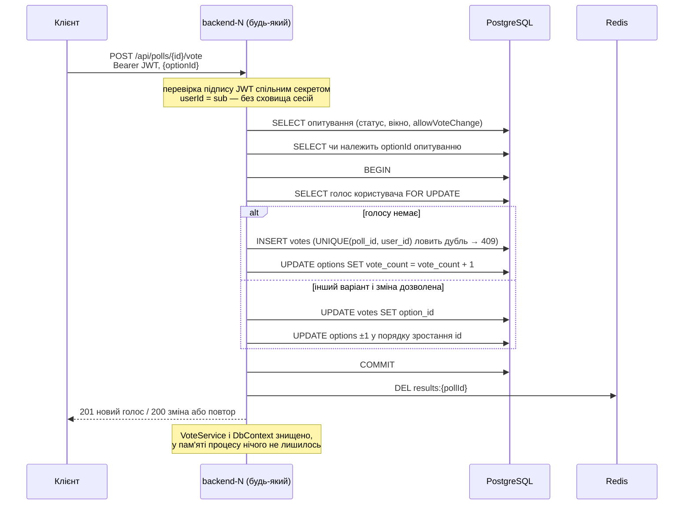

# Лаба 2 — чернетки розділів README (Учасник 2)

> Тимчасовий файл. Каркас README для лаби 2 з'явиться з гілкою `lab2/p1-infra` (П1-1); після її мерджу ці розділи
> переносяться у відповідні підрозділи README, а файл видаляється. Крок інвалідації в П2-5 остаточно звіряється з
> кодом після П2-3.

---

## П2-1. Аудит стану — голосування й результати

Пройдено `Votes/`, `Results/`, `Common/ErrorHandling/`, `Common/Exceptions/VoteExceptions.cs` і реєстрації цих
модулів у `Program.cs`. Категорії — з методички: **Ephemeral / Local Safe**, **Shared / Externalized**,
**Critical Stateful Dependency** (підлягає вилученню).

| Елемент | Де | Категорія | Чому |
|---|---|---|---|
| Кеш результатів: `ResultsCache` поверх `IMemoryCache` | `Results/ResultsCache.cs`; `Program.cs` — `AddMemoryCache()`, `AddSingleton<ResultsCache>()` | **Critical** | Агрегат лежить у пам'яті процесу. Інвалідація (`Remove`) спрацьовує лише на інстансі, що обробив запис; інші до 10 с (TTL) віддають старе. Усувається в П2-3 |
| Рішення про видимість у кеші: `CreatorId` і `Status` всередині кешованого запису | `Results/ResultsService.cs` — перевірка чернетки на попаданні в кеш | **Critical** (наслідок рядка вище) | На попаданні в кеш доступ вирішується за кешованим статусом. Після publish на одному інстансі інший до 10 с віддає стороннім **404** замість результатів — застаріє не лише число, а й рішення про доступ |
| Лічильник `options.vote_count` | PostgreSQL; змінюється SQL `vote_count ± 1` у транзакції голосу | Shared | Не лічильник у пам'яті: усі інстанси пишуть в один рядок БД (ADR 0014) |
| Серіалізація змін голосу | `SELECT … FOR UPDATE` у `VoteService` | Shared | Рядкове блокування PostgreSQL — працює між інстансами, на відміну від `lock`/`SemaphoreSlim` у процесі (ADR 0017) |
| «Один голос на користувача» | `UNIQUE(poll_id, user_id)` | Shared | Гарантія в БД; повтор, що прийшов на інший інстанс, усе одно отримає 409 |
| Стан опитування для голосу (статус, `startsAt`/`endsAt`, `allowVoteChange`) і належність варіанта | `VoteService.LoadVotablePollAsync`, перевірка `optionId` | Shared | Читається з PostgreSQL на **кожен** голос (`AsNoTracking`), у шляху голосування нічого не кешується |
| Ідентичність того, хто голосує | claim `sub` у JWT | Shared / Externalized | Зберігається на боці клієнта; інстанс лише перевіряє підпис спільним секретом із env (`JWT_SECRET`), сховища сесій немає |
| `VoteService`, `ResultsService`, `AppDbContext` | `Program.cs` — `AddScoped` | Ephemeral | Живуть один запит і знищуються після відповіді |
| Change tracker EF | `AppDbContext` | Ephemeral | Scoped разом із контекстом; на початку кожної спроби retry-стратегії очищується (`ChangeTracker.Clear()`) |
| `GlobalExceptionHandler` | `AddExceptionHandler<…>()` — реєструється як **singleton** | Ephemeral / Local Safe | Попри singleton, змінних даних немає: лише `IProblemDetailsService` і `ILogger`; `IsTransient` — чиста статична функція |
| `static readonly Ttl`, `static Key()` у `ResultsCache` | `Results/ResultsCache.cs` | Local Safe | Незмінна константа і чиста функція, не дані |
| Винятки з `VoteExceptions.cs` | `Common/Exceptions/` | Ephemeral | Незмінні об'єкти, створюються в межах одного запиту |
| Логи помилок | stdout контейнера | Local Safe | Діагностика, не бізнес-стан |

### Знахідки поза орієнтовним переліком із плану

1. **Застаріває не лише число, а й доступ.** Кешований запис тримає статус опитування, тому після publish інший інстанс
   до 10 с повертає стороннім 404 — сильніший приклад прихованої affinity, ніж застарілий `totalVotes`. Варто
   показати в П2-2 поруч із голосом.
2. **`GlobalExceptionHandler` — singleton, а не scoped.** Безпечно, бо стану немає, але в аудиті коду (С-4) пошук
   `AddSingleton`/`AddExceptionHandler` його знайде — пояснення готове.
3. **Гонка «прочитали до коміту — записали в кеш після інвалідації».** Якщо `GET /results` порахував агрегат до коміту
   голосу, а поклав у кеш уже після інвалідації, застаріле значення живе до 10 с — навіть на одному інстансі. Перенос
   у Redis її **не** усуває; це тема лаби 4 (вже записано в `project-context.md` як знахідка 5 рев'ю).
4. **Невідомий результат коміту.** Якщо з'єднання обірвалось після `COMMIT`, але до відповіді, повтор (retry-стратегія
   EF або клієнт на іншому інстансі) знайде вже записаний голос і поверне 409 (або 200 при `allowVoteChange` і тому
   самому варіанті). Голос записаний рівно один раз, але клієнт бачить 409 замість 201. Це очікувана поведінка для
   П2-7 і відповідь на питання «а якщо вбити інстанс посеред голосу».

---

## П2-5. Stateless Request Flow — `POST /api/polls/{id}/vote`

Сценарій — голосування, high-load сценарій проєкту. Запит може прийти на будь-який інстанс; нижче — що він бере з
запиту, що читає зі спільних сховищ, що змінює атомарно і чому після відповіді в процесі нічого не лишається.

| Вимога 2.3 | Як це зроблено | Код |
|---|---|---|
| Вхідні параметри / context token | `Authorization: Bearer <JWT>` → middleware JwtBearer перевіряє підпис ключем із `Jwt:Secret` (env `JWT_SECRET`, однаковий на всіх інстансах) → `userId` з claim `sub`. `pollId` — з маршруту, `{optionId}` — з тіла, валідатор (`optionId > 0`, інакше 422) | `Votes/VotesController.cs`, `Auth/ClaimsPrincipalExtensions.cs` |
| Вичитування контексту зі shared storage | PostgreSQL: опитування (видимість, статус, часове вікно, `allowVoteChange`) і належність варіанта цьому опитуванню | `VoteService.LoadVotablePollAsync`, перевірка `optionId` у `CastAsync` |
| Атомарні зміни у зовнішньому сховищі | Одна транзакція в execution strategy: наявний голос `SELECT … FOR UPDATE` → `INSERT` (новий голос; дубль ловить унікальний індекс) **або** `UPDATE votes` + `vote_count ± 1` у порядку зростання id варіантів (зміна) **або** нічого (той самий варіант) → `COMMIT`. Після коміту — інвалідація `results:{pollId}` | `VoteService.CastOnceAsync`, `InsertVoteAsync`, `ChangeVoteCountAsync` |
| Відсутність залишкових мутацій у пам'яті | `VoteService` і `AppDbContext` scoped — знищуються після відповіді; `static`-полів із даними немає; наступний запит того ж користувача може піти на інший інстанс | `Program.cs` — `AddScoped` |

> **Стан до П2-3:** вимога останнього рядка поки **не виконана**. Інвалідація зараз — `IMemoryCache.Remove` на
> поточному інстансі, тобто запит голосування змінює пам'ять процесу, і ця зміна переживає запит. Після П2-3 цей
> крок стає `DEL results:{pollId}` у Redis, і в пам'яті не лишається нічого. Діаграма нижче — цільовий стан.



**Інваріант після будь-якого запиту** — перевіряти по кожному варіанту, не сумою (ADR 0017):

```sql
SELECT count(*) FROM options o
WHERE o.vote_count <> (SELECT count(*) FROM votes v WHERE v.option_id = o.id);   -- 0
```

**Що буде, якщо інстанс упаде на півдорозі:**

- до `COMMIT` — транзакція обривається разом із з'єднанням, PostgreSQL її відкочує; голосу без лічильника не буває,
  бо обидві зміни в одній транзакції;
- після `COMMIT`, але до відповіді — голос збережено; повтор на іншому інстансі отримає 409 від унікального індексу,
  подвійного голосу немає;
- після `COMMIT`, але до інвалідації кешу — результати застаріють максимум на TTL 10 с (поведінку при збої самої
  інвалідації фіксує П2-4).
