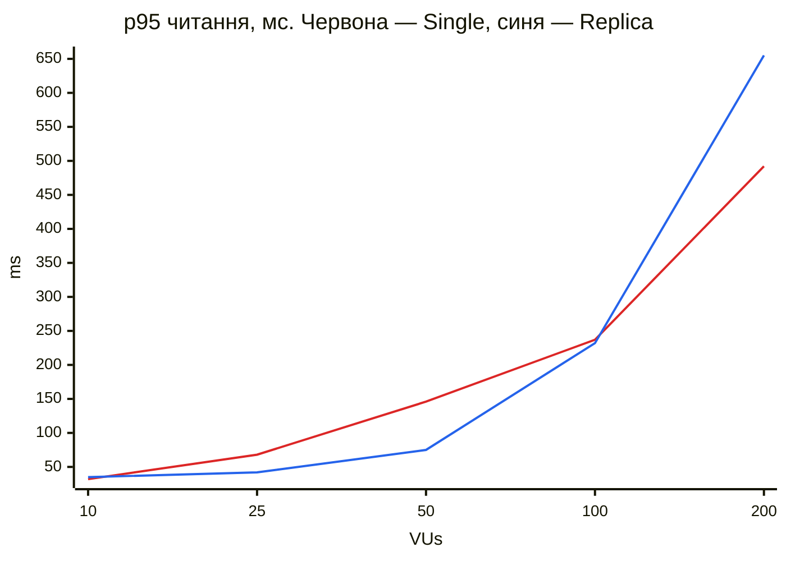

# Лабораторна 6, пункт 2.6: Single Primary проти Primary + Replica

Порівняльний звіт за скриптами лаби 5. Рішення щодо стенду — [ADR 0053](../ai/decisions/0053-replica-load-comparison.md),
повторити: `bash load-tests/series-lab6.sh` (≈ 95 хв). Серія від 2026-11-08, усього 17 прогонів, **0 % помилок у кожному ступені
кожного прогону**, розбіжностей лічильників голосів 0.

## Висновок

Одна репліка такого самого розміру **не збільшує пропускну здатність**: читання переїжджають з одного вузла на такий самий інший,
а Primary простоює. Її практична користь — **ізоляція читання від запису**: під змішаним навантаженням до точки насичення
p95 читання приблизно вдвічі менший, а запис проходить на ≈ 40 % швидше. Ціна — до ≈ 25 % пропускної здатності чистого запису.
Вище точки насичення перевага зникає, а реплікація відстає на секунди. Для масштабування самої пропускної здатності читання
потрібно більше реплік або читання також із Primary.

| Сценарій | Що відбувається | Ефект репліки |
|---|---|---|
| A: лише читання, кеш увімк. | RPS і затримка в межах розкиду | немає |
| A: лише читання, кеш вимк. | RPS і затримка в межах розкиду | немає |
| A + запис, до 50 VU | p95 читання ≈ 75 проти ≈ 146 мс, запис +40 % | **суттєвий виграш у затримці** |
| A + запис, 100–200 VU | p99 гірший, реплікація відстає на секунди | перевага зникає |
| B: лише запис | −25 % RPS на 10 VU, −4 % на 200 VU | **ціна реплікації** |
| C: workflow | читання майже не йдуть на репліку через Sticky | немає |

## Середовище

i5-9300H (4 ядра / 8 потоків), 16 ГБ, Docker Desktop: 8 CPU, 7.7 ГБ.

| Компонент | Потік (`cpuset`) | Ліміт |
|---|---|---|
| backend-1, backend-2 | 0, 1 | 1 CPU, 512 МБ кожен, пул 30 |
| PostgreSQL Primary | 2 | 1 CPU, 1 ГБ |
| PostgreSQL Replica | 3 | 1 CPU, 1 ГБ; у Single Primary зупинено, слот видалено |
| HAProxy | 4 | 1 CPU, 256 МБ |
| Redis, web, pgAdmin | 5 | без ліміту CPU |
| **k6, генератор** | **6, 7** | 2 CPU, 1.5 ГБ; у пробному прогоні використав ≈ 50 % одного потоку |

Профіль лаби 5: розігрів 20 с, далі 10 → 25 → 50 → 100 → 200 VU по 40 с. Кожен прогін — на чистому стеку, конфігурації чергуються.

**Обмеження точності.** Абсолютні числа не порівнюються з лабою 5 (інша машина, 24 vCPU). Сусідні потоки ділять фізичне ядро, тож ізоляція
неповна. Диск і пам'ять спільні. Прогонів по 1–3 на конфігурацію, а розкид Single під змішаним навантаженням великий, тому висновки
стосуються лише великих різниць. У таблицях кожна комірка: `RPS · p95 · p99`, стовпці — окремі прогони.

## A: лише читання

**Кеш увімкнено** (на репліку йдуть каталог і деталі, 40 % запитів; решта — HIT у Redis):

| VUs | Single | Replica |
|---|---|---|
| 10 | 1223 · 19.6 · 28.6 | 1078 · 23.0 · 32.8 |
| 25 | 1816 · 48.6 · 78.4 | 1813 · 45.5 · 70.6 |
| 50 | 1787 · 121.9 · 185.5 | 1894 · 109.3 · 165.8 |
| 100 | 1833 · 230.4 · 335.4 | 1891 · 215.5 · 302.4 |
| 200 | 1870 · 441.8 · 615.3 | 1935 · 435.7 · 611.7 |

**Кеш вимкнено** (усі читання — у БД, тут вузьке місце БД видно найкраще):

| VUs | Single 1 | Single 2 | Replica 1 | Replica 2 |
|---|---|---|---|---|
| 10 | 858 · 26.1 · 36.1 | 872 · 25.0 · 35.0 | 922 · 24.3 · 35.4 | 873 · 26.5 · 40.5 |
| 25 | 1115 · 49.6 · 80.8 | 1114 · 50.6 · 85.1 | 1163 · 45.4 · 69.5 | 1066 · 50.5 · 92.0 |
| 50 | 1141 · 109.9 · 165.9 | 1097 · 117.8 · 182.8 | 1150 · 107.0 · 157.7 | 1125 · 109.4 · 159.6 |
| 100 | 1163 · 199.7 · 279.5 | 1128 · 201.7 · 286.2 | 1076 · 210.2 · 312.5 | 1136 · 196.7 · 273.2 |
| 200 | 1163 · 461.0 · 601.2 | 1154 · 445.1 · 586.2 | 1091 · 485.4 · 626.9 | 1149 · 457.3 · 608.0 |

**Чому приросту немає.** На кроках насичення зайнятий один і той самий ресурс: CPU вузла БД ≈ 97 % і backend-и ≈ 85–90 %. Primary у конфігурації
з реплікою простоює: 1–4 % CPU і 4–5 транзакцій/с. Насичення однакове в обох конфігураціях: ≈ 25 VU при вимкненому кеші, ≈ 25–50 VU при ввімкненому.

## A + запис: те, де репліка працює

Сценарій A вимірюється, поки 15 VU сценарію B постійно голосують (кеш увімкнено).

| VUs | Single 1 | Single 2 | Replica 1 | Replica 2 | Replica 3 |
|---|---|---|---|---|---|
| 10 | 741 · 39.8 · 61.8 | 1118 · 24.1 · 39.0 | 855 · 31.5 · 53.2 | 755 · 36.3 · 55.8 | 713 · 38.0 · 58.1 |
| 25 | 1096 · 75.3 · 122.5 | 1325 · 60.0 · 101.5 | 1222 · 41.6 · 66.0 | 1209 · 41.9 · 66.2 | 1200 · 42.8 · 65.9 |
| 50 | 1201 · 158.2 · 256.4 | 1444 · 133.7 · 204.1 | 1372 · 72.8 · 108.7 | 1336 · 78.2 · 146.6 | 1345 · 74.1 · 118.3 |
| 100 | 1308 · 248.7 · 413.1 | 1550 · 225.1 · 405.7 | 1349 · 227.9 · 667.7 | 1417 · 191.9 · 554.7 | 1236 · 277.1 · 798.0 |
| 200 | 1447 · 530.1 · 752.8 | 1606 · 453.5 · 673.7 | 1109 · 777.5 · 1383.9 | 1340 · 651.0 · 925.4 | 1519 · 535.9 · 710.4 |

Самі 15 голосуючих VU за весь прогін:

| | Single 1 | Single 2 | Replica 1 | Replica 2 | Replica 3 |
|---|---|---|---|---|---|
| Запис, RPS | 152 | 127 | 197 | 193 | 198 |
| Запис, p95, мс | 383 | 472 | 223 | 222 | 220 |
| Запис, p99, мс | 972 | 1071 | 425 | 398 | 386 |

**Точка насичення:** Primary + Replica виходить на плато близько 50 VU (≈ 1350 RPS). Single далі повільно росте до ≈ 1500 RPS на 200 VU, але ціною вдвічі більшого p95
на 50 VU. Перевага в затримці тримається до насичення, а вище неї репліка завантажена на 97–99 % CPU, і p99 стає гіршим, ніж у Single.

## B: лише запис

| VUs | Single 1 | Single 2 | Replica 1 | Replica 2 | Replica 3 |
|---|---|---|---|---|---|
| 10 | 420 · 48.8 · 70.1 | 427 · 46.0 · 63.4 | 324 · 69.5 · 112.9 | 316 · 77.1 · 139.6 | 296 · 88.4 · 157.0 |
| 25 | 343 · 329.4 · 668.1 | 352 · 322.2 · 643.9 | 297 · 393.9 · 825.0 | 293 · 409.3 · 814.0 | 287 · 413.0 · 882.0 |
| 50 | 231 · 1200.2 · 2326.1 | 253 · 1130.4 · 2214.1 | 211 · 1312.1 · 2758.6 | 226 · 1239.1 · 2653.6 | 215 · 1305.7 · 2713.9 |
| 100 | 210 · 1775.1 · 3514.1 | 209 · 1829.3 · 3546.2 | 198 · 1936.5 · 3768.8 | 203 · 1928.1 · 3496.0 | 194 · 1984.7 · 3741.5 |
| 200 | 198 · 2514.9 · 4476.9 | 198 · 2606.0 · 4342.0 | 185 · 2784.4 · 4669.1 | 195 · 2667.3 · 4531.5 | 184 · 2792.9 · 4704.5 |

Реплікація асинхронна, тож COMMIT репліку не чекає; ціна — передача WAL на тому самому CPU Primary. Насичення не змінилося: ≈ 10 VU, далі пропускна здатність падає через
блокування рядків `options.vote_count`, як у лабі 5. На 200 VU RPS майже однаковий, бо вузьке місце не в реплікації.

## C: workflow

| VUs | Single | Replica |
|---|---|---|
| 10 | 71 · 13.1 · 25.7 | 70 · 14.9 · 24.5 |
| 25 | 176 · 14.8 · 33.2 | 178 · 11.5 · 20.8 |
| 50 | 354 · 17.9 · 38.0 | 351 · 18.3 · 36.8 |
| 100 | 634 · 83.5 · 155.6 | 592 · 134.8 · 275.5 |
| 200 | 687 · 447.0 · 698.4 | 659 · 468.7 · 706.0 |

Тут видно **ціну Read-After-Write**. Цикл користувача коротший за TTL (5 с), тож кожен його запис продовжує позначку, і всі читання йдуть на Primary: на репліці 4–5
транзакцій/с, CPU 3–6 %. Гарантія працює, але при частому записі повністю забирає розвантаження. Насичення ≈ 100 VU в обох конфігураціях. (Прогонів по одному.)

## Затримка реплікації

Максимум `replay_lag` на кожному ступені (знімається раз на ≈ 10 с, тому короткі стрибки могли не потрапити):

| Навантаження | До 50 VU | 100 VU | 200 VU |
|---|---|---|---|
| A: лише читання, запису немає, 3 прогони | ≤ 27 мс за весь прогін (лише кілька замірів: без запису `replay_lag` порожній) | | |
| B: лише запис, 3 прогони | ≤ 42 мс | ≤ 69 мс | ≤ 1.3 мс |
| A + запис, прогін 1 | 13 мс | **15.7 с** | **29.5 с** |
| A + запис, прогін 2 | 206 мс | **4.1 с** | 2.4 с |
| A + запис, прогін 3 | 18 мс | **24.8 с** | 32 мс |
| A + запис, діагностичний прогін (заміри частіше) | < 0.5 с | < 0.5 с | < 0.5 с |

- **До точки насичення** затримка щонайбільше 206 мс, у ≈ 24 рази менша за TTL Session Sticky (5 с).
- **Вище насичення** затримка стрибає до секунд, із великим розкидом між однаковими прогонами. У 2 з 4 прогонів вона перевищила TTL, тобто автор міг би побачити застарілі дані:
  це підтверджена межа механізму (ADR 0051), рішення лишити TTL 5 с — у ADR 0053.
- **Причина не встановлена.** У двох діагностичних прогонах конфліктів відтворення WAL із читаннями 0, скасованих запитів 0, а сам стрибок не повторився. Процес відтворення іноді чекав
  `LWLock/BufferContent`. Репліка в ці моменти завантажена на 97–99 % CPU, тож брак CPU — лише припущення.

## Як стенд сам себе спотворив

Перша версія серії показала, що Single Primary пише в 1.5 раза повільніше за Primary + Replica, хоча реплікація не може прискорювати запис. Повтори підтвердили стабільну різницю.
Причина була у стенді: у Single Primary репліку зупиняли, а її **слот реплікації лишався**. Слот тримав WAL, сегменти не перевикористовувалися, а створювалися заново.

| Сценарій B, RPS | Single зі слотом | Single без слота | Primary + Replica |
|---|---|---|---|
| 10 VU | 243, 249, 240 | **420, 427** | 324, 316, 296 |
| 200 VU | 120, 123, 120 | **198, 198** | 185, 195, 184 |

Під тим самим артефактом змішане навантаження показувало RPS читання +40 % і запис у 2.1 раза, а після виправлення лишилося: RPS без змін, запис +40 %. Усі таблиці вище — вже без слота; старі файли
лежать у `load-tests/results/with-stale-slot/`. Прогони A Single зроблено зі слотом: запису там немає, тож на результат він не впливає (у прогонах B він впливає через сегменти WAL).
