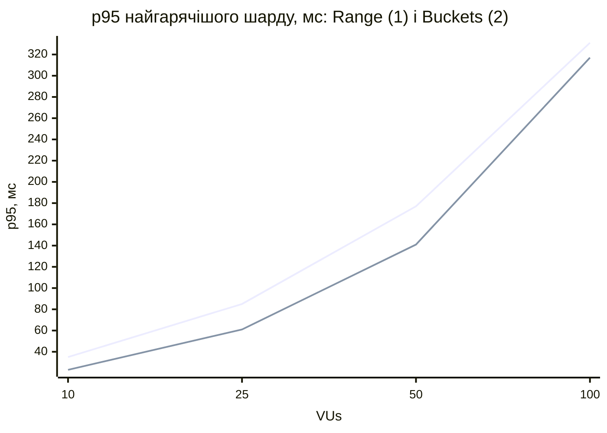

# Лабораторна 7, пункт 2.3: розподіл даних і Hot Shard

Рішення щодо стенду — [ADR 0056](../ai/decisions/0056-hot-shard-experiment.md). Повторити:
`python scripts/shard-distribution.py --live` (≈ 1 хв) і `bash load-tests/hot-shard.sh` (≈ 8 хв).

## Data Distribution Matrix

Згенерував набір через API (`shard-distribution.py --live`): 100 нових опитувань і 3000 голосів 50 користувачів у них,
стратегія `Buckets`. Частку записів рахував двома способами: за заголовком `X-Shard` відповідей і за лічильниками самого
PostgreSQL кожного шарду (`tup_inserted + tup_updated + tup_deleted`).

| Шард / Вузол | Кількість записів (polls + options + votes) | Частка даних (%) | Частка Write Operations (%), за X-Shard | за PostgreSQL |
|---|---|---|---|---|
| Shard A | 4934 (130 + 396 + 4408) | 42.2 | 55.6 | 55.1 |
| Shard B | 6758 (144 + 449 + 6165) | 57.8 | 44.4 | 44.9 |

Обидва способи дають однакову частку записів, тож роутер справді відправляє запис туди, куди каже заголовок. Частка даних
перекошена через сід: з 50 опитувань 32 потрапили на B, бо на такій малій кількості хеш ще не встигає вирівнятися.

На 10 000 id (модель у тому ж скрипті, без стеку) перекосу вже немає. Голоси в моделі — як у живому сервісі: 90 % іде
в найновіші 10 % опитувань.

| Стратегія | Дані A % | Дані B % | Записи A % | Записи B % | Перекіс записів (max / avg) |
|---|---|---|---|---|---|
| Range (межа 5000) | 50.0 | 50.0 | 5.6 | 94.4 | 1.89 |
| Modulo | 50.0 | 50.0 | 50.0 | 50.0 | 1.00 |
| Hash | 50.3 | 49.7 | 53.3 | 46.7 | 1.07 |
| Buckets | 50.3 | 49.7 | 53.3 | 46.7 | 1.07 |

Range ділить дані порівну, але майже всі записи йдуть на один шард: нові опитування мають найбільші id, і вони всі
в останньому діапазоні. Рівний розподіл даних ще не означає рівного навантаження.

## Hot Shard

Сценарій `scenario-hot-shard.js`: 40 свіжих опитувань, 80 % запитів — голос або зміна голосу, 20 % — деталі опитування.
Профіль: розігрів 20 с, далі 10 → 25 → 50 → 100 VU по 30 с. Primary кожного шарду має одне ядро і 1 ГБ
(`docker-compose.loadtest-shards.yml`), кожен прогін — на чистому стеку.

**До оптимізації — `Range`, межа 51.** Сід (id 1..50) лежить на Shard A як «архів», усі нові опитування — на Shard B.

| VUs | RPS | Частка A % | Частка B % | p95 B, мс | p99 B, мс | CPU A % | CPU B % | RAM B, МіБ |
|---|---|---|---|---|---|---|---|---|
| 10 | 504 | 0 | 100 | 35.1 | 45.9 | 3 | 66 | 83 |
| 25 | 525 | 0 | 100 | 85.3 | 106.9 | 3 | 67 | 116 |
| 50 | 512 | 0 | 100 | 177.1 | 226.3 | 2 | 99 | 174 |
| 100 | 556 | 0 | 100 | 330.7 | 391.6 | 1 | 99 | 176 |

Увесь трафік пішов на Shard B, його CPU дійшов до 99 %, а Shard A простоював (1–3 %). Пропускна здатність стала
на ≈ 520 RPS уже з 10 VU, і далі росла лише затримка: p95 від 35 до 331 мс.

**Після оптимізації — `Buckets`** (64 віртуальні бакети, хеш `fmix64`):

| VUs | RPS | Частка A % | Частка B % | p95 A, мс | p95 B, мс | CPU A % | CPU B % |
|---|---|---|---|---|---|---|---|
| 10 | 757 | 47.7 | 52.3 | 22.7 | 23.3 | 76 | 81 |
| 25 | 971 | 47.7 | 52.3 | 47.6 | 60.6 | 69 | 77 |
| 50 | 1004 | 47.4 | 52.6 | 76.1 | 140.8 | 61 | 68 |
| 100 | 1012 | 47.4 | 52.6 | 77.8 | 316.9 | 86 | 100 |

Навантаження поділилося майже навпіл, працюють обидва шарди, пропускна здатність виросла з ≈ 520 до ≈ 1000 RPS (у 1.9 раза).
На тих самих 10–50 VU p95 менший: 23 проти 35, 56 проти 85, 127 проти 177 мс.

```mermaid
xychart-beta
    title "Пропускна здатність, RPS: Range (1) і Buckets (2)"
    x-axis "VUs" [10, 25, 50, 100]
    y-axis "RPS" 0 --> 1100
    bar [504, 525, 512, 556]
    bar [757, 971, 1004, 1012]
```

На 100 VU p95 Shard B у Buckets (317 мс) майже такий самий, як у Range: модель закрита, тож система просто обробляє вдвічі
більше запитів, а B з 52.6 % трафіку першим доходить до 100 % CPU. Перекіс 47 / 53 — від того, що 40 опитувань лягли на
шарди 19 / 21.

## Межа методу: гарячий ключ

Хеш і бакети розкладають **багато** ключів. Одне вірусне опитування — це один ключ, тобто один шард і навіть один рядок
лічильника `options.vote_count`. Його не розкладе жодна функція хешування. Що ми маємо проти цього:

- читання гарячого опитування забирає кеш результатів у Redis (лаба 4), до шарду доходять лише промахи;
- запис лишається вузьким місцем одного рядка (лаба 5). Якщо потрібно більше — розщеплений лічильник (N рядків на варіант,
  голос пише у випадковий, результати їх сумують) або складений ключ шардингу `(poll_id, частина)` для голосів одного
  опитування; ціна — результати знову стають fan-out.
