# Лабораторна 7, пункт 2.6: Single Node проти шардів

Рішення щодо стенду — [ADR 0059](../ai/decisions/0059-sharding-load-comparison.md). Повторити:
`bash load-tests/series-lab7.sh` (≈ 25 хв), звіт — `python load-tests/shards-report.py`. Серія від 2026-11-10, 6 прогонів,
**0 % помилок у кожному ступені кожного прогону**.

## Висновок

Шардинг подвоює те, що йде на один шард: запис голосів і читання деталей опитування виросли в 1.9 раза, бо працюють
два вузли замість одного. Fan-out каталогу майже не виріс (×1.1): кожен його запит виконує роботу на всіх шардах,
тож другий шард додає не потужність, а ще одну копію тієї самої роботи. Масштабуються лише запити, які знають ключ.

| Режим | Single Node, RPS | 2 шарди, RPS | Приріст | Точка насичення Single → Sharded |
|---|---|---|---|---|
| shard-local запис (голоси) | ≈ 420 | ≈ 780 | ×1.9 | 10 VU / 420 RPS → 25 VU / 772 RPS |
| shard-local читання (деталі) | ≈ 1400 | ≈ 2700 | ×1.9 | 10 VU / 1445 RPS → 25 VU / 2675 RPS |
| fan-out (каталог) | ≈ 390 | ≈ 420 | ×1.1 | 10 VU / 455 RPS → 10 VU / 410 RPS |

## Стенд

24 vCPU, Docker Desktop. Кожен вузол БД — одне ядро і 1 ГБ (репліка — 512 МБ), backend-и — по 2 ядра, k6 — на окремих
8 ядрах (`docker-compose.loadtest-shards.yml`). Single Node — той самий стек із `SHARD_COUNT=1`: усі опитування на
Shard A (Primary + Replica), вузли Shard B стоять без роботи. Кожен прогін — на чистому стеку.

Сценарій `scenario-shards.js`, три режими: `write` — голос або зміна голосу в одне з 40 свіжих опитувань; `read` — деталі
одного з них (читання з репліки його шарду); `catalog` — `GET /api/polls?status=active&pageSize=20` (обидва шарди).
Профіль: розігрів 20 с, далі 10 → 25 → 50 → 100 → 200 VU по 30 с. Точка насичення — останній ступінь, після якого RPS
виріс менше ніж на 10 %. У таблицях `p95 / p99` у мілісекундах.

## Shard-local запис

| VUs | Single: RPS | p95 / p99 | 2 шарди: RPS | p95 / p99 | RPS × |
|---|---|---|---|---|---|
| 10 | 420 | 35.0 / 43.3 | 618 | 24.9 / 31.0 | 1.47 |
| 25 | 413 | 89.7 / 112.6 | 772 | 59.1 / 77.3 | 1.87 |
| 50 | 418 | 182.6 / 244.9 | 777 | 135.8 / 179.6 | 1.86 |
| 100 | 409 | 362.1 / 423.6 | 778 | 309.5 / 384.5 | 1.90 |
| 200 | 429 | 588.3 / 657.8 | 828 | 798.6 / 923.8 | 1.93 |

У Single Primary Shard A уже з 25 VU на 98–99 % CPU — це і є межа. З двома шардами обидва Primary доходять до 96–100 %,
а пропускна здатність майже подвоюється. На 200 VU p95 у шардах вищий, бо модель закрита: система пропускає вдвічі
більше запитів у ту саму чергу.

## Shard-local читання

| VUs | Single: RPS | p95 / p99 | 2 шарди: RPS | p95 / p99 | RPS × |
|---|---|---|---|---|---|
| 10 | 1445 | 10.6 / 14.6 | 2382 | 7.1 / 9.4 | 1.65 |
| 25 | 1404 | 27.3 / 38.8 | 2675 | 18.0 / 24.6 | 1.91 |
| 50 | 1385 | 56.6 / 81.9 | 2673 | 40.2 / 56.7 | 1.93 |
| 100 | 1425 | 107.0 / 135.8 | 2719 | 86.9 / 111.2 | 1.91 |
| 200 | 1406 | 190.9 / 220.7 | 2697 | 205.5 / 233.3 | 1.92 |

Читання йдуть на репліки (лаба 6). У Single на 100 % CPU сидить одна репліка Shard A, з двома шардами — обидві репліки
(94–102 %), Primary майже простоюють.

## Fan-out каталогу

| VUs | Single: RPS | p95 / p99 | 2 шарди: RPS | p95 / p99 | RPS × |
|---|---|---|---|---|---|
| 10 | 455 | 34.9 / 44.6 | 410 | 39.2 / 48.9 | 0.90 |
| 25 | 385 | 109.7 / 144.6 | 424 | 96.5 / 119.9 | 1.10 |
| 50 | 373 | 232.1 / 377.6 | 413 | 202.4 / 269.6 | 1.11 |
| 100 | 389 | 406.2 / 485.4 | 415 | 380.1 / 468.3 | 1.07 |
| 200 | 387 | 665.1 / 749.6 | 426 | 853.4 / 929.2 | 1.10 |

В обох конфігураціях репліки завантажені на 91–102 %, але з двома шардами кожен запит каталогу виконує підрахунок і
вибірку першої сторінки на обох вузлах. Роботи на запит удвічі більше, вузлів удвічі більше — RPS майже не змінився.
На 10 VU шарди навіть трохи повільніші, а на 200 VU p95 / p99 гірший (853 / 929 проти 665 / 750 мс): fan-out чекає
найповільніший шард, тож хвіст затримок росте.

```mermaid
xychart-beta
    title "RPS: Single Node (1) і 2 шарди (2) — запис / читання / каталог на 50 VU"
    x-axis ["запис", "читання", "каталог"]
    y-axis "RPS" 0 --> 3000
    bar [418, 1385, 373]
    bar [777, 2673, 413]
```

## Що з цього випливає

- Ключ шардингу треба обирати так, щоб гарячі запити були shard-local. У нас це голосування, результати й деталі —
  вони масштабуються майже лінійно.
- Fan-out має бути рідким або дешевим. Для каталогу варіанти — кеш першої сторінки (його читають усі однаково),
  окремий індекс каталогу на одному вузлі або пагінація курсором. У лабі не реалізовано: це наступна оптимізація.
- Абсолютні числа не порівнюються з лабами 5 і 6: тут кожен вузол БД обмежено одним ядром, щоб саме БД була вузьким місцем.
