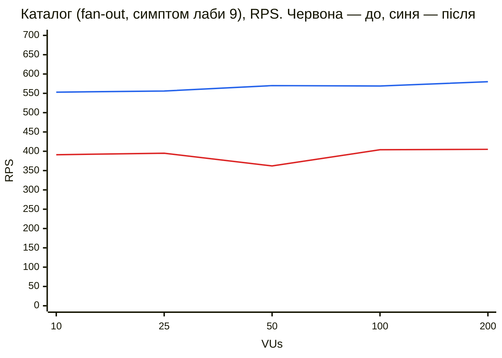
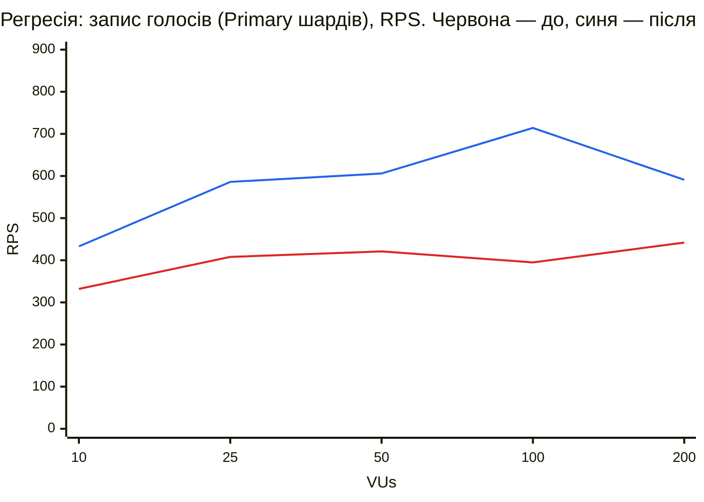
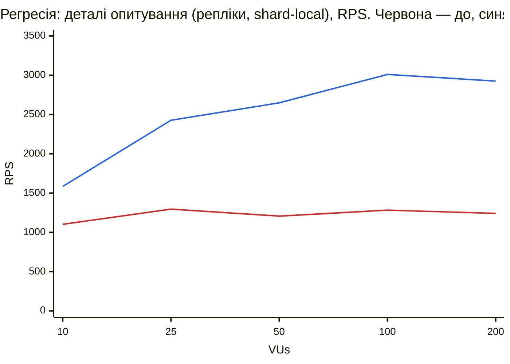

# Лабораторна 9: A/B — до і після `Max Auto Prepare`

Згенеровано `profiling/ab-report.py` з прогонів `profiling/ab-series.sh`. «До» — `DB_MAX_AUTO_PREPARE=0`, «після» — `20`. Кожна комірка — середнє по повторах; стенд — одне ядро на вузол БД.

## Каталог (fan-out, симптом лаби 9)

Повторів кожної конфігурації: 3.

| VUs | RPS до | RPS після | Δ RPS | p95 до / після, мс | Δ p95 | p99 до / після, мс | Δ p99 | помилки до / після, % |
|---|---|---|---|---|---|---|---|---|
| 10 | 391 | 553 | +41.4 % | 40.5 / 28.2 | -30.5 % | 50.4 / 34.6 | -31.3 % | 0.00 / 0.00 |
| 25 | 395 | 556 | +40.8 % | 104.5 / 73.7 | -29.5 % | 138.1 / 93.1 | -32.6 % | 0.00 / 0.00 |
| 50 | 362 | 570 | +57.5 % | 233.1 / 150.7 | -35.4 % | 325.3 / 207.6 | -36.2 % | 0.00 / 0.00 |
| 100 | 404 | 569 | +40.9 % | 391.9 / 275.4 | -29.7 % | 458.4 / 323.6 | -29.4 % | 0.00 / 0.00 |
| 200 | 405 | 580 | +43.3 % | 769.5 / 641.3 | -16.7 % | 842.0 / 700.7 | -16.8 % | 0.00 / 0.00 |

CPU, % одного ядра (вузли БД обмежені одним ядром, backend — двома, тобто 200 % = повністю), пам'ять backend:

| VUs | конфігурація | A pri | A rep | B pri | B rep | backend CPU | backend RAM, МіБ |
|---|---|---|---|---|---|---|---|
| 10 | до | 4 | 77 | 4 | 82 | 88 | 127 |
| 10 | після | 4 | 68 | 3 | 68 | 90 | 121 |
| 25 | до | 3 | 96 | 5 | 100 | 111 | 135 |
| 25 | після | 4 | 97 | 4 | 102 | 139 | 133 |
| 50 | до | 3 | 65 | 3 | 67 | 75 | 153 |
| 50 | після | 4 | 66 | 3 | 67 | 92 | 153 |
| 100 | до | 5 | 97 | 5 | 101 | 115 | 156 |
| 100 | після | 4 | 96 | 4 | 102 | 139 | 156 |
| 200 | до | 3 | 86 | 3 | 90 | 100 | 162 |
| 200 | після | 4 | 87 | 3 | 93 | 126 | 166 |

До: точка насичення — 10 VU, 391 RPS, p95 40.5 мс

Після: точка насичення — 10 VU, 553 RPS, p95 28.2 мс

## Регресія: запис голосів (Primary шардів)

Повторів кожної конфігурації: 1.

| VUs | RPS до | RPS після | Δ RPS | p95 до / після, мс | Δ p95 | p99 до / після, мс | Δ p99 | помилки до / після, % |
|---|---|---|---|---|---|---|---|---|
| 10 | 332 | 433 | +30.7 % | 50.5 / 35.9 | -28.9 % | 62.9 / 44.3 | -29.5 % | 0.00 / 0.00 |
| 25 | 408 | 586 | +43.6 % | 118.4 / 77.6 | -34.5 % | 151.4 / 113.0 | -25.3 % | 0.00 / 0.00 |
| 50 | 421 | 606 | +44.0 % | 253.0 / 177.8 | -29.7 % | 346.7 / 250.6 | -27.7 % | 0.00 / 0.00 |
| 100 | 395 | 714 | +80.8 % | 607.0 / 351.0 | -42.2 % | 749.0 / 461.8 | -38.3 % | 0.00 / 0.00 |
| 200 | 442 | 591 | +33.6 % | 1034.7 / 922.2 | -10.9 % | 1162.7 / 1163.0 | +0.0 % | 0.00 / 0.00 |

CPU, % одного ядра (вузли БД обмежені одним ядром, backend — двома, тобто 200 % = повністю), пам'ять backend:

| VUs | конфігурація | A pri | A rep | B pri | B rep | backend CPU | backend RAM, МіБ |
|---|---|---|---|---|---|---|---|
| 10 | до | 85 | 15 | 84 | 14 | 131 | 123 |
| 10 | після | 80 | 14 | 81 | 14 | 149 | 122 |
| 25 | до | 96 | 15 | 97 | 15 | 142 | 146 |
| 25 | після | 93 | 16 | 95 | 15 | 166 | 146 |
| 50 | до | 97 | 12 | 99 | 8 | 139 | 153 |
| 50 | після | 86 | 14 | 100 | 12 | 160 | 150 |
| 100 | до | 85 | 13 | 98 | 9 | 130 | 158 |
| 100 | після | 96 | 14 | 94 | 7 | 173 | 159 |
| 200 | до | 80 | 14 | 94 | 9 | 127 | 163 |
| 200 | після | 93 | 14 | 100 | 8 | 167 | 165 |

До: точка насичення — 25 VU, 408 RPS, p95 118.4 мс

Після: точка насичення — 25 VU, 586 RPS, p95 77.6 мс

## Регресія: деталі опитування (репліки, shard-local)

Повторів кожної конфігурації: 1.

| VUs | RPS до | RPS після | Δ RPS | p95 до / після, мс | Δ p95 | p99 до / після, мс | Δ p99 | помилки до / після, % |
|---|---|---|---|---|---|---|---|---|
| 10 | 1102 | 1585 | +43.8 % | 16.0 / 10.5 | -34.7 % | 21.9 / 14.7 | -33.2 % | 0.00 / 0.00 |
| 25 | 1296 | 2427 | +87.2 % | 38.8 / 17.9 | -53.8 % | 53.0 / 25.6 | -51.7 % | 0.00 / 0.00 |
| 50 | 1207 | 2649 | +119.5 % | 96.2 / 35.2 | -63.4 % | 135.1 / 55.6 | -58.8 % | 0.00 / 0.00 |
| 100 | 1283 | 3010 | +134.6 % | 187.6 / 69.3 | -63.1 % | 237.3 / 95.3 | -59.9 % | 0.00 / 0.00 |
| 200 | 1241 | 2926 | +135.8 % | 377.3 / 186.5 | -50.6 % | 466.1 / 231.6 | -50.3 % | 0.00 / 0.00 |

CPU, % одного ядра (вузли БД обмежені одним ядром, backend — двома, тобто 200 % = повністю), пам'ять backend:

| VUs | конфігурація | A pri | A rep | B pri | B rep | backend CPU | backend RAM, МіБ |
|---|---|---|---|---|---|---|---|
| 10 | до | 5 | 91 | 5 | 94 | 144 | 112 |
| 10 | після | 5 | 68 | 5 | 73 | 171 | 114 |
| 25 | до | 3 | 88 | 3 | 102 | 139 | 127 |
| 25 | після | 3 | 84 | 6 | 94 | 196 | 137 |
| 50 | до | 3 | 95 | 3 | 101 | 150 | 133 |
| 50 | після | 6 | 96 | 5 | 88 | 190 | 138 |
| 100 | до | 3 | 72 | 2 | 87 | 118 | 152 |
| 100 | після | 6 | 88 | 6 | 102 | 200 | 155 |
| 200 | до | 6 | 87 | 6 | 102 | 143 | 154 |
| 200 | після | 2 | 92 | 3 | 102 | 202 | 159 |

До: точка насичення — 25 VU, 1296 RPS, p95 38.8 мс

Після: точка насичення — 25 VU, 2427 RPS, p95 17.9 мс

