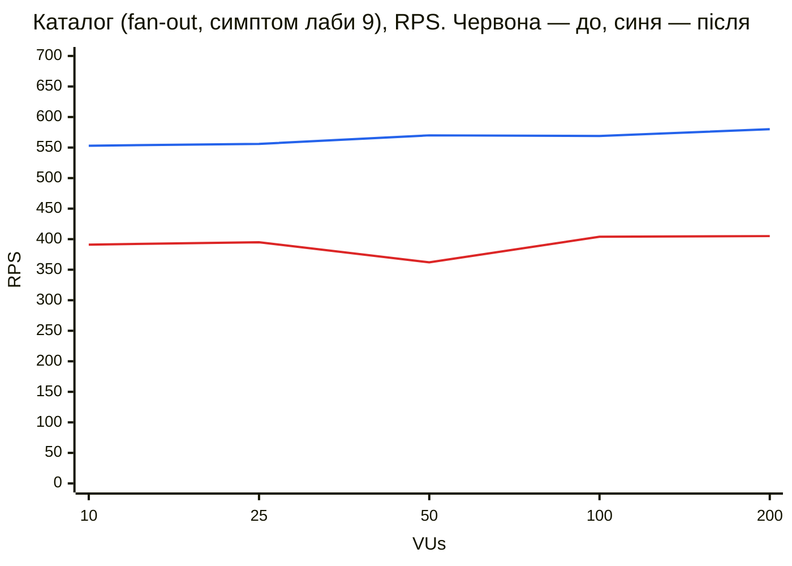
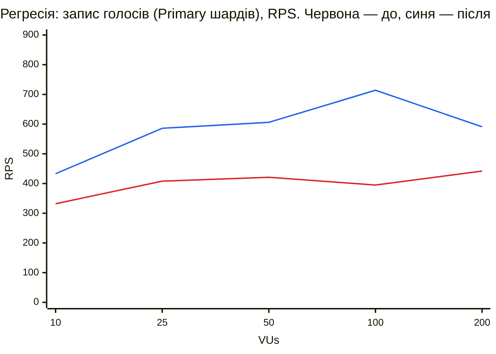
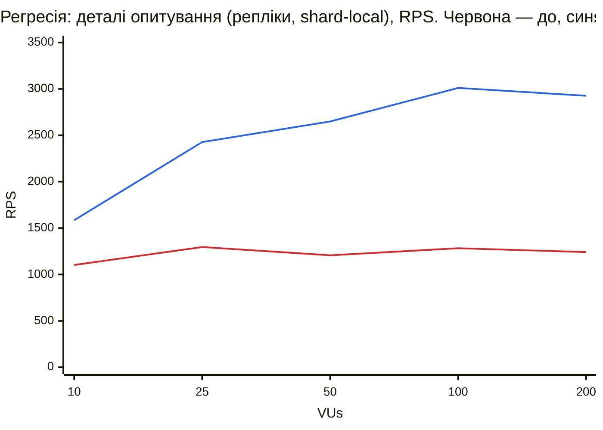

# Лабораторна 9: A/B — до і після `Max Auto Prepare`

Згенеровано `profiling/ab-report.py` з прогонів `profiling/ab-series.sh`. «До» — `DB_MAX_AUTO_PREPARE=0`, «після» — `20`. Кожна комірка — середнє по повторах; стенд — одне ядро на вузол БД. Каталог — 3 повтори кожної конфігурації через один, регресія запису й читання — по одному прогону, тож її числа менш надійні.

«Δ RPS, межі» — найгірший і найкращий випадок з окремих повторів: (мінімум «після» − максимум «до») / максимум «до» і (максимум «після» − мінімум «до») / мінімум «до». Якщо нижня межа вище нуля, ефект більший за розкид між повторами.

## Каталог (fan-out, симптом лаби 9)

Повторів кожної конфігурації: 3.

| VUs | RPS до (min–max) | RPS після (min–max) | Δ RPS | Δ RPS, межі | p95 до / після, мс | Δ p95 | p99 до / після, мс | Δ p99 | помилки до / після, % |
|---|---|---|---|---|---|---|---|---|---|
| 10 | 391 (386–400) | 553 (538–568) | +41.4 % | +34.5 % … +47.1 % | 40.5 / 28.2 | -30.5 % | 50.4 / 34.6 | -31.3 % | 0.00 / 0.00 |
| 25 | 395 (389–398) | 556 (539–571) | +40.8 % | +35.4 % … +46.9 % | 104.5 / 73.7 | -29.5 % | 138.1 / 93.1 | -32.6 % | 0.00 / 0.00 |
| 50 | 362 (307–389) | 570 (548–596) | +57.5 % | +40.7 % … +94.3 % | 233.1 / 150.7 | -35.4 % | 325.3 / 207.6 | -36.2 % | 0.00 / 0.00 |
| 100 | 404 (395–410) | 569 (557–581) | +40.9 % | +35.7 % … +47.3 % | 391.9 / 275.4 | -29.7 % | 458.4 / 323.6 | -29.4 % | 0.00 / 0.00 |
| 200 | 405 (400–412) | 580 (565–593) | +43.3 % | +37.1 % … +48.1 % | 769.5 / 641.3 | -16.7 % | 842.0 / 700.7 | -16.8 % | 0.00 / 0.00 |

CPU, % одного ядра (вузли БД обмежені одним ядром, backend — двома, тобто 200 % = повністю), пам'ять backend. `docker stats` дає замір раз на ≈ 13 с, тож на ступінь припадає 1–3 заміри на прогін (стовпець «замірів CPU» — сума по повторах): CPU показує, чи вузол на стелі, але не точний відсоток.

| VUs | конфігурація | A pri | A rep | B pri | B rep | backend CPU | backend RAM, МіБ | замірів CPU |
|---|---|---|---|---|---|---|---|---|
| 10 | до | 4 | 69 | 4 | 72 | 78 | 123 | 6 |
| 10 | після | 4 | 85 | 4 | 84 | 111 | 113 | 4 |
| 25 | до | 3 | 96 | 5 | 100 | 111 | 135 | 6 |
| 25 | після | 4 | 97 | 4 | 102 | 139 | 133 | 6 |
| 50 | до | 4 | 59 | 4 | 61 | 70 | 153 | 6 |
| 50 | після | 6 | 81 | 4 | 85 | 116 | 154 | 4 |
| 100 | до | 5 | 97 | 5 | 101 | 115 | 156 | 6 |
| 100 | після | 4 | 96 | 4 | 102 | 139 | 156 | 6 |
| 200 | до | 3 | 80 | 3 | 84 | 94 | 163 | 5 |
| 200 | після | 5 | 81 | 3 | 89 | 119 | 167 | 4 |

До: точка насичення — 10 VU, 391 RPS, p95 40.5 мс

Після: точка насичення — 10 VU, 553 RPS, p95 28.2 мс

## Регресія: запис голосів (Primary шардів)

Повторів кожної конфігурації: 1.

| VUs | RPS до (min–max) | RPS після (min–max) | Δ RPS | Δ RPS, межі | p95 до / після, мс | Δ p95 | p99 до / після, мс | Δ p99 | помилки до / після, % |
|---|---|---|---|---|---|---|---|---|---|
| 10 | 332 (332–332) | 433 (433–433) | +30.7 % | +30.7 % … +30.7 % | 50.5 / 35.9 | -28.9 % | 62.9 / 44.3 | -29.5 % | 0.00 / 0.00 |
| 25 | 408 (408–408) | 586 (586–586) | +43.6 % | +43.6 % … +43.6 % | 118.4 / 77.6 | -34.5 % | 151.4 / 113.0 | -25.3 % | 0.00 / 0.00 |
| 50 | 421 (421–421) | 606 (606–606) | +44.0 % | +44.0 % … +44.0 % | 253.0 / 177.8 | -29.7 % | 346.7 / 250.6 | -27.7 % | 0.00 / 0.00 |
| 100 | 395 (395–395) | 714 (714–714) | +80.8 % | +80.8 % … +80.8 % | 607.0 / 351.0 | -42.2 % | 749.0 / 461.8 | -38.3 % | 0.00 / 0.00 |
| 200 | 442 (442–442) | 591 (591–591) | +33.6 % | +33.6 % … +33.6 % | 1034.7 / 922.2 | -10.9 % | 1162.7 / 1163.0 | +0.0 % | 0.00 / 0.00 |

CPU, % одного ядра (вузли БД обмежені одним ядром, backend — двома, тобто 200 % = повністю), пам'ять backend. `docker stats` дає замір раз на ≈ 13 с, тож на ступінь припадає 1–3 заміри на прогін (стовпець «замірів CPU» — сума по повторах): CPU показує, чи вузол на стелі, але не точний відсоток.

| VUs | конфігурація | A pri | A rep | B pri | B rep | backend CPU | backend RAM, МіБ | замірів CPU |
|---|---|---|---|---|---|---|---|---|
| 10 | до | 84 | 12 | 81 | 12 | 131 | 124 | 1 |
| 10 | після | 78 | 15 | 80 | 14 | 150 | 123 | 1 |
| 25 | до | 96 | 15 | 97 | 15 | 142 | 146 | 2 |
| 25 | після | 93 | 16 | 95 | 15 | 166 | 146 | 2 |
| 50 | до | 97 | 12 | 99 | 8 | 139 | 153 | 2 |
| 50 | після | 87 | 15 | 100 | 10 | 165 | 149 | 1 |
| 100 | до | 85 | 13 | 98 | 9 | 130 | 158 | 2 |
| 100 | після | 96 | 14 | 94 | 7 | 173 | 159 | 2 |
| 200 | до | 80 | 14 | 94 | 9 | 127 | 163 | 2 |
| 200 | після | 93 | 14 | 100 | 8 | 167 | 165 | 2 |

До: точка насичення — 25 VU, 408 RPS, p95 118.4 мс

Після: точка насичення — 25 VU, 586 RPS, p95 77.6 мс

## Регресія: деталі опитування (репліки, shard-local)

Повторів кожної конфігурації: 1.

| VUs | RPS до (min–max) | RPS після (min–max) | Δ RPS | Δ RPS, межі | p95 до / після, мс | Δ p95 | p99 до / після, мс | Δ p99 | помилки до / після, % |
|---|---|---|---|---|---|---|---|---|---|
| 10 | 1102 (1102–1102) | 1585 (1585–1585) | +43.8 % | +43.8 % … +43.8 % | 16.0 / 10.5 | -34.7 % | 21.9 / 14.7 | -33.2 % | 0.00 / 0.00 |
| 25 | 1296 (1296–1296) | 2427 (2427–2427) | +87.2 % | +87.2 % … +87.2 % | 38.8 / 17.9 | -53.8 % | 53.0 / 25.6 | -51.7 % | 0.00 / 0.00 |
| 50 | 1207 (1207–1207) | 2649 (2649–2649) | +119.5 % | +119.5 % … +119.5 % | 96.2 / 35.2 | -63.4 % | 135.1 / 55.6 | -58.8 % | 0.00 / 0.00 |
| 100 | 1283 (1283–1283) | 3010 (3010–3010) | +134.6 % | +134.6 % … +134.6 % | 187.6 / 69.3 | -63.1 % | 237.3 / 95.3 | -59.9 % | 0.00 / 0.00 |
| 200 | 1241 (1241–1241) | 2926 (2926–2926) | +135.8 % | +135.8 % … +135.8 % | 377.3 / 186.5 | -50.6 % | 466.1 / 231.6 | -50.3 % | 0.00 / 0.00 |

CPU, % одного ядра (вузли БД обмежені одним ядром, backend — двома, тобто 200 % = повністю), пам'ять backend. `docker stats` дає замір раз на ≈ 13 с, тож на ступінь припадає 1–3 заміри на прогін (стовпець «замірів CPU» — сума по повторах): CPU показує, чи вузол на стелі, але не точний відсоток.

| VUs | конфігурація | A pri | A rep | B pri | B rep | backend CPU | backend RAM, МіБ | замірів CPU |
|---|---|---|---|---|---|---|---|---|
| 10 | до | 7 | 94 | 8 | 93 | 147 | 111 | 1 |
| 10 | після | 7 | 67 | 7 | 72 | 173 | 114 | 1 |
| 25 | до | 3 | 88 | 3 | 102 | 139 | 127 | 2 |
| 25 | після | 3 | 84 | 6 | 94 | 196 | 137 | 2 |
| 50 | до | 4 | 99 | 3 | 101 | 154 | 132 | 1 |
| 50 | після | 2 | 91 | 2 | 99 | 198 | 128 | 1 |
| 100 | до | 3 | 72 | 2 | 87 | 118 | 152 | 2 |
| 100 | після | 6 | 88 | 6 | 102 | 200 | 155 | 2 |
| 200 | до | 6 | 87 | 6 | 102 | 143 | 154 | 2 |
| 200 | після | 2 | 94 | 3 | 103 | 203 | 162 | 1 |

До: точка насичення — 25 VU, 1296 RPS, p95 38.8 мс

Після: точка насичення — 25 VU, 2427 RPS, p95 17.9 мс

